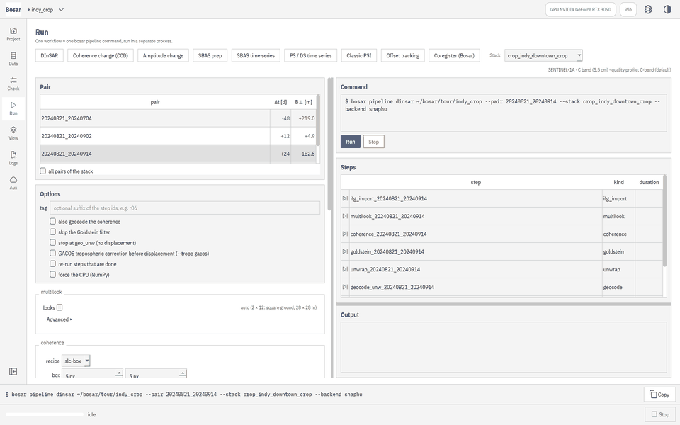
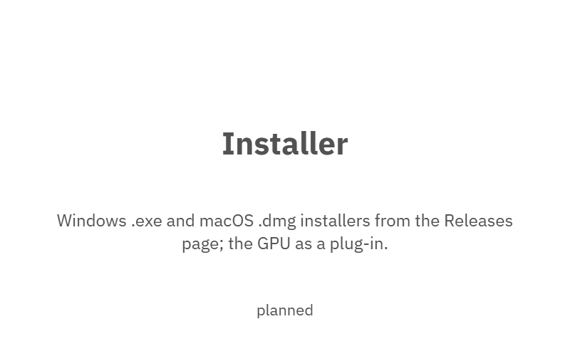
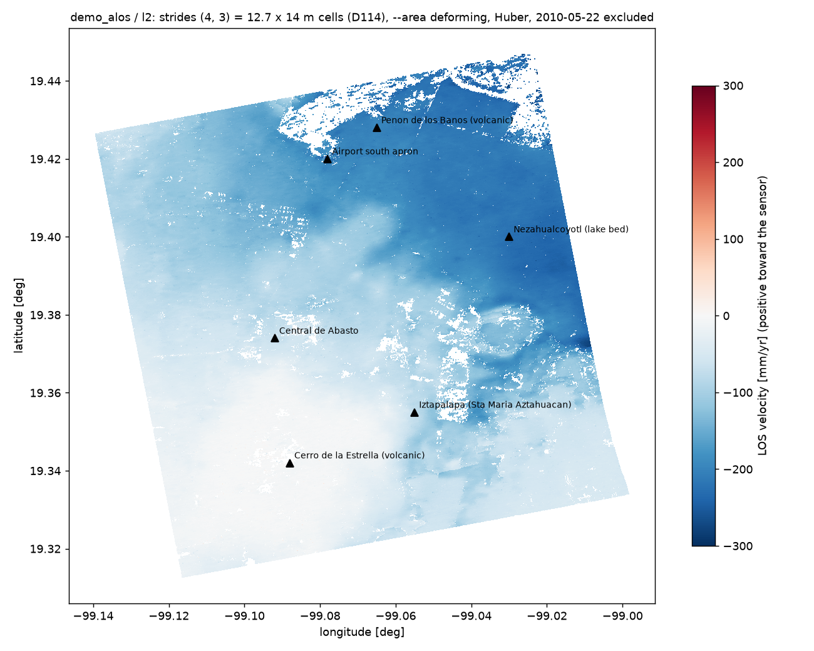

<p align="center">
  
  <h1 align="center">Bosar</h1>
  <p align="center"><b>Install-and-run SAR interferometry for Windows and macOS.</b><br>
  DInSAR · coherence change detection · PS-InSAR · SBAS · offset tracking — one installer, optional CUDA.<br>
  Free for non-commercial use.</p>
</p>

<p align="center">
  <a href="https://github.com/HU-Jiashu/bosar/releases"></a>
  
  <a href="LICENSE"></a>
  <a href="https://doi.org/10.5281/zenodo.23443567"></a>
</p>

> **Status: beta.** Bosar installs from a Windows `.exe` or a macOS `.dmg`
> ([Releases](https://github.com/HU-Jiashu/bosar/releases)); every chain below is validated on
> real data (the table *Validated on*). This repository holds the documentation and the
> releases; the source is not published and ships as the installers (see
> [Licensing](docs/LICENSING.md)). Documentation site: https://hu-jiashu.github.io/bosar/

<!-- tour:start -->
## Feature tour

What works today, module by module - click a card for the step-by-step tutorial ([all modules](docs/tour/README.md)). Grey cards are planned and light up in the release that delivers them.

<p align="center"> <sub>(the same run as a 4K MP4 and every screenshot at 4K: <a href="https://github.com/HU-Jiashu/bosar/releases">bosar-tour-4k.zip under Releases</a>)</sub></p>

<table>
<tr><td width="33%" valign="top"><a href="docs/tour/project_data.md"><picture><source media="(prefers-color-scheme: dark)" srcset="docs/assets/tour/project_data/03_preview_dark.png"></picture></a><br><b>Project and data</b><br>Create a project, import a stack, look at dates, baselines and a coherence preview.<br><sub><a href="docs/tour/project_data.md">3 steps</a></sub></td><td width="33%" valign="top"><a href="docs/tour/system_check.md"><picture><source media="(prefers-color-scheme: dark)" srcset="docs/assets/tour/system_check/01_preflight_dark.png"></picture></a><br><b>System check</b><br>Preflight table: Python, GPU, SNAPHU, SNAP, credentials, read-only data roots.<br><sub><a href="docs/tour/system_check.md">2 steps</a></sub></td><td width="33%" valign="top"><a href="docs/tour/dinsar.md"><picture><source media="(prefers-color-scheme: dark)" srcset="docs/assets/tour/dinsar/04_result_dark.png"></picture></a><br><b>DInSAR</b><br>Choose a pair, set the parameters, run, read the LOS displacement on the map.<br><sub><a href="docs/tour/dinsar.md">4 steps</a></sub></td></tr>
<tr><td width="33%" valign="top"><a href="docs/tour/gacos.md"><picture><source media="(prefers-color-scheme: dark)" srcset="docs/assets/tour/gacos/04_before_after_dark.png"></picture></a><br><b>GACOS correction</b><br>What is missing, the run with --tropo gacos, displacement before and after.<br><sub><a href="docs/tour/gacos.md">4 steps</a></sub></td><td width="33%" valign="top"><a href="docs/tour/ccd.md"><picture><source media="(prefers-color-scheme: dark)" srcset="docs/assets/tour/ccd/03_dpm_dark.png"></picture></a><br><b>Coherence change detection</b><br>Pre- and co-event pairs, the run, the damage proxy map over satellite imagery.<br><sub><a href="docs/tour/ccd.md">3 steps</a></sub></td><td width="33%" valign="top"><a href="docs/tour/amplitude.md"><picture><source media="(prefers-color-scheme: dark)" srcset="docs/assets/tour/amplitude/03_rgb_dark.png"></picture></a><br><b>Amplitude change</b><br>Log-ratio and pre/post RGB composite over the basemap.<br><sub><a href="docs/tour/amplitude.md">3 steps</a></sub></td></tr>
<tr><td width="33%" valign="top"><a href="docs/tour/viewer.md"><picture><source media="(prefers-color-scheme: dark)" srcset="docs/assets/tour/viewer/02_satellite_mask_dark.png"></picture></a><br><b>Result viewer</b><br>Basemaps, layer opacity and masks, stretch, linked views, figure export, two chains compared.<br><sub><a href="docs/tour/viewer.md">6 steps</a></sub></td><td width="33%" valign="top"><a href="docs/tour/sbas_prep.md"><picture><source media="(prefers-color-scheme: dark)" srcset="docs/assets/tour/sbas_prep/03_closure_dark.png"></picture></a><br><b>SBAS preparation</b><br>Network designer, derived pairs, batch unwrapping, closure maps.<br><sub><a href="docs/tour/sbas_prep.md">3 steps</a></sub></td><td width="33%" valign="top"><a href="docs/tour/sbas_ts.md"><picture><source media="(prefers-color-scheme: dark)" srcset="docs/assets/tour/sbas_ts/03_time_series_dark.png"></picture></a><br><b>SBAS time series</b><br>Velocity and temporal coherence; click a pixel for its displacement history.<br><sub><a href="docs/tour/sbas_ts.md">4 steps</a></sub></td></tr>
<tr><td width="33%" valign="top"><a href="docs/tour/psds.md"><picture><source media="(prefers-color-scheme: dark)" srcset="docs/assets/tour/psds/04_result_dark.png"></picture></a><br><b>PS / DS time series</b><br>Phase linking of distributed scatterers plus persistent scatterers: several times the coverage of multilooked SBAS, with a quality verdict.<br><sub><a href="docs/tour/psds.md">4 steps</a></sub></td><td width="33%" valign="top"><a href="docs/tour/psi.md"><picture><source media="(prefers-color-scheme: dark)" srcset="docs/assets/tour/psi/01_run_dark.png"></picture></a><br><b>Classic PS-InSAR</b><br>The periodogram chain (amplitude dispersion, arcs, APS) as a workflow of the Run page; its GeoPackage is a point layer of the Results page.<br><sub><a href="docs/tour/psi.md">1 steps</a></sub></td><td width="33%" valign="top"><a href="docs/tour/snap_bridge.md"><picture><source media="(prefers-color-scheme: dark)" srcset="docs/assets/tour/snap_bridge/03_result_dark.png"></picture></a><br><b>SNAP bridge</b><br>Preprocess raw Sentinel-1 zips with SNAP as the engine, import, process.<br><sub><a href="docs/tour/snap_bridge.md">3 steps</a></sub></td></tr>
<tr><td width="33%" valign="top"><a href="docs/tour/fetch_slc.md"><picture><source media="(prefers-color-scheme: dark)" srcset="docs/assets/tour/fetch_slc/01_card_dark.png"></picture></a><br><b>SLC download</b><br>Search Sentinel-1 scenes at ASF by the stack's track and frame or an AOI; a dry run, then a resumable, verified download that keeps running after the session.<br><sub><a href="docs/tour/fetch_slc.md">1 steps</a></sub></td><td width="33%" valign="top"><a href="docs/tour/logs.md"><picture><source media="(prefers-color-scheme: dark)" srcset="docs/assets/tour/logs/02_failure_dark.png"></picture></a><br><b>Logs and failures</b><br>Every run with its UTC-stamped records; a failure card says what, where and how.<br><sub><a href="docs/tour/logs.md">2 steps</a></sub></td><td width="33%" valign="top"><a href="docs/tour/settings.md"><picture><source media="(prefers-color-scheme: dark)" srcset="docs/assets/tour/settings/01_settings_dark.png"></picture></a><br><b>Settings</b><br>Theme, language, compute device, credentials, data roots.<br><sub><a href="docs/tour/settings.md">2 steps</a></sub></td></tr>
<tr><td width="33%" valign="top"><a href="docs/tour/native_s1.md"><picture><source media="(prefers-color-scheme: dark)" srcset="docs/assets/tour/native_s1/04_multi_year_dark.png"></picture></a><br><b>Native Sentinel-1</b><br>From raw Sentinel-1 zips to a coregistered stack without SNAP - bursts, deramp, geometric coregistration, ESD, calibration, sub-swath merge - and a multi-year PS / DS time series on it.<br><sub><a href="docs/tour/native_s1.md">4 steps</a></sub></td><td width="33%" valign="top"><a href="docs/tour/sensors.md"><picture><source media="(prefers-color-scheme: dark)" srcset="docs/assets/tour/sensors/03_alos_pair_dark.png"></picture></a><br><b>More sensors</b><br>ALOS-1 PALSAR (L band), ENVISAT ASAR and ERS-1/2 through the stripmap chain: the stack with its sensor, the L-band quality profile, a Mexico City interferogram of each.<br><sub><a href="docs/tour/sensors.md">4 steps</a></sub></td><td width="33%" valign="top"><picture><source media="(prefers-color-scheme: dark)" srcset="docs/assets/tour/planned/installer_dark.png"></picture><br><b>Installer</b><br>Windows .exe and macOS .dmg installers from the Releases page; the GPU as a plug-in.<br><sub>planned</sub></td></tr>
</table>

<sub>Basemaps in the screenshots: © OpenStreetMap contributors; Sentinel-2 cloudless 2016 by EOX IT Services GmbH (CC BY 4.0, contains modified Copernicus Sentinel data).</sub>
<!-- tour:end -->

<p align="center"><br><sub>Mexico City from 16 ALOS-1 PALSAR scenes (2007–2011), the PS / DS chain at L band: the former lake bed of Nezahualcóyotl at −223 mm/yr along the line of sight, the airport at −192, the volcanic outcrops still — the pattern and the rates of Chaussard et al. (2014).</sub></p>

## Why

Research groups without a commercial InSAR licence — or unable to use one because of
export-control constraints — still need reproducible, scriptable, end-to-end SAR processing.
Bosar packages the whole chain (data search → orbits → DEM → coregistration →
interferometry → time series) into a desktop application that installs like any other program,
runs the same code on Windows and macOS, uses an NVIDIA GPU when one is present, and writes a
complete UTC-stamped log of every processing step so results can be audited and reproduced.

## What it does

| Module | What it does |
|---|---|
| Pre-flight check | OS, CPU flags, RAM, disk, GPU + CUDA, dependency versions, binaries, credentials (presence only), API reachability — a ✅ / ⚠️ / ❌ table before every run (`bosar preflight`, `--offline`, `--json`) |
| Sentinel-1 TOPS | burst model, deramp / reramp, coregistration from orbits + DEM, sinc resampling, enhanced spectral diversity, deburst, calibration and terrain flattening, three sub-swaths merged, one date at a time with reuse (`bosar pipeline s1-coregister` from the raw zips) |
| Two-pass DInSAR | interferogram, flat-earth / topographic phase removal, Goldstein filter, SNAPHU unwrapping, LOS displacement, geocoding (`bosar pipeline dinsar`) |
| Coherence & CCD | coherence estimation, coherence change detection, damage-proxy maps (`bosar pipeline ccd`) |
| Amplitude change | calibrated σ⁰ / β⁰ / γ⁰ with thermal-noise removal, six speckle filters, log-ratio, pre / post RGB composites |
| PS / DS | distributed scatterers by phase linking (EMI / EVD, GPU), persistent scatterers by amplitude dispersion, a hybrid stack through the SBAS unwrapping and inversion; classic PSI as an independent chain; a quality verdict on every time series with a stable-area and a deforming-area mode (`bosar pipeline psds`, `bosar pipeline psi`, `bosar sbas quality`) |
| SBAS-InSAR | network design with quality rules, derived small-baseline pairs, batch unwrapping, triplet closure and closure-based correction, pixel-wise inversion, temporal coherence, velocity + time series, GACOS / ERA5 correction, MintPy export |
| Offset tracking | amplitude NCC on oversampled patches (GPU), SNR and outlier masks, geocoded range / azimuth offset fields |
| Ionosphere | range split-spectrum estimate of the dispersive phase with closure and IONEX checks; models opt-in |
| Exports | geocoded products clipped to an AOI as Cloud-Optimized GeoTIFFs, vectors as GeoPackage, a README with units and sign conventions (`bosar export`) |
| Auxiliary data | precise orbits and the Copernicus GLO-30 DEM found locally first or fetched, GACOS request card and delivery check, ERA5 delays, Sentinel-1 SLC search and resumable, verified download from ASF |
| Project files and logs | a JSON project with data references, parameters and step status; a JSON Lines run log with microsecond UTC timestamps and a markdown report; precise WHAT / WHERE / HINT failures |
| GUI | a PySide6 desktop application (Carbon Design System): project, data and baselines, system check, every workflow with live progress and Stop, a result viewer with basemaps (off until enabled), layers, masks and time series, figure export, two chains compared, logs with failure cards, settings and the licence |
| Installers | a one-folder application with the command line and the GUI, SNAPHU (built without the CS2 solver), GDAL / PROJ and the licence texts; a Windows per-user `.exe`, a macOS `.dmg`; `bosar demo` runs a synthetic pair on any installed build |
| GPU plug-in | `bosar gpu install` fetches CuPy and the CUDA 12 runtime into the user's plug-in folder; the next run uses the NVIDIA GPU |

### Validated on

| Sensor | Site · data | Yardstick | Number |
|---|---|---|---|
| Sentinel-1 IW, native TOPS chain | Indianapolis, 89 dates 2023–2026 (track 121) | the SNAP / StaMPS route on the same scenes; classic PSI against PS / DS; seven landmarks | coregistration double difference 0.03 rad; PS / DS velocity spread 0.54 mm/yr, PSI − PS/DS median 0.00 mm/yr; USABLE |
| Sentinel-1 IW, SBAS | Indianapolis, 26 dates | MintPy on identical inputs | within 0.4 mm/yr |
| Sentinel-1, calibration | the same scenes | SNAP σ⁰ | within 0.003 dB (0.00001 dB with the thermal noise removed) |
| ALOS-1 PALSAR, PS / DS at L band | Mexico City, 16 scenes 2007–2011 (path 186) | Chaussard et al. (2014) | Nezahualcóyotl −223 mm/yr LOS, the airport −192, the volcanic hill −4 ± 3; USABLE (deforming-area mode) |
| ENVISAT ASAR, ERS-1/2 | Mexico City (track 255; the 1996 tandem pair) | the published subsidence order; a one-day pair carries atmosphere only | a 70-day C-band pair spans 5 cm of LOS across the basin; the tandem day ±6 rad of atmosphere and nothing else |
| NISAR L-band | track 33, path 40, frame 50 (provisional RSLC, 2026-10-14) | the granule's own metadata | opens (frequency B, λ 0.2454 m, left-looking); a pair follows when a repeat exists |

### Sensors

| Sensor | Band | Format | Status |
|---|---|---|---|
| Sentinel-1 A/B/C/D | C | SAFE (IW SLC) | ✅ IW SLC reader (manifest, annotation, bursts, geolocation grid, calibration and noise LUTs) and the native TOPS chain to a coregistered multi-year stack; GRD and the EW / SM modes later |
| ENVISAT ASAR | C | N1 (Envisat format) | ✅ IMS reader with DORIS / PRC orbits, the stripmap chain; Mexico City track 255 validated |
| ERS-1/2 | C | E1 / E2 (Envisat format, ESA on-the-fly) | ✅ IMS reader, the stripmap chain; the 1996 tandem pair through the chain |
| ALOS-1 PALSAR | L | CEOS L1.1 (ASF) | ✅ reader, `fetch slc --mission alos`, the L-band profile, the stripmap coregistration chain; a 16-scene series validated |
| NISAR | L + S | HDF5 RSLC | 🚧 reader against the product layout; the first provisional granule opens; a pair when a repeat exists |
| SNAP → GAMMA/StaMPS export | — | `.rslc / .diff / .base / .par` | ✅ `bosar data import`, `data crop` |
| ESA SNAP stacks, ISCE2 stacks | — | BEAM-DIMAP, topsStack | 🚧 readers on synthetic fixtures |
| ALOS-2, SAOCOM, RCM, TerraSAR-X, COSMO-SkyMed, ICEYE, Capella, RADARSAT-2 | L / C / X | vendor | 📋 see the [sensor download plan](docs/data/sensor_download_plan.md) |

Known data quirks (nominal range axis, Earth radius, copied headers, half-second times of the SNAP export; SAFE placeholder files): [docs/data/formats.md](docs/data/formats.md).

## Install

| Platform | Download from [Releases](https://github.com/HU-Jiashu/bosar/releases) | Notes |
|---|---|---|
| Windows 10/11 x64 | `bosar-<version>-win-x64-setup.exe` | per-user, no administrator rights; the GUI in the Start menu; `bosar` on the command line (tick *Add to PATH*) |
| macOS 12+ (Apple silicon / Intel) | `bosar-<version>-mac-arm64.dmg` / `-mac-x64.dmg` | unsigned: right-click → Open once; the command line at `Bosar.app/Contents/MacOS/bosar` |
| GPU (NVIDIA, CUDA 12) | `bosar gpu install` after installing | CuPy and the CUDA runtime as a plug-in (about 1.5 GB); `bosar preflight` shows it |

The installers carry Python, the numerical stack, GDAL / PROJ, SNAPHU (built without the CS2
solver) and the licence texts; nothing else is needed. First steps on an installed build:

```bash
bosar preflight --offline        # the environment table
bosar demo my_demo               # a synthetic pair through the whole DInSAR chain (about a minute)
bosar-gui                        # the desktop application
```

More in [docs/install.md](docs/install.md) and the walkthrough [`docs/WALKTHROUGH.md`](docs/WALKTHROUGH.md) ([中文](docs/WALKTHROUGH_zh.md)).

## Quick start (CLI)

```bash
bosar preflight --offline
bosar project new  indy --storage-mode full
bosar data import  indy  data/snap_export/IW2 --annotation data/S1A_..._20240821.SAFE       # GAMMA/StaMPS export + SAFE annotation
bosar pipeline dinsar indy --pair 20240821_20240914 --looks 2,10 --geocode-coh          # ifg_import -> multilook -> coherence -> goldstein -> unwrap -> geocode
bosar info         indy/products/geo/geocode_unw_20240821_20240914.tif
bosar logs         indy  --tail
bosar sbas network indy --max-dt 48 --k 3 --name ts                                    # small-baseline network
bosar sbas prep    indy --network ts --looks 2,10 --workers 6                          # derive, coherence, unwrap, closure
bosar pipeline sbas indy --network ts --tropo era5                                     # correction, inversion, velocity + time series
```

Every run writes `<project>/logs/run_<utc>.jsonl` with microsecond UTC timestamps, parameters,
inputs, outputs and per-step summaries, and updates `<project>/project.json`. The failure
screen of a step says what went wrong, where, and what to do:

```text
x Step failed  dummy_001   E302 DTypeError
  DummyStep.kernel(): argument 'cpx_sec' must be complex64 or complex128, got float32

WHERE
  project   demo
  run       r_20260917T032151Z_d95b
  step      dummy_001 (dummy v1)
  tile      3 of 9 — read rows 200:400 cols 300:600, write rows 200:400 cols 300:600
  param     cpx_sec

HINT  convert with .astype(np.complex64) or check the producing step
      -> https://hu-jiashu.github.io/bosar/ERRORS/#e302

LOG   demo/logs/run_r_20260917T032151Z_d95b.jsonl  #11
```

## Acknowledgements

Bosar builds on and learns from open InSAR software:
[ISCE2](https://github.com/isce-framework/isce2) and the isce-framework projects (Apache-2.0),
[MintPy](https://github.com/insarlab/MintPy) (GPL-3.0, algorithm reference),
[ESA SNAP](https://step.esa.int) (processing-logic reference, BEAM-DIMAP import),
[pypsi](https://github.com/whtimo/pypsi) (MIT),
[snaphu-py](https://github.com/isce-framework/snaphu-py) and SNAPHU (Stanford),
[xarray-sentinel](https://github.com/bopen/xarray-sentinel), [dem_stitcher](https://github.com/ACCESS-Cloud-Based-InSAR/dem-stitcher),
[asf_search](https://github.com/asfadmin/Discovery-asf_search), [sentineleof](https://github.com/scottstanie/sentineleof).
See [THIRD_PARTY_NOTICES.md](THIRD_PARTY_NOTICES.md) for adapted code and licences.

Data: Copernicus Sentinel-1 (ESA), ENVISAT and ERS (ESA), ALOS-1 PALSAR (JAXA through ASF), NISAR (NASA / ISRO through ASF), Copernicus GLO-30 DEM, ASF DAAC.

## Citing

If you use Bosar in research, please cite the software (see [`CITATION.cff`](CITATION.cff);
every public release is archived on Zenodo - the DOI of all versions is 10.5281/zenodo.23443567, this version's 10.5281/zenodo.23443568) and the underlying methods you used
(Ferretti et al. 2001 for PS; Berardino et al. 2002 for SBAS; Chen & Zebker 2001 for SNAPHU).

## Contact and commercial licences

Bosar is written and maintained by Jiashu Hu — oswaldmurphy66@gmail.com. Bug reports and
questions: the [issue tracker](https://github.com/HU-Jiashu/bosar/issues) of this repository.
Commercial use needs a licence from the author: write to the address above with the intended
use (product, service, internal processing) and the number of seats; terms are agreed per case.

## License

Bosar is free for **non-commercial** use under the
[PolyForm Noncommercial License 1.0.0](LICENSE): research, teaching, personal and non-profit
work may use, modify and redistribute it; every commercial right is reserved by the author, and
**commercial licences are available** (above). The licence covers the Bosar code and the
installers; the third-party components shipped with them (Qt / PySide6 under the LGPL-3, the
SNAPHU binary under the Stanford terms without the CS2 solver, the Python packages under their
BSD / MIT / Apache licences) keep their own licences, listed with the required notices in
[`THIRD_PARTY_NOTICES.md`](THIRD_PARTY_NOTICES.md). The obligations per component are in
[`docs/LICENSING.md`](docs/LICENSING.md).
