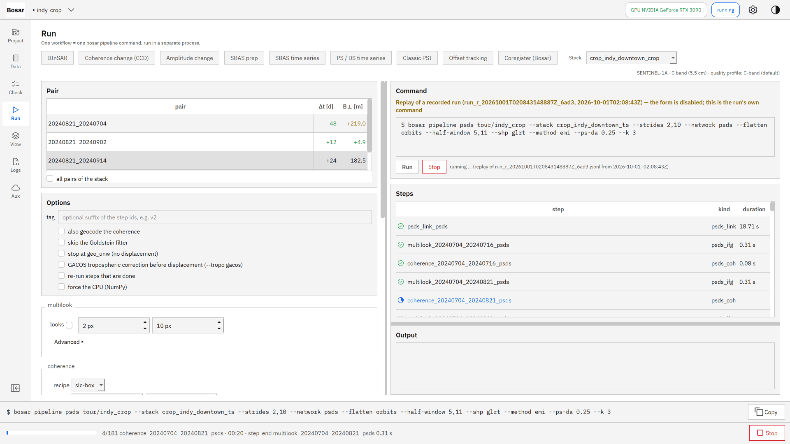
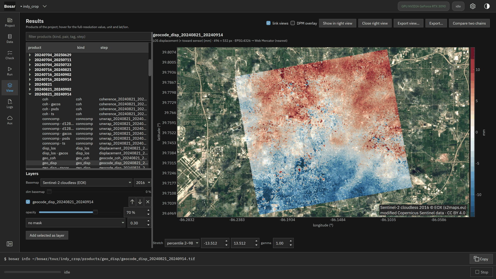
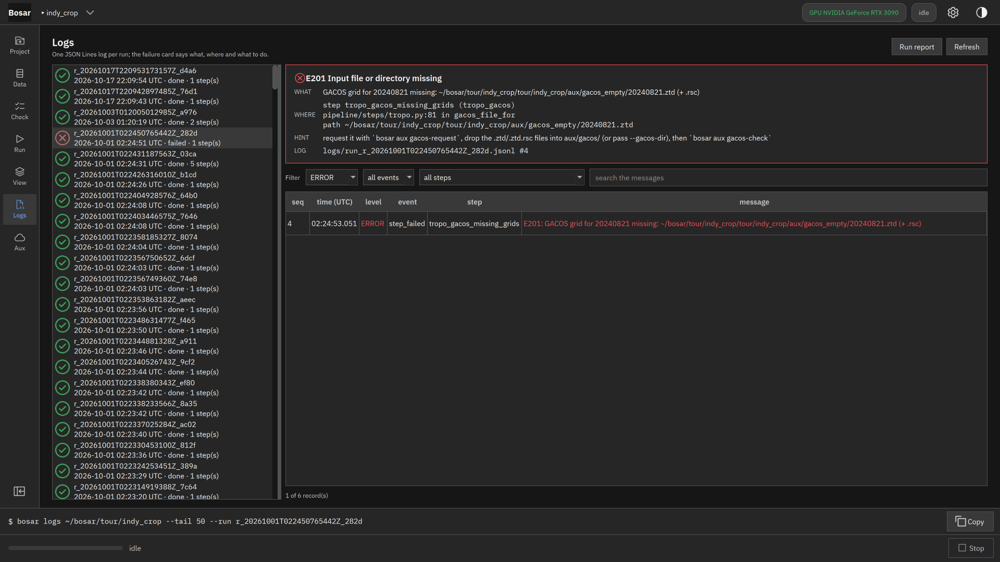

# Bosar 上手手册：从全新克隆到市中心的形变图与损毁代理图

> **用的是安装版？** 这份手册是在源码检出上写的。用到源码树的步骤（`git clone`、`pip install -e`、`scripts/...`、`pytest`）需要源码；源码不公开，只按作者的源码许可提供（见 [Licensing](LICENSING.md)）。用安装包的读者从 [Install](install.md) 和第 50 步（安装版）开始；其余各步的 `bosar` 命令就是安装版的命令。

适用版本：`v0.1.0-alpha.1`（第 1 阶段结束）。这份手册回答"软件现在做到哪一步"：
每一条命令都在写手册时逐字运行过，完整输出在
发布说明。没有图形界面，
所有操作都在 PowerShell 里完成。

目标：在 Indianapolis 市中心 7.2 × 10.8 km 的裁剪区上，从 SNAP 导出的 GAMMA/StaMPS 栈出发，
得到地理编码的视线向形变图 `geo_disp`、相干变化的损毁代理图 `geo_dpm`、幅度对数比与 RGB 合成图，
再把它们裁到高速公路两侧 500 m 的范围导出成 COG + GeoPackage。整个过程在 CPU 上约 8 分钟，
其中大部分是第 2 步的 pip 安装；处理本身不到 2 分钟。

---

## 第 0 步：按你的机器修改这三个变量（唯一需要改的地方）

```powershell
$DATA = "<data-root>"                  # 只读数据池（本手册只读取，不写入）
$MAIN = "<repo>"       # 已经编译过 SNAPHU 的主工作目录
$WORK = "<repo>\data\walkthrough_bosar"   # 放新克隆的位置
```

`$DATA` 下用到的文件：GAMMA 栈 `01_Preprocessed\01_IW2\`、原始 zip
`00_RawData\S1A_IW_SLC__1SDV_20240821T..._E05B.zip`（只读几何注释，不解压）、高速公路线
`04_GIS\indianapolis_highways.geojson`、GACOS 文件夹 `05_Auxiliary\00_GACOS\`。

## 第 1 步：克隆代码

```powershell
New-Item -ItemType Directory -Force $WORK | Out-Null
Set-Location $WORK
git -c safe.directory=* clone --quiet $MAIN bosar_walk
Set-Location bosar_walk
git -c safe.directory=* log --oneline -1
```

克隆来自第 0 步的主工作副本（`$MAIN`）；GitHub 上的公开仓库只放文档和安装包，不放源码。拿到源码仓库地址的读者把它换到 `$MAIN` 的位置。在不记录文件所有者的
磁盘上，git 会对新克隆报 "dubious ownership"（退出码 128）；上面这条命令只对这一次放行，不改你的全局配置。
想长期放行，可以自己执行 `git config --global --add safe.directory <克隆目录>`。

## 第 2 步：建立 Python 环境

```powershell
python -m venv .venv
.\.venv\Scripts\Activate.ps1
python -m pip install --quiet -e ".[dev,unwrap,viz]"
python --version
```

- `unwrap` 装 scikit-image（没有 SNAPHU 时的解缠后备），`viz` 装 matplotlib（快视图）。
- 有 NVIDIA 显卡时再装 `python -m pip install -e ".[gpu]"`，软件自动用 CuPy；本手册不装，
  全部在 CPU 上跑（`preflight` 会提示 W401，属正常）。

## 第 3 步：开发环境变量

```powershell
. .\scripts\dev_env.ps1
```

把 ruff / pytest / CuPy 的缓存都放进仓库内的 `.cache\`，并提醒：同一时间只应有一个使用 GPU
的进程（跑流水线时不要同时跑完整测试）。

## 第 4 步：自检 `preflight`

```powershell
bosar version
bosar preflight
```

逐项检查 Python、依赖、GPU、磁盘、SNAPHU 等；`OK` 通过、`WARN` 可以继续、`FAIL` 会阻止运行。
全新克隆里还没有 SNAPHU 可执行文件，P401 显示 `WARN`（W501：会退回 scikit-image）。

## 第 5 步：放入 SNAPHU

```powershell
New-Item -ItemType Directory -Force packaging\bin\win-x64 | Out-Null
Copy-Item "$MAIN\packaging\bin\win-x64\snaphu.exe" packaging\bin\win-x64\
bosar preflight | Select-String "P401"
```

SNAPHU 2.0.6 由 `packaging\snaphu\build.ps1` 用 MinGW-w64 编译；它和 author 在 WSL 里跑的 SNAPHU 对同样输入给出逐像素相同的结果。
二进制文件不进 git（许可证与平台原因），所以新克隆要从主目录复制或自己编译。复制后 P401 为 `OK`。

## 第 6 步：新建项目

```powershell
bosar project new walk --name walk_demo --storage-mode full
```

项目就是一个文件夹：`project.json`（步骤、参数、产品清单）、`products\`、`logs\`、`scratch\`。
`full` 保留全部中间产品（便于查看）；默认的 `minimal` 会在链结束后删除可再生的中间文件。

## 第 7 步：从全栈裁出市中心

```powershell
bosar data crop "$DATA\01_Preprocessed\01_IW2" --window 7904,8672,2590,5662 --dates 20240704,20240821,20240902,20240914,20250723 --annotation "$DATA\00_RawData\S1A_IW_SLC__1SDV_20240821T234025_20240821T234052_055318_06BEBA_E05B.zip" --out data\indy_downtown_crop
```

从 12239 × 25925 的 IW2 栈里按窗口读出 768 × 3072 像素、5 个日期（只读，窗口读取，不载入整景），
写成本仓库 `data\` 下的 GeoTIFF + `crop.json`。`--annotation` 直接从原始 zip 里读 SAFE 注释，
把 SNAP 导出里的名义几何（距离向 2 m、地球半径小 11.5 km）改成真实值（2.33 m 等），
`crop.json` 里记 I201。

## 第 8 步：导入裁剪区和全栈

```powershell
bosar data import walk data\indy_downtown_crop
bosar data import walk "$DATA\01_Preprocessed\01_IW2" --annotation "$DATA\00_RawData\S1A_IW_SLC__1SDV_20240821T234025_20240821T234052_055318_06BEBA_E05B.zip"
bosar project info walk
```

导入只登记元数据（日期、几何、基线、足迹），原始数据留在原地。全栈 29 景，20240821_20240704 的
B⊥ 从名义几何的 223.8 m 校正为 213.9 m（SNAP 自己给 216.1 m）。项目里有两个栈，后面的流水线
用 `--stack` 指明。

## 第 9 步：DInSAR 流水线 → `geo_disp`

```powershell
bosar pipeline dinsar walk --stack crop_indy_downtown_crop --all-pairs --looks 2,10 --backend snaphu --geocode-coh
```

每一对干涉图依次运行：`ifg_import`（引用栈里的差分干涉图）→ `multilook`（2 × 10 视，28 × 23 m）
→ `coherence`（DInSAR v0.1.0 起默认用 `slc-box` 配方：全分辨率 5 × 5 窗口，再在 2 × 10 块里平均，
与 MintPy 的相干一致；`--recipe looks` 是标准估计，每个多视块 20 个样本。CCD 则默认 `looks`，见第 11 步）→ `goldstein`（滤波）
→ `unwrap`（SNAPHU，
单块）→ `geocode_unw` → `displacement`（`d = −λφ/4π`，米，**朝向卫星为正**，参考点为 0）→
`geocode_disp` → `geocode_coh`。屏幕上每行一步，最后一行是运行日志的位置。
四对共 36 步，CPU 上约 25 秒（结果与 GPU 一致到 1e-6）。

## 第 10 步：看快视图

```powershell
Get-ChildItem walk\products\figure -Name | Select-Object -First 12
```

- `*_coherence.png`：相干（黑 0 → 白 1），河道、植被暗，建筑、道路亮。
- `*_unwrapped.png`：解缠相位（弧度，红蓝对称）。
- `*_displacement.png`：视线向形变（毫米，红 = 朝向卫星，蓝 = 远离卫星，色标取 2–98 % 对称），
  12–48 天的短对上主要是大气（厘米级），不是地面沉降。
- `geo_*` 产品（`walk\products\geo_disp\` 等）是 EPSG:4326 的 GeoTIFF，可直接拖进 QGIS。

## 第 11 步：相干变化检测 → `geo_dpm`

```powershell
bosar pipeline ccd walk --pre 20240821_20240902 20240821_20240914 --co 20240821_20240704
bosar pipeline ccd walk --pre 20240821_20240902 20240821_20240914 --co 20240821_20250723
```

`--pre` 是事件前的两对（夏季，12/24 天），`--co` 是"事件"对。没有真实的破坏事件，所以：
第一条是**空检验**（同一季节的另一对）；第二条是**季节伪事件**（336 天，跨过冬季）。实测结果
（用的是标准估计 `looks`，详见发布说明）：按分位阈值 2 % 超阈、去斑点后约 0.36 % 留在图上；但两种情况的图
都集中在相干的城区目标上，而不是植被——在 C 波段 12/24 天的夏季对里，农田和林地在事件前就已经
失相干，没有可失去的相干，所以审查预期的像土地覆盖图这种失效方式在这批数据上不会出现。空检验也
不是纯噪声：48 天的事件对本身比 12/24 天的事件前对更失相干，固定阈值 z ≥ 3 会标出约 5 %。产品：`ccd_delta`（相干下降量）、`ccd_z`（按事件前各对之间的离散度标准化，正 = 下降）、
`dpm`（1 = 显著下降，0 = 无，255 = 事件前相干 < 0.3 被屏蔽），以及地理编码的 `geo_ccd`、`geo_dpm`。
人工注入的 200 m 损毁块能被检出（测试 `tests/test_ccd.py`，`looks` 下精度与召回 ≥ 0.9）。
两种相干配方的取舍：`slc-box` 方位向 5 行的窗口大于 2 视，相邻多视像素共用样本，
`ccd_z` 在空间上相关（空检验的 Moran's I 约 0.37，`looks` 下 < 0.1），损毁块边缘会多标出一圈像素（召回
仍为 1，精度约 0.72）——偏差小但边界发虚；`looks` 像素彼此独立、边界清晰，低相干处偏差略大。做损毁
制图时定位比偏差更要紧，所以 **`pipeline ccd` 和界面的 CCD 工作流默认 `looks`**（DInSAR 仍默认
`slc-box`）。如果 CCD 读到的是 `slc-box` 相干，日志里会记一条 W106 说明；想用它就显式加
`--recipe slc-box`（新算的相干步骤建议加 `--tag`，两套结果并存）。

## 第 12 步：幅度变化（对数比与 RGB）

```powershell
bosar run walk amplitude --step-id amplitude_crop --stack crop_indy_downtown_crop --looks 2,10
bosar run walk log_ratio --step-id log_ratio_20240821_20250723 --requires amplitude_crop --pre 20240821 --post 20250723
bosar run walk rgb_composite --step-id rgb_20240821_20250723 --requires amplitude_crop --pre 20240821 --post 20250723
bosar run walk geocode --step-id geocode_log_ratio_20240821_20250723 --requires amplitude_crop --requires log_ratio_20240821_20250723 --source log_ratio
```

GAMMA 栈没有辐射定标，所以幅度变化是**相对的**：每个日期先在"稳定散射体"（幅度离散度最低的 95 %
像素）上归一化，再算 `10·log10(I_后/I_前)`（正 = 变亮）。RGB 合成里红 = 事前、绿蓝 = 事后：
红色是变暗，青色是变亮，灰色是不变。定标查找表（σ⁰）已经能直接从原始 zip 读出（33 个 zip 全部可读），
在 v0.2.0 的原生 SAFE 流程里使用。

## 第 13 步：导出（裁到高速公路两侧 500 m）

```powershell
bosar export walk all --aoi "$DATA\04_GIS\indianapolis_highways.geojson" --buffer-m 500 --out walk\export
Get-Content walk\export\README.txt -TotalCount 25
```

每个地理编码产品写成一个云优化 GeoTIFF（COG），高速公路 500 m 以外设为无数据；矢量（产品范围、
参考点、AOI、栈足迹）写进一个 GeoPackage；`README.txt` 和 `export.json` 写明每个文件的单位、
符号约定、参考点、日期对和运行编号。

## 第 14 步：日志在哪里、怎么看

```powershell
bosar logs walk --tail 3
Get-ChildItem walk\logs -Name | Select-Object -Last 3
```

每次运行一个 `logs\run_*.jsonl`（每行一条 JSON，UTC 时间精确到微秒，含参数、输入、输出、用时、
峰值内存），旁边是给人看的 `.log` 和 Markdown 报告 `.md`。`bosar logs walk --failure` 显示
最近一次失败的原因和提示。

## 第 15 步：GACOS 申请卡与已有文件的校验

```powershell
bosar aux gacos-request walk --stack gamma_01_IW2
bosar aux gacos-check walk --stack gamma_01_IW2 --dir "$DATA\05_Auxiliary\00_GACOS"
```

GACOS 没有 API：软件根据项目算出要填进 gacos.net 表单的范围（N/W/E/S）、时间（23:40 UTC，来自
SAFE 的 startTime，而不是 SNAP 导出 par 里被减半的 11:50）、日期（每次最多 20 个，29 个分两次），
你提交表单、收到邮件后把 `.ztd/.rsc` 放进 `walk\aux\gacos\`，再用 `gacos-check` 校验。
`<data-root>` 里已有的 29 个日期全部通过（时间差 0.4 分钟、边缘余量 0.10°、无缺值）。
对流层改正本身在 v0.2.0 加入。

## 第 16 步：图形界面

同一个 PowerShell 窗口里（虚拟环境和 `dev_env.ps1` 都已生效）启动图形界面：

```text
bosar gui walk
```

也可以直接运行 `bosar-gui walk`（不带控制台窗口的启动器）。这一步在上面的自动核对里**不执行**，因为
窗口会一直开着；关掉窗口即结束。界面的设置（主题、最近的项目、SNAPHU 路径等）存在
`$env:BOSAR_CONFIG_DIR` 指向的 INI 文件里（开发环境是仓库内的 `.cache\config`），不写注册表。

图形界面不做任何计算：**每一个操作都是一条 `bosar …` 命令**，显示在窗口底部的命令条里，可以一键
复制到 PowerShell 执行，结果与上面第 6–15 步完全相同；处理在单独的进程里运行，界面读取的是同一个
`project.json` 和 `logs\run_*.jsonl`。

- **Project**：新建 / 打开项目，摘要卡片列出数据栈、步骤状态和各级产品的占用空间。
- **Check**：第 4 步的 `preflight`，按系统 / GPU / 依赖 / 程序 / 凭据 / 网络 / 项目分组，绿黄红三色。
- **Data**：数据集表、基线表（Δt 与 B⊥ 按阈值着色）、基线网络图、Natural Earth 底图上的数据栈足迹，
  选中日期时显示该日期的幅度图；把栈文件夹拖进来即可导入（第 8 步）。
- **Run**：选流程（DInSAR / CCD / 幅度变化）、选像对，参数表由各步骤的参数定义自动生成（常用项在上，
  其余在"Advanced"里），右边实时显示将要运行的那条命令；**Run** 启动，**Stop** 先请求取消（当前步骤
  记为 cancelled），5 秒内没有停下再结束整个进程树（包括 SNAPHU）。



- **View**：左边是产品树，右边两个可联动的图像视图；色表按产品类型固定（相干灰度 0–1、形变红蓝对称、
  单位 mm，红 = 朝向卫星），鼠标下方显示全分辨率的数值、单位和经纬度；可叠加损毁代理图，可导出
  （第 13 步的 `bosar export`）。



- **Logs**：每次运行一行，记录表可按级别 / 事件 / 步骤 / 文字筛选；失败的运行显示失败卡片：
  WHAT（错误码与信息）、WHERE（步骤、代码位置、文件）、HINT（怎么办）、LOG（日志文件与行号）。



- **Aux**：第 15 步的 GACOS 申请卡，每个字段都有复制按钮，"Copy request k" 按网站表单的顺序复制一批
  日期；放文件的文件夹一有变化就自动重新校验。轨道和 DEM 的卡片在 v0.2.0 启用。
- **Settings**（右上角齿轮）：主题（深色 / 浅色 / 跟随系统）、计算设备（自动 / CPU / GPU）、SNAPHU
  路径、新项目的存储模式、只读数据目录；凭据**只显示有没有**，从不显示内容。

---

## 第 17 步：账号凭据

凭据只走两条路：终端里 `bosar auth set <service>`（隐藏输入，或 `--from-file 你的文件.txt`，文件
只读一次不复制），或者图形界面 **Settings → Credentials → Set…**（先提示注册、说明去哪里找 key、
再填写或"从文件导入"）。值存进系统凭据库（Windows 凭据管理器 / macOS 钥匙串），从不出现在命令行、
日志和交付包里。看状态：

```powershell
bosar auth status
bosar auth services
```

这几步用到的下载都不需要账号：轨道走本地文件夹和 SNAP 缓存，缺的走 ASF 公开镜像；DEM 走 AWS 公开桶。
`cdse`（Copernicus Data Space）账号是可选的加速来源。

## 第 18 步：轨道文件——先找本地，再下载

```powershell
bosar fetch orbits walk --stack crop_indy_downtown_crop --local-dir <data-root>/05_Auxiliary/03_Orbits --no-download
```

每个日期挑一个覆盖采集时刻（±60 s）的 POEORB（没有才用 RESORB），先在 `--local-dir`（会记进
`project.json`）、`BOSAR_ORBIT_DIRS` 和 SNAP 的缓存 `~/.snap/auxdata/Orbits/Sentinel-1` 里找，找到的
原地引用并记 sha256；缺的日期去掉 `--no-download` 就会下载到 `walk/aux/orbits/`。项目里有两个栈
（裁剪栈和整幅栈），所以要用 `--stack` 指明；这个裁剪栈的 5 个日期在本地全部命中，0 下载。

## 第 19 步：DEM——本地瓦片拼接，默认椭球高

```powershell
bosar fetch dem walk --stack crop_indy_downtown_crop --tile-dir <data-root>/05_Auxiliary/02_DEM/tiles --no-download
```

按栈的足迹加 0.1° 找 1°×1° 的 GLO-30 瓦片，本地齐全就直接拼接（不联网），写到
`walk/aux/dem/glo30_<W>_<S>_<E>_<N>.tif` 和同名 `.json`（用了哪些瓦片、sha256、大地水准面模型）。
默认 **椭球高**（GLO-30 是 EGM2008 正高，程序加上大地水准面差距，这里约 −33 m）；`--height orthometric`
保留正高。

## 第 20 步：快速相干预览与用轨道算基线

```powershell
bosar data preview walk --pair 20240821_20240914
bosar data baselines walk --stack crop_indy_downtown_crop --from-orbits
```

预览几秒钟给出一对的粗相干图（`walk/preview/coh_<pair>.tif`，带 Δt 与 B⊥），界面里在 Data 页选中
一对按 **Preview coherence**。`--from-orbits` 用第 18 步的轨道在 10×10 个目标上算 B⊥/B∥，和
`.base` 里的 TCN 值逐对比较，没有 `.base` 的对补上（method `orbit`）。裁剪栈的 4 对差都在 3 m 以内；对整幅栈
`gamma_01_IW2`（29 期）跑同一条命令，25 对里 21 对差 1 m 以内。

## 第 21 步：GACOS 大气改正（`--tropo gacos`）

```powershell
bosar pipeline dinsar walk --stack crop_indy_downtown_crop --pair 20240821_20240914 --looks 2,10 --backend snaphu --tropo gacos --gacos-dir <data-root>/05_Auxiliary/00_GACOS --tag gacos
```

在 `unwrap` 之后多一步 `tropo_gacos`：每个像素在两个日期的 ZTD 网格上双线性取值，除以该像素入射角的
余弦得斜距延迟，`φ_tropo = 4π/λ (S_sec − S_ref)`（次影像延迟更大 = 距离变长 = 相位为正），
`unw_tropo = unw − φ_tropo`（参考点保持 0），`displacement` 改用 `unw_tropo`。步骤摘要里有改正前后
相干像素的位移 RMS（这一对 6.25 → 5.09 mm；整幅 IW2 同一对 30.2 → 22.3 mm）。缺哪个日期的文件、时刻
对不上或网格不覆盖，步骤会报 E201/E204 并说明是哪个日期哪个文件。`bosar aux status walk --for
dinsar+gacos` 提前列出缺什么、哪些能自动取（给出命令）、哪些要你动手。

## 第 22 步：SBAS 网络设计

```powershell
bosar sbas network walk --stack crop_indy_downtown_crop --max-dt 400 --max-bperp 300 --k 2 --name crop
```

按 Δt / |B⊥| 阈值选对，再给每个日期补 `--k` 条按时间最近的连接（跨越空档也能连通），报告连通分量、
冗余度（对数 / 日期数）和三元环数；被拒绝的对连同原因一起记进 `project.json`（`aux.sbas.networks`）。
你自己的 `network_design.csv` 可以用 `--from-csv` 导入（B⊥ 以栈里的轨道基线为准）。裁剪栈 5 个日期：
9 对、1 对被拒（|B⊥| 392 m 但作为顺序连接保留）、7 个三元环、连通。界面里在 Run 页选 **SBAS prep**，
可以直接设计网络、看网络图（选中的对实线、被拒的对虚线）。

## 第 23 步：派生小基线干涉图、公共参考点、批量解缠

```powershell
bosar sbas prep walk --stack crop_indy_downtown_crop --network crop --looks 2,10 --backend snaphu --workers 3 --nproc 2 --tag sbas
```

步骤 id 带网络名（`coherence_<对>_crop_sbas`），同一项目里两个栈的网络互不干扰。四个可续跑的阶段：**prepare**——每对 `ifg_derive → multilook → coherence`（`ifg_derive` 用星形栈
`diff(ref,i)`、`diff(ref,j)` 与参考影像功率算出平地化的 (i, j) 对，相干用同一分子和两景 SLC 功率）；
**reference**——所有对里都相干（≥ 0.3）的像元中平均相干最高的那个当公共参考点（写进网络记录）；
**unwrap**——每对 SNAPHU（`smooth` 代价）、统一参考；**closure**——见下一步。`--workers 3` 让三对并行
（子进程，CPU），`project.json` 的并发写入靠修订号合并。裁剪区 9 对：prepare 约 1 分钟/对，
unwrap 1–3 秒/对，参考像元 (20, 167)。

## 第 24 步：三元环闭合（B4）

`sbas prep` 的最后一步就是 `closure`；也可以单独跑：

```powershell
bosar sbas prep walk --stack crop_indy_downtown_crop --network crop --phase closure --looks 2,10 --tag sbas
```

每个闭合三角算两样：缠绕相位闭合 `arg(c_ij c_jk conj(c_ik))`（相位偏差）和解缠相位的整数闭合
`round((u_ij + u_jk − u_ik − w)/2π)`（解缠错误）；产品 `closure/wrapped_rms`、`closure/integer_count`，
摘要里有逐三元环、逐对（含"系统性错误"标记）和只看相干像元的统计。裁剪区 7 个三元环：缠绕闭合
RMS 中位数 0.94 rad（三对都相干的像元 0.43–0.52 rad），整数闭合非零的像元占 9–24 %（相干像元
2–11 %；夏季三元环 20240821-0902-0914 最好，2.2 %）。

## 第 25 步：用 SNAP 做预处理（需要装好 ESA SNAP）

```powershell
bosar preflight --offline
bosar pipeline preprocess walk --engine snap --product "$DATA\00_RawData\S1A_IW_SLC__1SDV_20240821T234025_20240821T234052_055318_06BEBA_E05B.zip" --product "$DATA\00_RawData\S1A_IW_SLC__1SDV_20240902T234025_20240902T234052_055493_06C53E_B90F.zip" --product "$DATA\00_RawData\S1A_IW_SLC__1SDV_20240914T234026_20240914T234052_055668_06CC28_B2FF.zip" --subswath IW2 --aoi-wkt "POLYGON((-86.30 39.65,-86.00 39.65,-86.00 39.90,-86.30 39.90,-86.30 39.65))" --threads 8 --cache-mb 8192 --tag subset
```

预检的 P402 报告 SNAP 的 `gpt`、工具箱和堆内存。命令把 SNAP 当作单独的程序调用（不复制、不导入
SNAP 的代码）：TOPSAR-Split（按 AOI 选 burst）→ Apply-Orbit-File（用第 18 步找到的本地轨道，复制到
`walk/snap/userdir`）→ Back-Geocoding（外部 DEM = 第 19 步的椭球高拼接，`walk/aux/dem`）→ ESD →
Interferogram（平地 + 地形相位、相干、高程、经纬度）→ Deburst，产品是 BEAM-DIMAP，随后自动导入
（`data import --reader dimap --ifg-dim`）成栈 `snap_subset`，第 8 步之后的所有命令都能用它。SNAP
写的每个文件都在 `walk/snap/` 和 `walk/products/dimap/` 里，`~/.snap` 一个文件都不动。本机上：栈
90 s、干涉图 344 s、gpt 峰值内存 45 GB（`gpt.vmoptions` 的 -Xmx132G 允许它这么用）。注意：DEM 只
拼了 AOI 那个框，Back-Geocoding 会把没有高程的像元全部置空，所以子集里只有 AOI 框内有数据。

## 第 26 步：相干不够时哪些对、哪些像元会被剔除

SBAS 的结果好不好，主要取决于喂进去的解缠相位靠不靠谱。Bosar 把"剔除"做成明确的规则，每一条都
会在命令输出和 `project.json` 里留下记录，你可以逐条放宽或收紧：

| 层次 | 规则 | 在哪里调 | 记录在哪里 |
|---|---|---|---|
| 整对 | **空对**：相干处处为 0（导出里该日期的干涉图或 SLC 全零，导入时报 W206） | 不可调 | 网络记录 `empty_pairs` |
| 整对 | **弱对**：相干 ≥ 0.4 的像元不到 5 %；但每个日期保留它向前、向后最好的一条连接 | `sbas prep --min-coherent-fraction 0.05`（0 = 不剔除） | `weak_pairs`、`weak_pairs_kept`、`pair_quality` |
| 整对 | **不可靠对**：它参与的每一个三元环里，相干像元上整数闭合不为 0 的比例都超过 30 %（整景去相干或配准坏掉的日期） | `unw_correct --pair-max-error 0.3` | `unw_correct` 摘要的 `unreliable_pairs` |
| 像元 | 该对在这个像元的相干低于阈值 | `pipeline sbas --coh-min 0.3` | `sbas_invert` 摘要 `pair_pixels_dropped.coherence` |
| 像元 | 该像元不在参考点所在的解缠连通分量里 | `--any-component` 关闭此规则 | `pair_pixels_dropped.component` |
| 像元 | 闭合改正之后该对所在的三元环仍不闭合 | `--keep-unclosed` 关闭此规则 | `pair_pixels_dropped.unclosed_triplet` |

一个像元至少剩下 2 对才有时间序列（`--min-pairs`）；只有它的网络把所有日期连成一片、并且时间相干
≥ 0.7，才进入默认掩膜（产品 `ts_mask`）。如果整对规则把整个网络断成几段（冬季几对全不可靠时会这样），
`sbas_invert` 报 **W107**：各段之间的偏移未知，速度按"同一速率 + 每段一个截距"拟合；想把断口接上，
就多留几条跨越断口的对（`sbas network --k` 调大、`--min-coherent-fraction` 调小，或用
`sbas_invert --exclude-pairs` 自己指定）。网络设计还有两个选项：`--sequential-only`（只要每个日期
时间上最近的 k 条连接）和 `--season-months 5-10`（拒绝跨季节的对，顺序连接除外）。

## 第 27 步：SBAS 时间序列（`pipeline sbas`）

```powershell
bosar pipeline sbas walk --network crop --tag sbas --tropo gacos --gacos-dir <data-root>/05_Auxiliary/00_GACOS
```

在第 23 步准备好的网络上依次做：`unw_correct`（按闭合环改正 2π 解缠错误，Yunjun 等 2019 的相位闭合
法，按"闭合模式"去重后每种模式只解一次）→ `sbas_invert`（逐像元网络的加权最小二乘 / 最小范数解，
Berardino 等 2002；权来自相干和视数；输出 `ts_los`（每个日期一个波段，单位 m，朝向卫星为正）、
`velocity`（m/yr）及其标准差、`temporal_coherence`、`n_pairs_used`、`ts_rank`、`ts_mask`）→
`ts_correct`（每个日期的 GACOS 斜距延迟，参考到参考点和参考日期；`--deramp` 再逐日期去一个平面；
`--tropo era5` 用 ERA5 气压层数据，需要 CDS key）→ 地理编码（速度、时间相干、时间序列）。
产品内部一律是米和米/年，界面、CSV 和摘要里才换成毫米。改正方式写进步骤 id（`ts_correct_crop_sbas_gacos`），
所以不改正、GACOS、ERA5 的结果可以并存对比。这个 5 景裁剪只有 9 对，结果只用来演示流程；26 景的
裁剪（`data/indy_downtown_ts`，见发布说明）才有像样的时间序列。

## 第 28 步：导出给 MintPy 对比（可选）

```powershell
bosar sbas export-mintpy walk --network crop --tag sbas --out walk\mintpy
```

写出 `inputs/ifgramStack.h5`、`inputs/geometryRadar.h5` 和一个最小的 `smallbaselineApp.cfg`（文件
格式按 MintPy 手册写，没有用 MintPy 的代码）。MintPy 作为单独的程序在这些文件上运行
（`ifgram_inversion.py inputs/ifgramStack.h5 -w var`），就能和 Bosar 在完全相同的输入上对比；
`--mintpy-legacy-bperp` 把基线写成导出里 `.base` 的值，和你以前那套 MintPy 数据一致。

## 第 29 步：在界面里看时间序列、叠图层、导出图

`bosar gui walk` → Results 页：

- 选中 `geo_velocity`（速度图）：左下 **Layers** 面板里选底图（默认“无”——v0.4.0 起发行版不再默认连任何瓦片服务器；Sentinel-2 无云镶嵌 2016 年是
  CC BY、可直接用，OpenStreetMap、Esri 各有使用条款，自定义 XYZ 在 Settings 里填模板、密钥与署名），可以把底图调暗；每个图层有显示开关、0–100 % 的
  透明度（底图上默认 70 %）、上下顺序、"相干 / 时间相干低于阈值处透明"的掩膜；"Add selected as layer"
  把树里选中的另一个地理编码产品叠上来。雷达几何的产品不会被偷偷重投影，而是给一个
  "Geocode for the map" 按钮去跑 `geocode` 步骤。
- 在速度图上点像元：下方出现该像元的 LOS 位移时间序列（毫米）和线性拟合、速率（mm/yr）；可以点多个
  像元、勾选不同改正（未改正 / GACOS / ERA5）、导出 CSV；雷达几何视图里参考点用星号标出。
- "Export view…" 把当前视图存成 PNG 或 PDF：带色标、每个图层一行图例、比例尺、指北针和底图署名，
  生成各图层的命令写在文件元数据里。

## 第 30 步：结果能不能用？——质量判定和数据体检

```powershell
bosar sbas quality walk --network crop --tag sbas
```

每条时间序列链（`pipeline sbas`、`pipeline psds`）跑完都会打印一个**质量判定**：
`USABLE`（可用）/ `MARGINAL`（勉强，只能在说明的限制内读）/ `NOT USABLE`（不能当形变解读）。
判定来自实测指标，每条都带警告码、实测值、门槛和**具体的补救办法**：

| 警告码 | 指标 | 勉强 | 不可用 |
|---|---|---|---|
| W108 | 连通且时间相干达标的像元占比 | < 20 % | < 2 % |
| W109 | 被剔除的干涉对占比，或整天丢失的日期 | > 30 % 或有日期丢失 | — |
| W107 | 网络断成几段 | 是 | — |
| W110 | 可用像元的速度离散度 | > 4 mm/yr | > 10 mm/yr |
| W111 | 改正后仍不闭合的三元环占比 | > 15 % | — |
| W112 | 速度中位数相对参考点明显偏离（场景斜坡或参考点本身有问题） | 是 | — |
| W113 | 相邻两期之间出现接近半个波长的跳变的像元占比（并指出从哪天开始） | > 3 % | — |

`bosar sbas quality` 还会打印**逐日期的数据体检表**：每个日期有几对、多少是空的（全零）、多少太弱、
多少被闭合检查判为不可靠、平均相干像元占比。所有对都是空的日期是数据问题（那一景在导出里就是空的，
调参数没用，只能重新配准或剔除）；所有对都失败的日期是那天失相干（雪、雨、落叶）。界面里结果页会在
地图上方用横幅显示同样的判定。

## 第 31 步：PS / DS 时间序列（`pipeline psds`）

```powershell
bosar pipeline psds walk --stack crop_indy_downtown_crop --strides 2,10 --workers 3 --backend snaphu
```

植被多的地方多视 SBAS 留不下多少像元。这条链改用两类散射体：**分布式散射体（DS）**——在每个像元周围
找统计上同质的邻居（SHP，幅度的 GLRT 检验），在这些邻居上估 N×N 的相干矩阵，再用**相位联合**（EMI）
一次估出 N 个日期的相位；**永久散射体（PS）**——幅度离差 D_A ≤ 0.25 的点保留自己的相位。两者合成
一个"混合栈"，再走第 23–27 步同样的解缠、闭合、反演。依次是：`slc_flatten`（用 Bosar 自己的平地相位
把每景 SLC 去平；同时扫描每个日期，**有一条缺失带的日期会被检出并默认剔除**，W207）→ `psds_link`
（SHP、相位联合、PS 选择；GPU 上 26 景 768×3072 只要十几秒）→ 每对的干涉图 → 解缠 → 闭合改正 →
反演 → 地理编码 → 质量判定。常用选项：`--shp glrt|ks`、`--method emi|evd`、`--ps-da 0.25`、
`--strides 方位,距离`（输出网格的抽稀）、`--ds-tcoh 0.6`（DS 需要的相位联合时间相干；纯噪声在这个栈上
最高只有 0.36）、`--keep-partial-dates`。5 景的裁剪只用来演示流程（日期太少，相位联合意义不大）；
26 景测试区的结果见发布说明。

## 第 32 步：经典 PS-InSAR 作为独立对照（`pipeline psi`）

```powershell
bosar pipeline psi walk --stack crop_indy_downtown_crop --name psds --max-arc-m 3000
```

按 Ferretti 等 2001 / Kampes 2006 重新实现的经典 PSI，不做相位联合也不做空间解缠：PS 候选点
（D_A）→ Delaunay 三角网的边 → 每条边用周期图同时估高程误差和速率（一次矩阵乘法批量算）→ 从参考点沿
最相干的路径积分 → 由残差估大气相位屏并扣除 → 每个点最终估计。结果是一个 GeoPackage 点图层
（`products/psi_points/`）：LOS 速度（朝向卫星为正）、高程误差、时间相干和每个日期的位移。验收门槛会
按这个栈的日期数自动抬到"纯噪声的 99 分位"之上（日期少时噪声也能凑出很高的时间相干）。它复用上一步
`slc_flatten_psds` 的去平栈。

## 第 33 步：在界面里看 PS/DS 结果

`bosar gui walk` → Run 页选 **PS / DS time series** 可以直接跑上面的命令；Results 页选中 PS/DS 的
速度图后，勾选 **PS points** 会把永久散射体画成点（颜色 = 速度，大小 = 质量），点一下看它的时间序列；
`psds_temporal_coherence`、`shp_count`、`psds_type`、`amp_dispersion` 这几张质量图都可以直接看。网络
断成几段时，时间序列按段分别画线、每段一个偏移量（段与段之间的位移未知）。

## 第 34 步：从 ASF 下载原始 SLC（`fetch slc`）

```powershell
bosar fetch slc --project demo_dinsar --stack gamma_01_IW2 --range 2025-08-01:2026-09-30 --dry-run
bosar fetch slc --project demo_dinsar --stack gamma_01_IW2 --range 2025-08-01:2026-09-30 --range 2023-07-01:2024-06-30 --dest data/raw/s1 --detach
bosar fetch status --dest data/raw/s1
bosar fetch stop --dest data/raw/s1
```

按栈的相对轨道、帧和足迹（或 `--aoi "POINT(lon lat)"` + `--relative-orbit`）在 ASF 搜索景，`--dry-run`
只列清单和大小；真下载是 Bosar 自己的循环：断点续传（Range）、按大小和 MD5 校验、每景一个
`<name>.json` 来源记录、剩余空间低于 `--min-free-gb`（默认 150 GB）就停、第二批只有剩余空间大于
`--continue-if-free-gb` 才开始。`--detach` 让它在后台跑、跨会话继续；进度文件
`fetch_slc_progress.json` 和 `fetch_slc.log` 在目标目录。Earthdata 凭据走 `~/.netrc` 或钥匙串，不经
聊天。Aux 页有同样的卡片。目标目录拒绝只读的数据根。

## 第 35 步：原生 TOPS 配准——不经 SNAP 从 zip 到栈（`pipeline s1-coregister`）

```text
bosar project new demo_native
bosar fetch dem demo_native --bbox -86.52,39.27,-85.06,40.28 --margin-deg 0
bosar pipeline s1-coregister demo_native --product <zip1> --product <zip2> --product <zip3> --subswath IW2 --pol VV --aoi-wkt "POLYGON((-86.30 39.65,-86.00 39.65,-86.00 39.90,-86.30 39.90,-86.30 39.65))" --tag r11
bosar fetch orbits demo_native --stack native_r11 --no-download
bosar run demo_native slc_flatten --step-id slc_flatten_r11 --stack native_r11
```

第一个 zip 是参考。一步做完：把子条带的注记和影像从 zip 解到 `cache/safe/`（一次）、从注记建 burst 模型、
精密轨道（项目里记录的，否则数据根 / SNAP 缓存，再否则注记星历并给 W301）、每个参考 burst 在格网上
用 DEM 做 topo、每个副影像 burst 去斜（deramp）→ 按轨道 + DEM 的偏移量做 Knab 窗 sinc 重采样 → 加回
斜坡（reramp）、burst 重叠区做 ESD 并迭代到 0.001 行以内、按重叠中线拼接（deburst），写成 ISCE
`merged/` 布局（`--output cint16` 省一半空间）并自动导入成栈 `native_<tag>`。RTX 3090 上一个
1500 × 25000 的 burst 不到 1 秒（CPU 55 秒）。`products/native/stack/<step>.json` 记录 burst 参数、
拼接方案、每个日期的 ESD 表与偏移量、耗时。与 SNAP 在同三景上的比对（`scripts/validate_native_tops.py`、
`scripts/validate_native_flat.py`）见发布说明。

## 第 36 步：导入时的空景体检与分波段质量阈值

`bosar data import` 现在对每个日期做抽样扫描（每 128 行读 16 行），全零的日期给 W206、比"公共底数"
（所有日期都为零的区域——景边缘、burst 缝隙——取各日期零比例的最小值，W208）多出 2 个百分点以上的
给 W207，并记在栈记录的 warnings 和每个日期记录的 `zero_fraction` / `partially_empty` / `empty` 里；
时间序列链默认仍会剔除 W207 的日期。质量判定按波段选阈值：C 波段默认，L 波段草案（毫米量级的阈值按
波长比放大），输出第二行写明 `thresholds: C-band (default)`。

## 第 37 步：界面里的经典 PSI 与点图层

`bosar gui walk` → Run 页多了 **Classic PS-InSAR (periodogram)**（对应第 32 步的命令，D_A、点数、最长
边、时间相干作为基本参数，计划里是 `slc_flatten_psi` + `psi_classic_psi`）；Results 页选中一个 PSI
的结果后勾选 **PS points**，GeoPackage 里的点会按速度着色、按时间相干定大小地画出来，与 PS/DS 的
点图层同一套机制。

## 第 38 步：多年原生栈——目录里所有 zip、按 AOI 裁剪、可续跑

```text
bosar project new demo_multi
bosar fetch dem demo_multi --bbox -86.52,39.27,-85.06,40.28 --margin-deg 0
bosar fetch orbits demo_multi --product <参考 zip> --product <其余 zip…>
bosar pipeline s1-coregister demo_multi --product <参考 zip> --products-from <data-root>/00_RawData --products-from data/raw/s1 --subswath IW2 --aoi-wkt "POLYGON((-86.30 39.65,-86.00 39.65,-86.00 39.90,-86.30 39.90,-86.30 39.65))" --crop-wkt "POLYGON((-86.245 39.692,-86.078 39.692,-86.078 39.813,-86.245 39.813,-86.245 39.692))" --drop-cache --tag multi
bosar pipeline psds demo_multi --stack native_multi --workers 6 --tropo era5 --ref-latlon 39.7684,-86.1581 --no-correct --keep-unclosed
bosar pipeline psi demo_multi --stack native_multi --name psds --max-arc-m 3000
```

`--products-from` 把文件夹里所有 `S1?_IW_SLC__*.zip` 按日期排进来（S1A、S1D 一视同仁）；burst 由
AOI 多边形与每个 burst 足迹**求交**选出；`--crop-wkt` 只把多边形外接框那一块写盘（burst 仍整块配准）。
一次只处理一个日期：打开 → 去斜 → 几何偏移 → 距离向互相关检查 → ESD → 拼接 → 写盘 → 关闭，
内存不随日期数增长；每个日期写一个 `merged/SLC/<date>/coreg.json`（设置的签名），**再跑同一条命令
只处理新下载的日期**（摘要里的 `n_reused`）。默认输出 CINT16（`--output cfloat` 可换回）。
`fetch orbits --product` 在还没有栈的时候按产品名取精密轨道。53 个日期（2024-07 至 2026-07，
含 2 景 S1D）在 RTX 3090 上每景约 53 秒。质量判定第三行给出"实测速度离散 vs 由日期数和时间跨度
预期的离散"：`sigma_v = sigma_d * sqrt(12 (N-1) / (N (N+1))) / T`。
长栈（两年、近 200 对）上要加 `--no-correct --keep-unclosed`：闭合改正步骤在这么大的网络上会把
解缠结果改坏（待修），不闭合的对保留下来由时间相干去判定。这样两年数据上 PS/DS 判定
USABLE（26.5 % 的像元可靠，速度离散 1.45 mm/yr，预期 1.1），经典 PSI 也是 USABLE（1.26 mm/yr），
两条链在可靠像元上相差 0.4–0.6 mm/yr。跨相干缺口（比如河两岸）的相对速度不要读。时间序列项目
建议用 `bosar project new --storage-mode full` 创建。

## 第 39 步：定标与地形展平（`--calibration`、`--terrain-flatten`）

```text
bosar pipeline s1-coregister demo_native --product <zip1> --product <zip2> --subswath IW2 --bursts 6,8 --output cfloat --calibration sigma0 --terrain-flatten --tag cal
bosar pipeline amplitude demo_native --stack native_cal --pre 20240821 --post 20240902
```

SLC 保持 DN 不变；`merged/calibrated/<date>/<date>.sigma0.rdr`（或 beta0 / gamma0）是用 SAFE 定标 LUT
算出的线性功率，`gamma0_flat.rdr` = beta0 × 面积因子（Small 2011，因子在雷达几何里由 DEM 小面元算出，
平地上等于 tan(入射角)，叠掩和阴影置 NaN），因子本身在 `geom_reference/gamma_flat_factor.rdr`。
原生栈带定标层时，振幅变化链自动改用绝对后向散射（`dB (sigma0)`，不再做相对归一化）。
与 SNAP 的 Calibration / Terrain-Flattening 的比对：`scripts/validate_native_cal.py`。

## 第 40 步：三个子条带与条带拼接（`--subswath IW1,IW2,IW3`）

```text
bosar project new demo_full
bosar fetch dem demo_full --bbox -87.65,38.40,-84.001,40.75 --margin-deg 0
bosar pipeline s1-coregister demo_full --product <zip1> --product <zip2> --subswath IW1,IW2,IW3 --tag full --id native_full
```

三个子条带各配准一次（步骤 `s1_coregister_full_iw1…3`，不给 `--bursts` / `--aoi-wkt` 就是全部
burst），然后 `s1_swath_merge_full` 把三个栈并到一张距离 / 方位网格上：整像素放置（与 ISCE2 相同）、
重叠区中线切割、不做任何插值，几何层同样拼接，所以每个像素带着自己的经纬度。摘要里的 `seams`
给出每条接缝、每个日期的相位台阶、相干和幅度台阶。DEM 镶嵌图按窗口读取，整景也不会整幅进内存。

## 第 41 步：电离层分频估计（`iono_split`）

```powershell
bosar run demo_full slc_flatten --step-id slc_flatten_full --stack native_full
bosar run demo_full iono_split --step-id iono_full --requires slc_flatten_full --pair 20240821_20240902
```

在**去平地后的** SLC 栈上：把距离向频谱的上下三分之一各取出来做子带干涉图，只解缠全带一次，
由两个子带相位算出色散项（Gomba 2016），按相干加权做高斯低通。输出 `iono_phase/<pair>`（载频处的
电离层相位，弧度，多视网格）；摘要里有改正前后解缠相位的平面斜率。噪声放大约 120 倍，所以默认
64 × 256 视。常数项不可定（与所有干涉相位一样是相对量）。

## 第 42 步：界面——Coregister 工作流与下载批次

`bosar gui demo_multi` → Run 页的 **Coregister (Bosar)**：Engine 选 `bosar`（原生链，对应第 38 步的
命令）或 `snap`（第 25 步的 SNAP 桥接），勾选"all three sub-swaths"就是第 40 步，表单里有输出类型、
定标和地形展平。Aux 页的 **Sentinel-1 SLC scenes (ASF)** 卡片现在列出每一批的进度、正在传输的
文件和按最近一分钟速率估计的剩余时间；`bosar fetch slc --parallel 3` 并行下载，网络中断的景在
之后的尝试里自动重试。

## 第 43 步：时间参考日期与离群日期

```powershell
bosar pipeline sbas demo_multi --network psds --no-correct --ref-latlon 39.7684,-86.1581 --tropo era5
bosar pipeline sbas demo_multi --network psds --tag ex5 --no-correct --ref-latlon 39.7684,-86.1581 --fit huber --exclude-dates 20230803,20240330,20240622,20250325,20250816
```

不给 `--ref-date` 时，序列的零日期不再是第一景，而是"共模中位数"规则：每个日期取好像元的空间
中位数（整景一起相对参考像元动的量，多半是大气），选最接近这些中位数之中位数的那个日期——永远不是
离群日。摘要里记 `ref_date_rule`、`common_mode_mm`。W117 点名"偏离拟合直线超过 3 倍稳健标准差且
超过 20 % 像元"的日期；`--exclude-dates` 把它们连同所有相关对一起剔除，`--fit huber` 用 Huber 估计
速度；质量报告同时打印最小二乘与 Huber 两种离散。`--tag` 现在可以只给时间序列部分命名变体，
配对产品沿用网络自己的。

## 第 44 步：距离向偏移隐含的 ΔSTEC

```powershell
bosar aux range-shift demo_multi --stack native_multi --ionex-dir data/aux/ionex --write
bosar sbas quality demo_multi --network psds
```

每个日期：ERA5 对流层预测的偏移、残差、以及把残差当成电离层群延迟换算的斜向 TEC 差
（2.33 m 一个像元 ≈ 169 TECU）；有 IONEX 图时并排给出 GIM 值。`--write` 写进每个日期的
`coreg.json` 和配准步骤摘要，`sbas quality` 的逐日期表多出 `shift[px]`、`dSTEC[TECU]`、`GIM[TECU]` 三列。

## 第 45 步：电离层模型改正（可选）

```powershell
bosar pipeline sbas demo_multi --network psds --iono --iono-model plane
bosar pipeline psds demo_alos --stack alos_mx --network l --iono --iono-looks 32,32
```

不加 `--iono` 什么都不做。加上后每个干涉对跑一次分频估计并拟合模型（C 波段默认 `plane`，L 波段
默认 `filtered`），反演时在读入阶段减去模型；链结束时打印模型跨度、W220 对数和三元闭合。

每个模型先过一道合理性门限（幅度、梯度、三元组闭合；`--no-iono-gate` 关掉它）：不过门的模型被跳过并计数
（W227），坏估计不会进入反演。实测（0.4.1）：C 波段（Sentinel-1 印第安纳波利斯 88 个冬季日期）没有可测的
收益——门限只放行几对，速度变化小于自身噪声；L 波段（ALOS-1 墨西哥城）门限留下约一半模型，产品在
0.01 mm/yr 内不变。门限默认开，因为 `filtered` 模型可能跟着它所在的形变走，门限的幅度和闭合规则正是
抓这个。用 `--iono` 时带着门限，比较加与不加的速度图，保留残差和地标序列站得住的那一次；它仍是可选项。

NISAR 一景里有两个频段（`0505` 模式：A 频段 1221.5 MHz，B 频段 1236.5 MHz，各 5 MHz，同一网格）。把第二
个频段单独配准成一个栈（`pipeline stripmap-coregister … --reader nisar --frequency B --tag b`），再指名它：

```text
bosar pipeline sbas demo_nisar --network l --iono --iono-band-stack stripmap_b
```

电离层就由两个整频段估计而不是一个频段的外侧三分之一（`iono_split` 步骤的 `bands` 来源）：载波间隔
15 MHz 对 3.3 MHz，噪声增益 58 对 259，同样视数下噪声低四到五倍。两个栈的极化可以不同（该模式下 A 为
HH、B 为 VV），每个频段的干涉图在自己频段内形成。估计器在合成频段上验证过；2026 年的临时 `0505` 产品
（track 58 / frame 53）B 频段没有信号，所以先看 `iono_split` 摘要里的 `band.coherence_median` 再信结果。

## 第 46 步：长序列的顺序相位连接与星形解缠实验

```powershell
bosar pipeline psds demo_multi --stack native_multi --network psds_seq --method sequential --ministack 15
bosar pipeline psds demo_multi --unwrap star
```

`sequential`：每 15 景一个小栈各自连接，用压缩 SLC 把基准串起来，矩阵永远不超过"小栈 + 之前小栈数"
个日期（N/L 从 0.9 降到 0.2）；摘要报 `n_over_l_median`。`--unwrap star`：只以第一景的星形对为
测量，其余对由星形推出（闭合恒为零），独立解缠的相邻对只用来投票整周错误。

88 景实测：`sequential` 连接快 7 倍、选出的 DS 多 68 %，产品覆盖翻倍（73 % 对 37 %），
但速度离散从 0.54 变成 0.80 mm/yr，6 % 像元出现整周跳变——由连接相位推出的干涉对天然闭合，反演的
时间相干对它恒为 1.0，把不住关。默认仍是 `auto`；`sequential` 是可选项，v0.4.0 改用连接相干做掩膜后再评。
`--unwrap star` 在 88 景上也是负结果：以第一景为中心的星形对最长跨 1171 天，远端对整片整周错误，
每景三个相邻对的投票压不住（五个日期被改掉 91–98 % 的像元），速度离散 3.6 mm/yr。默认仍是 `pairs`。

## 第 47 步：ALOS-1 / ENVISAT / ERS / NISAR 读取器与条带配准链

```text
bosar fetch slc --mission alos --path 186 --frame 370 --flight-direction ascending --range 2007-01-01:2011-12-31 --dry-run
bosar project new demo_alos --storage-mode full
bosar fetch dem demo_alos --bbox -99.30,19.15,-98.85,19.60 --tile-dir data/aux/dem_tiles
bosar pipeline stripmap-coregister demo_alos --product A.zip --product B.zip --reader alos --crop-wkt "POLYGON((...))" --id alos_pair
bosar sbas network demo_alos --stack alos_pair --name pair --max-dt 400 --max-bperp 5000
bosar run demo_alos slc_flatten --step-id slc_flatten_alos_pair --stack alos_pair --mode orbits
bosar sbas prep demo_alos --stack alos_pair --network pair --flat-step slc_flatten_alos_pair
```

ALOS-1 PALSAR L1.1（CEOS，ASF 的 zip 直接读）、ENVISAT ASAR IMS 与 ERS IMS（Envisat 格式，
`--reader asar` / `ers_envisat`）、NISAR RSLC（HDF5，尚未见真数据）都读成同一个 `StripmapScene`；
条带配准链带多普勒中心（几何用 `rdr2geo`/`geo2rdr` 的多普勒项，重采样先解调再调制），写出和
TOPS 链一样的 ISCE 目录。原生栈没有存好的干涉图，所以配对要先展平再用 `--flat-step` 推导；
三景以上直接走 `pipeline psds`。墨西哥城三种传感器各跑了一对；ALOS 的 16 景序列
（`pipeline psds demo_alos --stack alos_mx --network l --k 3`，再 `pipeline sbas --tag ex --ref-latlon 19.342,-99.088
--exclude-dates 20100522 --fit huber`）给出 Nezahualcóyotl −223 mm/yr（LOS，垂直约 −290）、机场 −192、
火山岩参考点 −4 ± 3——与 Chaussard 2014 的图形和量级一致。注意两点：默认参考像元（最好的 DS）会落在
沉降盆地里，要用 `--ref-latlon` 指到稳定地表；质量判定的 W110/W113 是按稳定区设计的，在 30 cm/yr 的
盆地上会把形变本身判成 NOT USABLE。

## 第 48 步：比较两条链、4K 导览

```powershell
bosar compare demo_multi --list
bosar compare demo_multi products/geo_velocity/geocode_velocity_psds_era5.tif ps:psds_link_psds --out compare_out
python scripts/gui_tour.py --project tour/indy_crop --size 1920x1080 --scale 2
```

`bosar compare` 是 Results 页"Compare two chains"的命令行版本；导览截图以 2 倍缩放渲染成
3840 × 2160，每一步多一张"点哪里"的动画提示，DInSAR 演示另存一份 4K MP4。

## 现在的局限与接下来的工作

- 输入可以是 SNAP 导出的 GAMMA/StaMPS 栈、SNAP 桥接的预处理（第 25 步），或 v0.3.0 起 Bosar 自己的
  原生 TOPS 配准（第 35、38–40 步：多年栈、定标、三条带拼接）。
- 时间序列有三条链：SBAS（第 22–27 步）、PS/DS 混合栈（第 31 步）、经典 PSI（第 32 步）。这片 C 波段
  植被区上速度噪声在 2–5 mm/yr 量级，一年的数据读不出毫米级形变；质量判定会明确告诉你这一点。
- 电离层分频估计接进了时间序列链（第 45 步，可选）；ALOS-1、ENVISAT、ERS 的读取器与条带配准链在 v0.4.0
  上了真数据（第 47 步），NISAR 只有合成数据；偏移量追踪与斑点滤波在 v0.3.0；安装包在 v0.4.0。

## 第 49 步：形变区的质量判定、连接相干门限、下载的两处保险

```powershell
bosar pipeline sbas demo_alos --network l --tag ex2 --area deforming --exclude-dates 20100522 --fit huber --no-geocode
bosar sbas quality demo_alos --network l --tag ex2
bosar sbas quality demo_multi --network psds --step ts_correct_psds_era5 --area deforming
bosar pipeline sbas demo_multi --network psds_seq --tag gate --link-coherence-min 0.7 --tropo era5 --no-geocode
bosar fetch dem demo_alos --bbox -99.30,19.15,-98.85,19.60 --timeout-s 120
```

- `--area stable | deforming | auto`：稳定区规则（默认）会把 30 cm/yr 的沉降盆地判成
  NOT USABLE——速度离散本身就是形变、相邻日期之间的整周步进也是形变。`deforming` 模式下 W110 看
  速度减去 1 km 平滑场后的残差离散，W113 看相对每个像元拟合直线的周跳，W114 看去趋势后的共模步进，
  W112 不再报；没有指定参考点时，参考点自动移到速度场"最稳定五分位"里相干邻域最密的格元
  （`--stable-end max` 对应沉降场景，`min` 对应隆升）。`auto` 在离散超过稳定区预期 3 倍时自动切到
  `deforming`。墨西哥城 16 景序列由此判定 USABLE，参考点自动落在 Cerro de la Estrella 火山岩上。
- W117 两级：超过 20 % 像元离群的日期只记录（报告里标 `(info)`），≥ 35 % 才是 marginal，
  两个以上 marginal 日期才降判定；`sbas quality` 现在按当前阈值重新评判存储的指标，`--step` 指定要
  报告的步骤，`--area` 换一套规则看同一产品。
- `--link-coherence-min 0.7`：PS/DS 产品的可靠掩膜再用相位连接的时间相干把一次关——顺序
  连接的栈反演相干恒为 1，必须用这个门限，所以 `pipeline psds --method sequential` 默认就带 0.7
  （`--link-coherence-min 0` 关掉）。三年栈上门限留下 82.5 % 的像元，判定仍是 marginal，地标速度
  与不加门限的产品差 0.15 mm/yr 以内——门限换掉的是"可靠"的定义，不是产品。
- `fetch dem --timeout-s`（v0.4.0 起唯一路径）：直接从 Copernicus 公开桶下载缺的
  GLO-30 瓦片到 `<project>/aux/dem/tiles/` 再拼接；`fetch slc` 对已有文件先核一次 MD5、以后用尾
  哈希（最后 1 MiB）快速核对，不再只看大小。

## 第 50 步：安装版——不用源码，从 .exe / .dmg 开始

从 v0.4.0 起 Bosar 有安装程序；下面这些命令在**安装版**上跑（不是这个开发检出），所以写成普通文本块，
`check_walkthrough.py` 不会执行它们。

1. 从 [Releases](https://github.com/HU-Jiashu/bosar/releases) 下载：Windows 用
   `bosar-<版本>-win-x64-setup.exe`（按用户安装，不需要管理员；向导里勾上"Add the bosar command line
   to the user PATH"），macOS 用 `bosar-<版本>-mac-arm64.dmg`（只有 Apple 芯片版；首次打开
   右键 → 打开，或 `xattr -dr com.apple.quarantine /Applications/Bosar.app`）。
2. 新开一个终端（PATH 生效），看版本和环境：

```text
bosar version                      # 带 build id：bosar 0.4.0b0 (build 2026…-win-x64 …)
bosar preflight --offline          # P305 显示构建记录；P401 的 SNAPHU 是 "no CS2 solver (MST init)"
```

3. 不要任何数据，先跑一遍演示（合成的一对影像、建项目、导入、DInSAR 全链，约一分钟）：

```text
bosar demo my_demo                 # 8 步 done；my_demo/project 是一个普通项目，可以在界面里打开
bosar-gui my_demo/project          # 或从开始菜单 / Applications 打开 Bosar
```

4. 有 NVIDIA 显卡的机器：GPU 是插件，装一次（约 1.5 GB，从 PyPI 取 CuPy 和 CUDA 12 运行库，不需要 pip）：

```text
bosar gpu install                  # 或 --no-ctk（系统已有 CUDA 12 工具包时）
bosar preflight --offline          # P202 gpu.plugin ok，P201 gpu.backend 显示显卡
```

   Apple 芯片的 Mac 没有 CUDA，Bosar 在 CPU（NumPy）上跑。
5. 之后第 1–10 步的流程在安装版上完全一样（`bosar project new`、`bosar data import`、
   `bosar pipeline dinsar …`）；PS-InSAR（第 32 步的 `pipeline psi`）和两景差分也都在里面。安装版
   的 SNAPHU 没有 CS2 求解器：解缠用 MST 初始化（0.4.1 起所有地方的默认值，步骤摘要里 `init: mst`），
   结果是同一个最优化问题从另一个起点出发；需要 MCF 初始化的话用源码检出里的 CS2 构建
   （`packaging/snaphu/build.ps1`）并设 `unwrap.init=mcf`。
6. 许可证：设置页的"About Bosar"卡片显示许可证行（PolyForm Noncommercial 1.0.0；商业授权联系作者）和
   三个文件（Licence… / Notice… / Third-party licences…）；安装目录 `_internal/licenses/` 里是同样的文本。

## 第 51 步：ALOS-2 PALSAR-2 读取器与 JAXA 免费样例

```powershell
bosar fetch slc --mission alos2 --sample list
bosar fetch slc --mission alos2 --sample 730_greenland
bosar project new demo_alos2 --storage-mode full
bosar fetch dem demo_alos2 --bbox -71.5,77.4,-67.0,78.5 --tile-dir data/aux/dem_tiles
bosar pipeline stripmap-coregister demo_alos2 --product data/raw/alos2/ALOS2150521570-170307 --product data/raw/alos2/ALOS2152591570-170321 --reader alos2 --crop-wkt "POLYGON((-70.1 77.85,-69.1 77.85,-69.1 78.05,-70.1 78.05,-70.1 77.85))" --id alos2_pair
```

ALOS-2 的 L1.1 CEOS 产品由同一个 `ceos_alos` 读取器读（按场景号 `ALOS2…` 区分）：模式来自产品号
（FBS/FBD/FBQ、HBS/HBD/HBQ、UBS/UBD 条带可读，聚束 SBS 与 ScanSAR 识别后拒绝并点名），行头 544 字节带
微秒时标，起始斜距取行头而非 leader 的 range gate（后者在 ALOS-2 上不是到首采样的延迟）。JAXA 的
22 组免费样例可匿名 FTP 取得（`--sample list` 列出）；ASF 的 ALOS-2 集合目前只有 ScanSAR（每景
30–60 GB）。格陵兰 FBS 对（2017-03-07 / 03-21，14 天）走条带配准链的结果见 v0.4.0 的发布说明。
