# Bosar feature tour and tutorial

Every module that works today, with the result first and then each step from the start. The screenshots are generated from the real application by `scripts/gui_tour.py` on a small downtown-Indianapolis crop for every release, so they always match the code. Light and dark follow your GitHub theme. [中文](zh/README.md)

The screenshots at 4K, the where-to-click animations and the DInSAR recording are in `bosar-tour-4k.zip` under [Releases](https://github.com/HU-Jiashu/bosar/releases); the pages show the same screenshots at 1080p.

## [Project and data](project_data.md)

Create a project, import a stack, look at dates, baselines and a coherence preview.

[<picture><source media="(prefers-color-scheme: dark)" srcset="../assets/tour/project_data/03_preview_dark.png">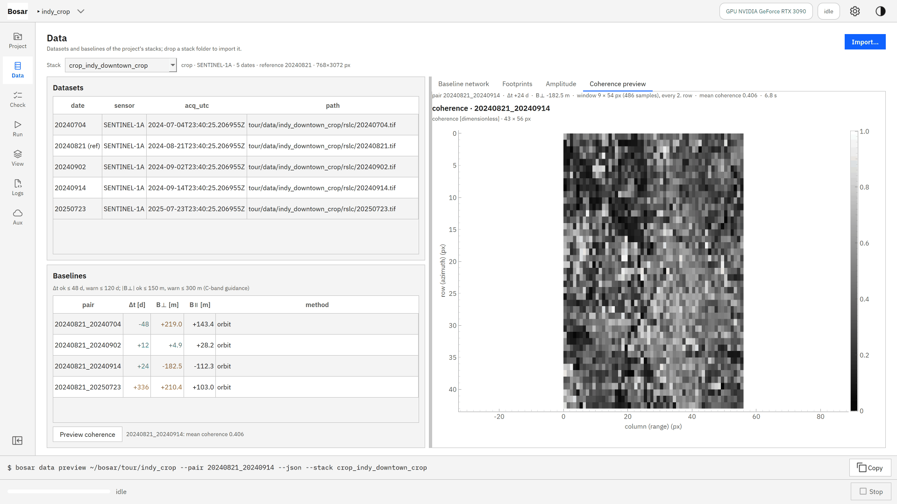</picture>](project_data.md)

## [System check](system_check.md)

Preflight table: Python, GPU, SNAPHU, SNAP, credentials, read-only data roots.

[<picture><source media="(prefers-color-scheme: dark)" srcset="../assets/tour/system_check/01_preflight_dark.png">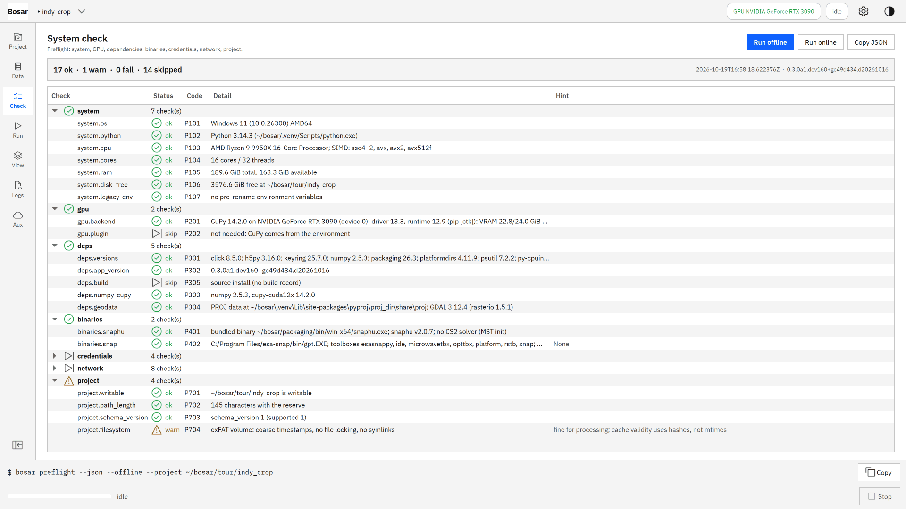</picture>](system_check.md)

## [DInSAR](dinsar.md)

Choose a pair, set the parameters, run, read the LOS displacement on the map.

[<picture><source media="(prefers-color-scheme: dark)" srcset="../assets/tour/dinsar/04_result_dark.png">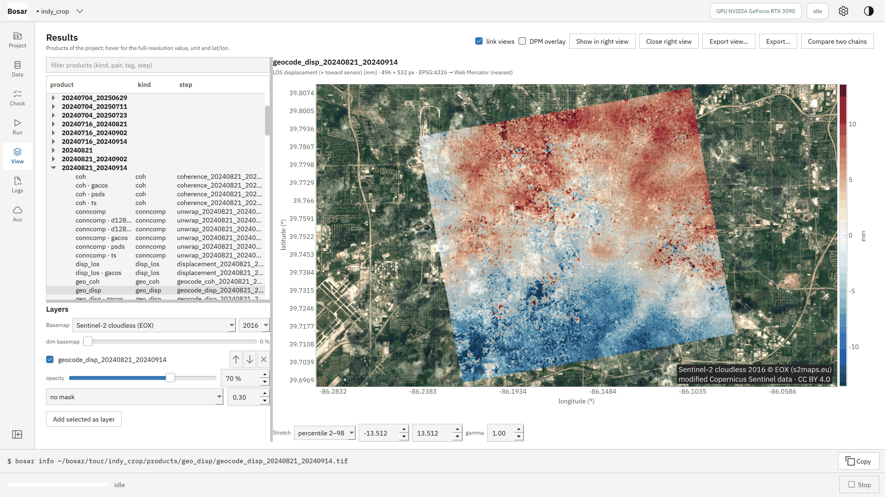</picture>](dinsar.md)

## [GACOS correction](gacos.md)

What is missing, the run with --tropo gacos, displacement before and after.

[<picture><source media="(prefers-color-scheme: dark)" srcset="../assets/tour/gacos/04_before_after_dark.png">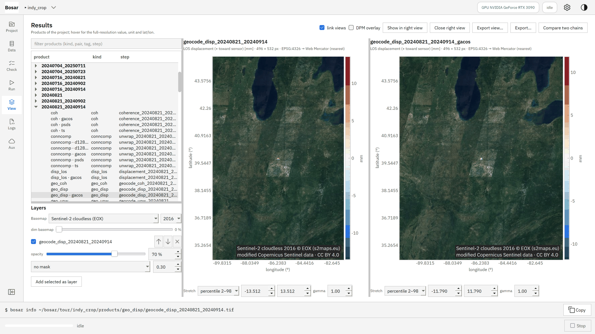</picture>](gacos.md)

## [Coherence change detection](ccd.md)

Pre- and co-event pairs, the run, the damage proxy map over satellite imagery.

[<picture><source media="(prefers-color-scheme: dark)" srcset="../assets/tour/ccd/03_dpm_dark.png">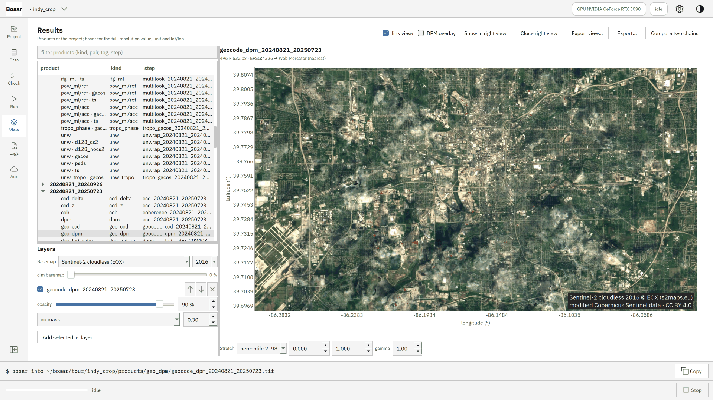</picture>](ccd.md)

## [Amplitude change](amplitude.md)

Log-ratio and pre/post RGB composite over the basemap.

[<picture><source media="(prefers-color-scheme: dark)" srcset="../assets/tour/amplitude/03_rgb_dark.png">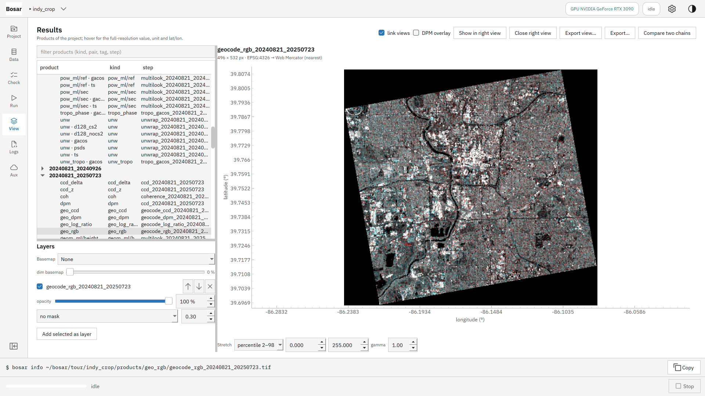</picture>](amplitude.md)

## [Result viewer](viewer.md)

Basemaps, layer opacity and masks, stretch, linked views, figure export, two chains compared.

[<picture><source media="(prefers-color-scheme: dark)" srcset="../assets/tour/viewer/02_satellite_mask_dark.png">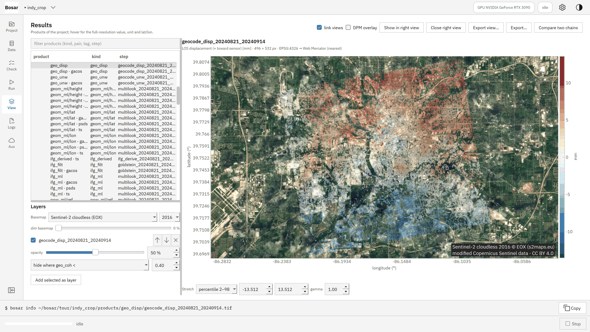</picture>](viewer.md)

## [SBAS preparation](sbas_prep.md)

Network designer, derived pairs, batch unwrapping, closure maps.

[<picture><source media="(prefers-color-scheme: dark)" srcset="../assets/tour/sbas_prep/03_closure_dark.png">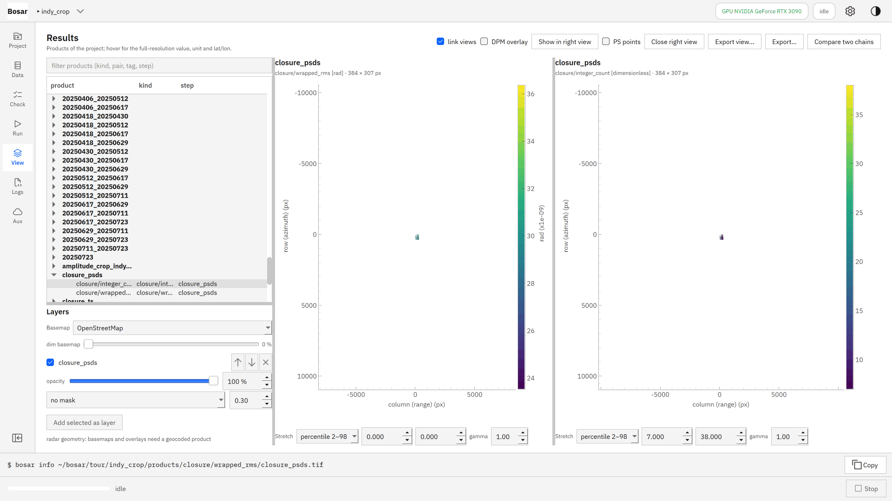</picture>](sbas_prep.md)

## [SBAS time series](sbas_ts.md)

Velocity and temporal coherence; click a pixel for its displacement history.

[<picture><source media="(prefers-color-scheme: dark)" srcset="../assets/tour/sbas_ts/03_time_series_dark.png">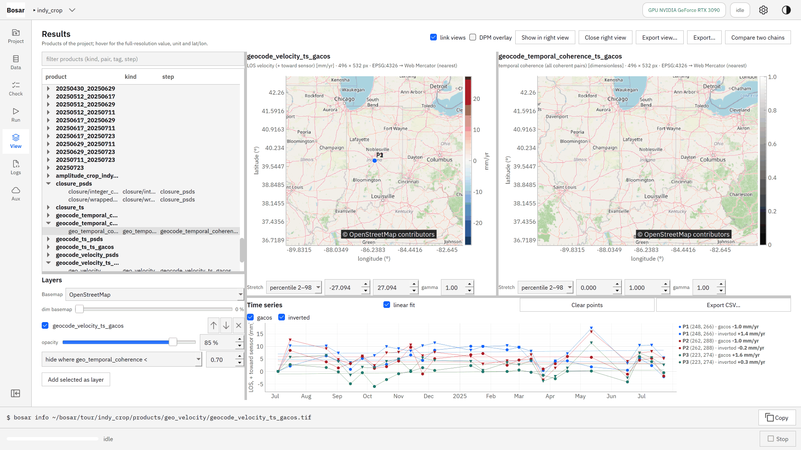</picture>](sbas_ts.md)

## [PS / DS time series](psds.md)

Phase linking of distributed scatterers plus persistent scatterers: several times the coverage of multilooked SBAS, with a quality verdict.

[<picture><source media="(prefers-color-scheme: dark)" srcset="../assets/tour/psds/04_result_dark.png">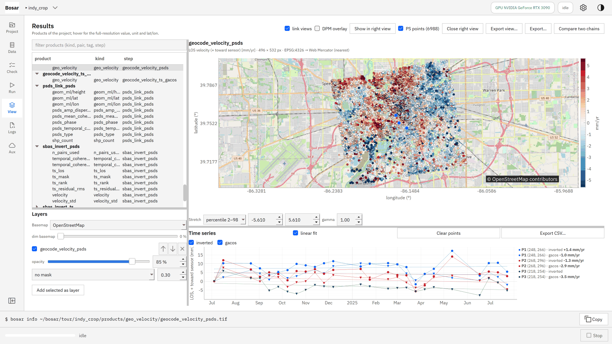</picture>](psds.md)

## [Classic PS-InSAR](psi.md)

The periodogram chain (amplitude dispersion, arcs, APS) as a workflow of the Run page; its GeoPackage is a point layer of the Results page.

[<picture><source media="(prefers-color-scheme: dark)" srcset="../assets/tour/psi/01_run_dark.png">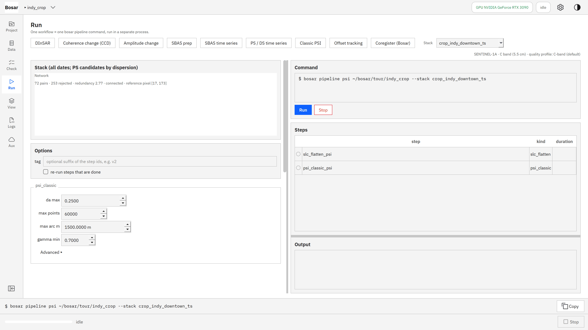</picture>](psi.md)

## [SNAP bridge](snap_bridge.md)

Preprocess raw Sentinel-1 zips with SNAP as the engine, import, process.

[<picture><source media="(prefers-color-scheme: dark)" srcset="../assets/tour/snap_bridge/03_result_dark.png">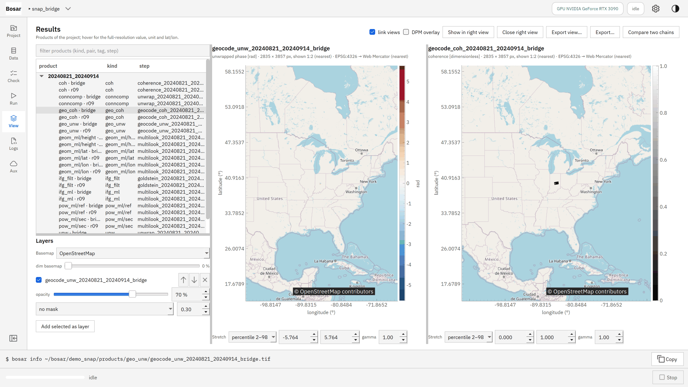</picture>](snap_bridge.md)

## [SLC download](fetch_slc.md)

Search Sentinel-1 scenes at ASF by the stack's track and frame or an AOI; a dry run, then a resumable, verified download that keeps running after the session.

[<picture><source media="(prefers-color-scheme: dark)" srcset="../assets/tour/fetch_slc/01_card_dark.png">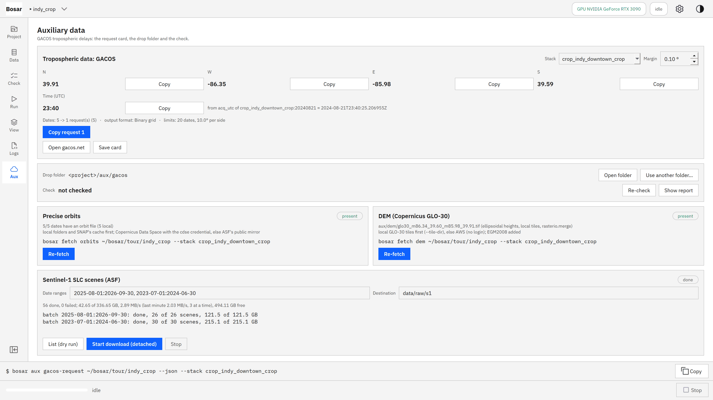</picture>](fetch_slc.md)

## [Logs and failures](logs.md)

Every run with its UTC-stamped records; a failure card says what, where and how.

[<picture><source media="(prefers-color-scheme: dark)" srcset="../assets/tour/logs/02_failure_dark.png">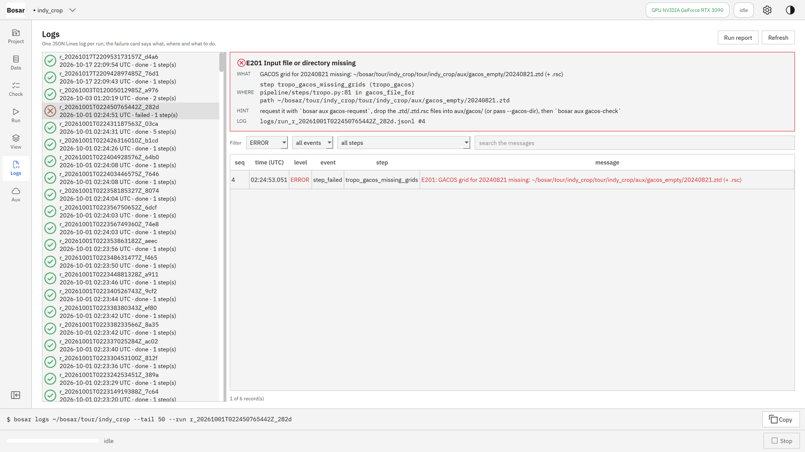</picture>](logs.md)

## [Settings](settings.md)

Theme, language, compute device, credentials, data roots.

[<picture><source media="(prefers-color-scheme: dark)" srcset="../assets/tour/settings/01_settings_dark.png">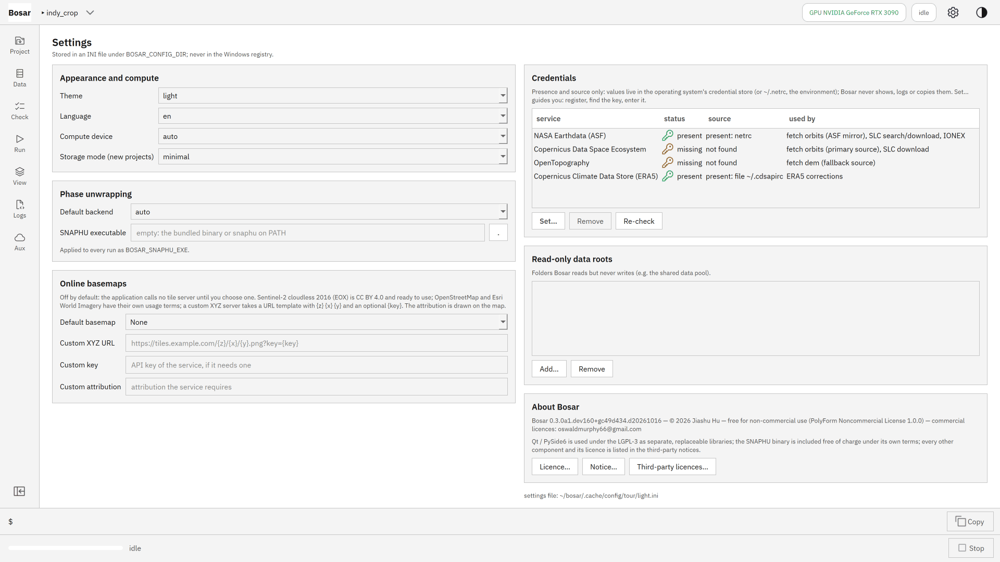</picture>](settings.md)

## [Native Sentinel-1](native_s1.md)

From raw Sentinel-1 zips to a coregistered stack without SNAP - bursts, deramp, geometric coregistration, ESD, calibration, sub-swath merge - and a multi-year PS / DS time series on it.

[<picture><source media="(prefers-color-scheme: dark)" srcset="../assets/tour/native_s1/04_multi_year_dark.png">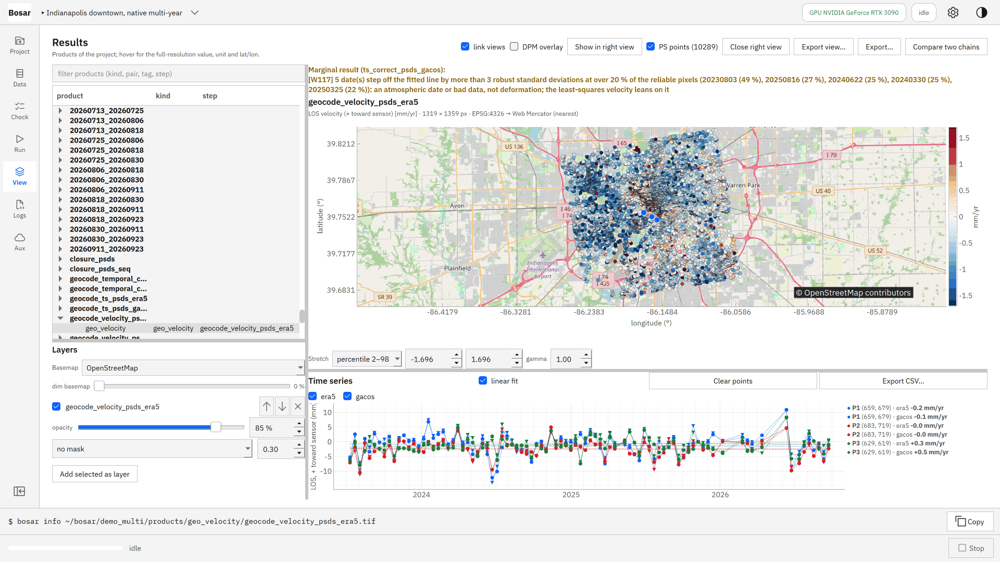</picture>](native_s1.md)

## [More sensors](sensors.md)

ALOS-1 PALSAR (L band), ENVISAT ASAR and ERS-1/2 through the stripmap chain: the stack with its sensor, the L-band quality profile, a Mexico City interferogram of each.

[<picture><source media="(prefers-color-scheme: dark)" srcset="../assets/tour/sensors/03_alos_pair_dark.png">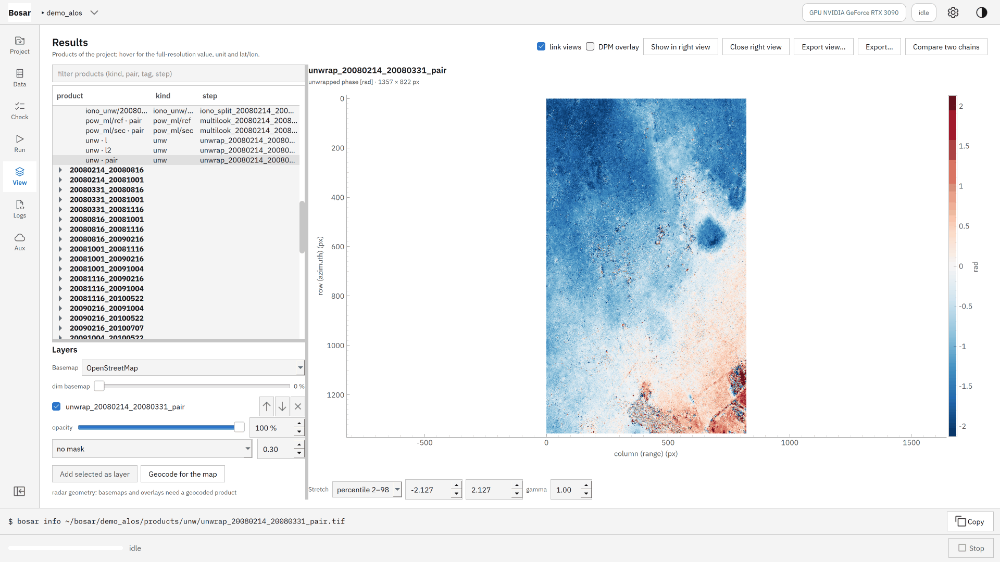</picture>](sensors.md)

## Installer (planned)

Windows .exe and macOS .dmg installers from the Releases page; the GPU as a plug-in.
