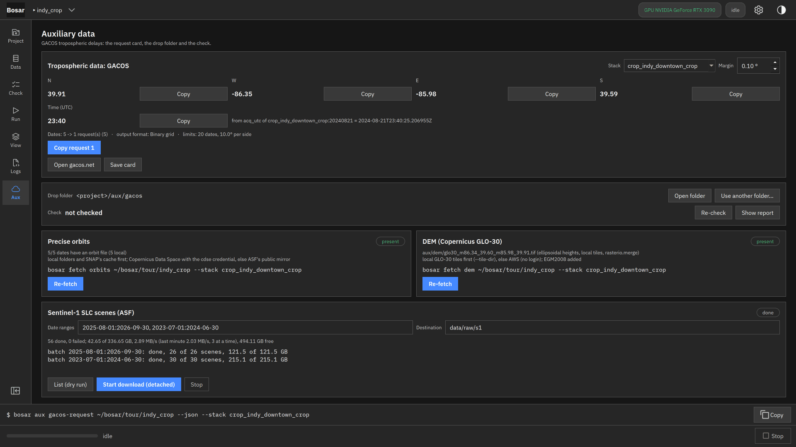

# SLC download

Search Sentinel-1 scenes at ASF by the stack's track and frame or an AOI; a dry run, then a resumable, verified download that keeps running after the session.

Built in v0.3.0. [Back to the tour](README.md)

The screenshots at 4K, the where-to-click animations and the DInSAR recording are in `bosar-tour-4k.zip` under [Releases](https://github.com/HU-Jiashu/bosar/releases); the pages show the same screenshots at 1080p.

## Result

<picture><source media="(prefers-color-scheme: dark)" srcset="../assets/tour/fetch_slc/01_card_dark.png"></picture>

## Step by step

### 1. Sentinel-1 SLC scenes (ASF): the stack's relative orbit, frame and footprint pick the scenes of each date range; a dry run lists them with their sizes, the download resumes, verifies size and MD5, writes a provenance file per scene, stops below the free-space guard and keeps running after the session (`bosar fetch status`).

```bash
bosar fetch slc tour/indy_crop --range 2025-08-01:2026-09-30 --range 2023-07-01:2024-06-30 --dest data/raw/s1 --dry-run
```


<details><summary>dark theme</summary>



</details>
