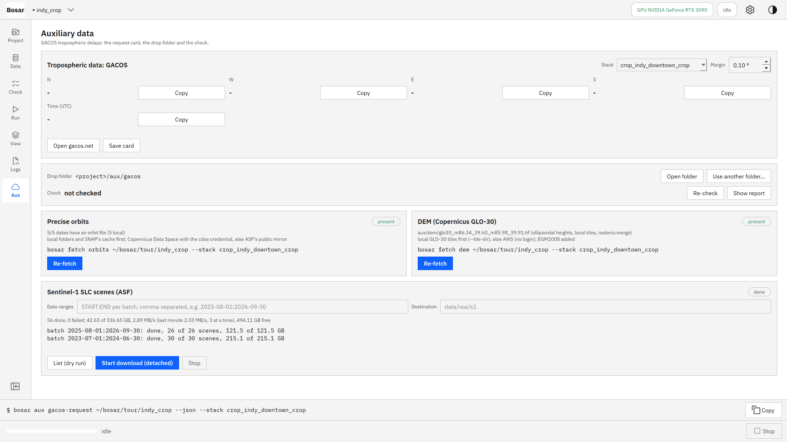
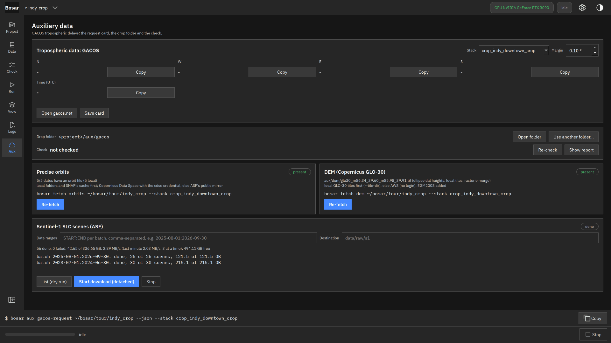
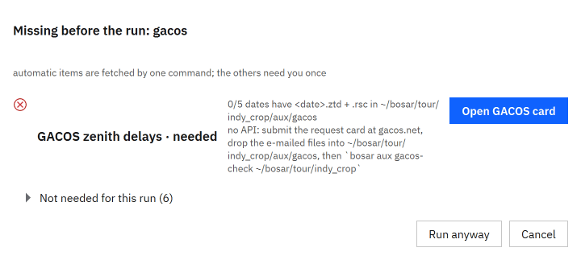
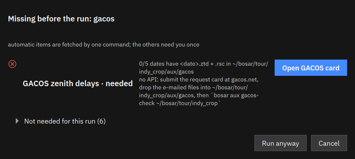
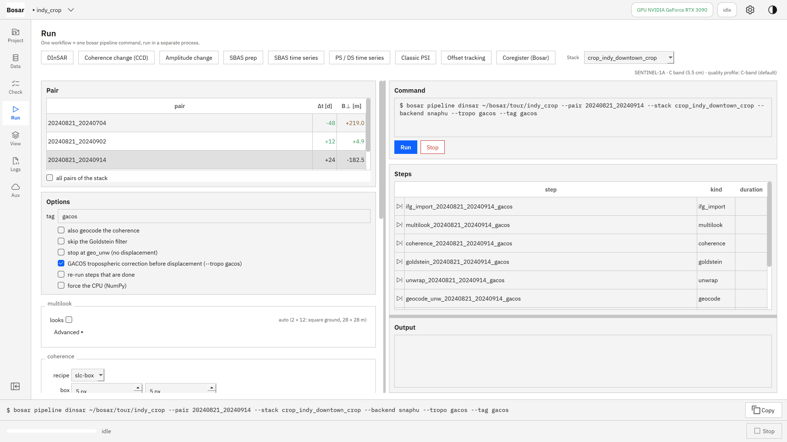
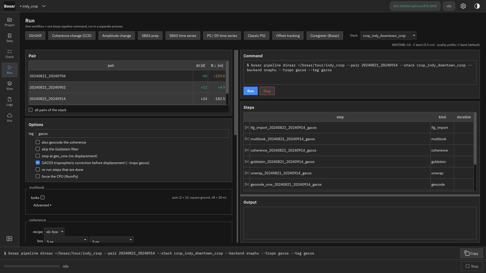
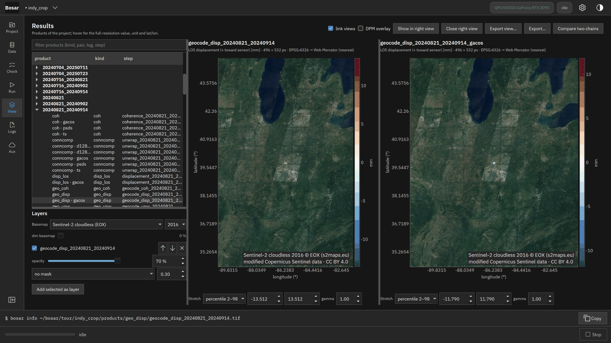

# GACOS correction

What is missing, the run with --tropo gacos, displacement before and after.

Built in v0.2.0. [Back to the tour](README.md)

The screenshots at 4K, the where-to-click animations and the DInSAR recording are in `bosar-tour-4k.zip` under [Releases](https://github.com/HU-Jiashu/bosar/releases); the pages show the same screenshots at 1080p.

## Result

<picture><source media="(prefers-color-scheme: dark)" srcset="../assets/tour/gacos/04_before_after_dark.png"></picture>

## Step by step

### 1. Aux page: what the project has - orbits, DEM, GACOS grids - and where each came from.

```bash
bosar aux status tour/indy_crop
```



<details><summary>dark theme</summary>



</details>

### 2. Before a run the assistant lists only what this run needs, what is automatic and what needs you (the GACOS request).

```bash
bosar aux status tour/indy_crop --for dinsar+gacos
```



<details><summary>dark theme</summary>



</details>

### 3. Tick the GACOS correction: the tropo_gacos step joins the chain before the displacement.

```bash
bosar pipeline dinsar tour/indy_crop --stack crop_indy_downtown_crop --pair 20240821_20240914 --tropo gacos --tag gacos
```



<details><summary>dark theme</summary>



</details>

### 4. Left without, right with the GACOS correction, the two views linked.

```bash
bosar gui tour/indy_crop
```


<details><summary>dark theme</summary>



</details>
