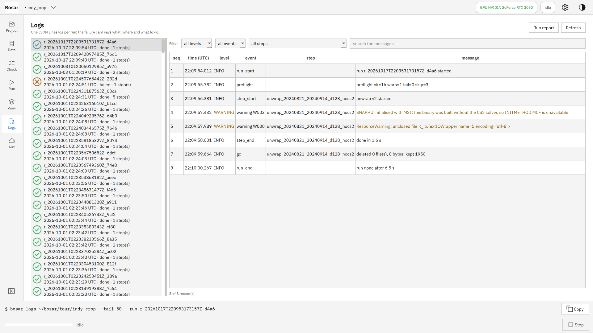
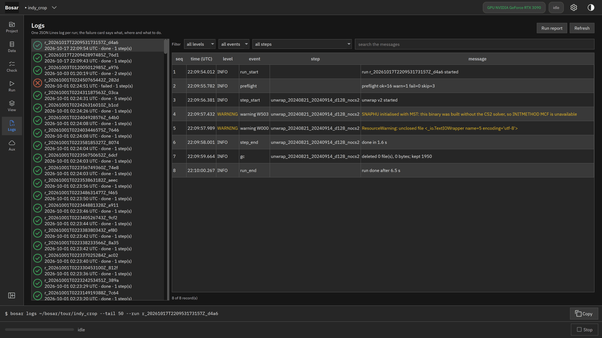

# Logs and failures

Every run with its UTC-stamped records; a failure card says what, where and how.

Built in v0.1.0. [Back to the tour](README.md)

The screenshots at 4K, the where-to-click animations and the DInSAR recording are in `bosar-tour-4k.zip` under [Releases](https://github.com/HU-Jiashu/bosar/releases); the pages show the same screenshots at 1080p.

## Result

<picture><source media="(prefers-color-scheme: dark)" srcset="../assets/tour/logs/02_failure_dark.png"></picture>

## Step by step

### 1. Logs page: every run with its records - UTC timestamps, step, level, parameters, inputs, outputs, durations.

```bash
bosar logs tour/indy_crop --tail 3
```



<details><summary>dark theme</summary>



</details>

### 2. A failed step shows a card: the error code, what was wrong, where, and the hint for fixing it.

```bash
bosar logs tour/indy_crop --level ERROR
```


<details><summary>dark theme</summary>


</details>
