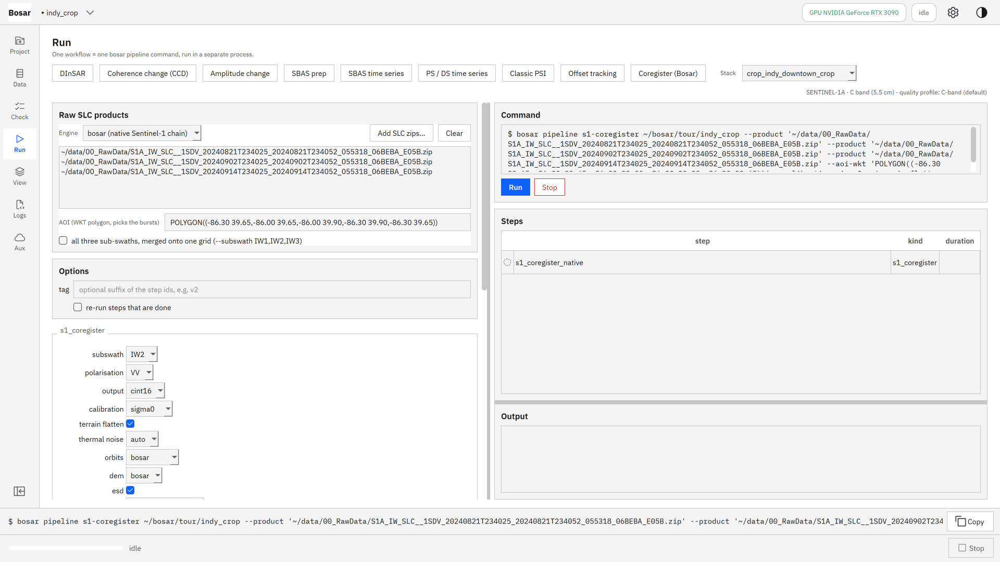
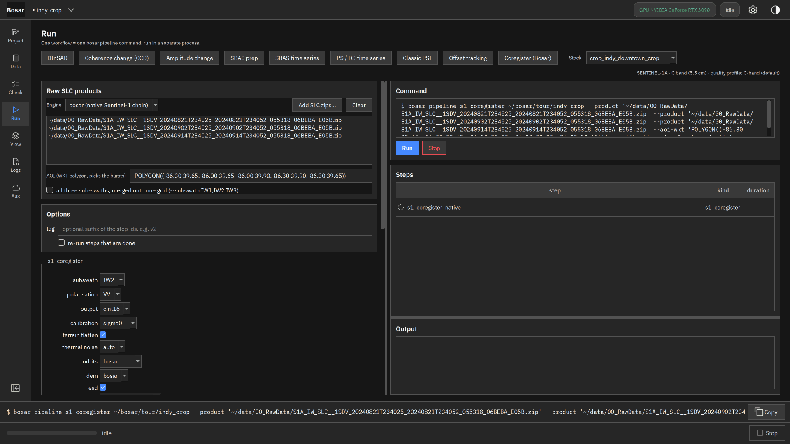
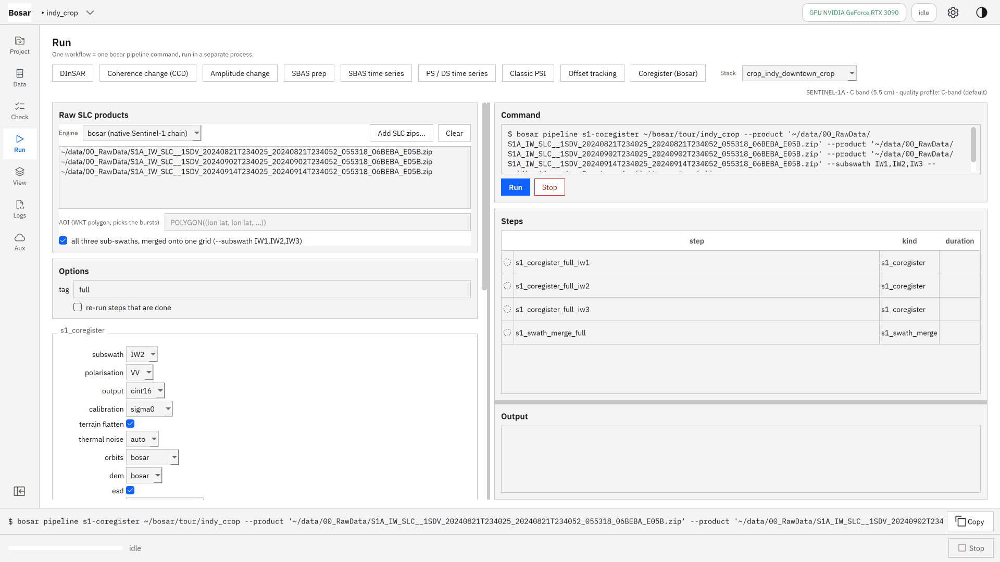
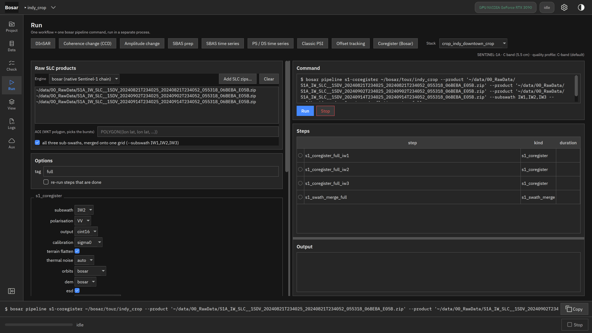
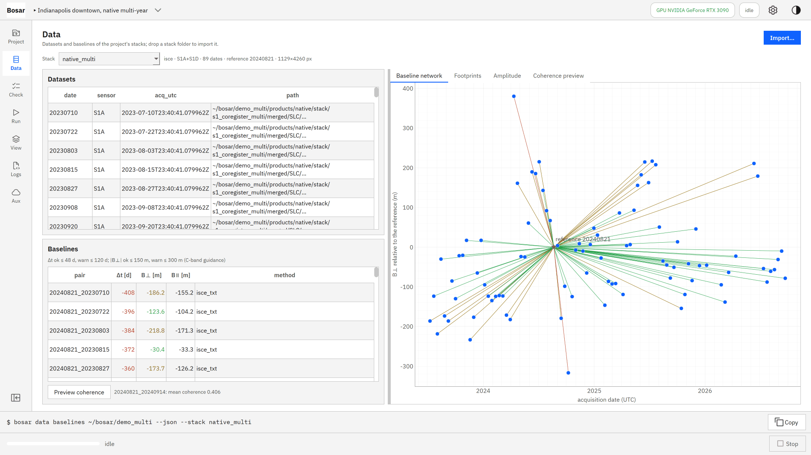
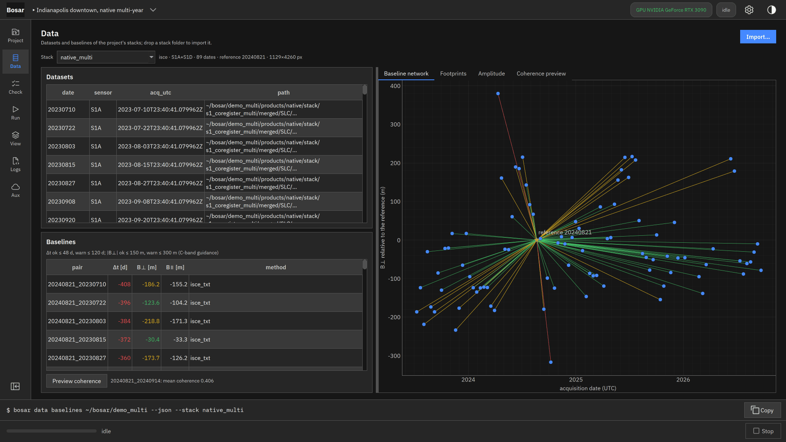
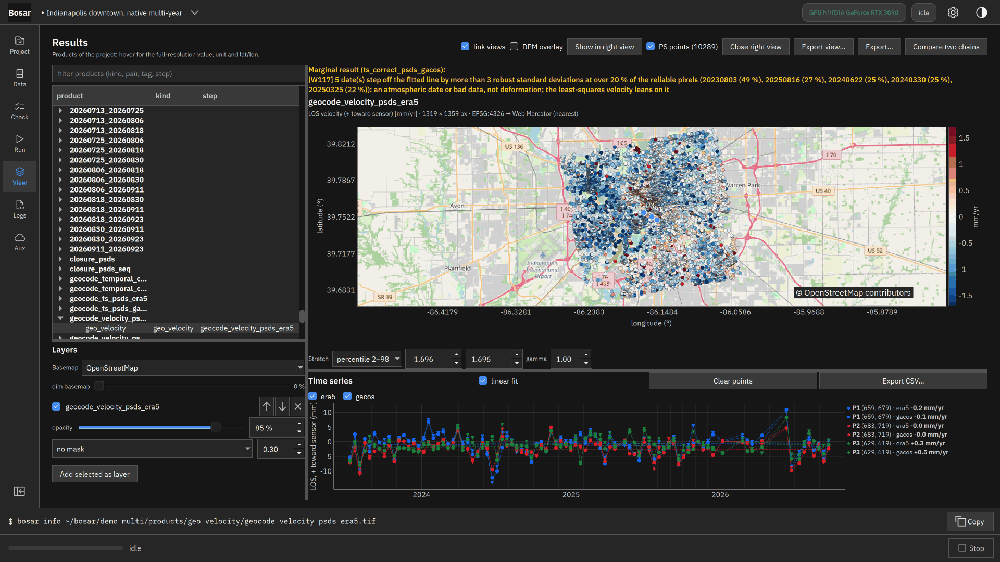

# Native Sentinel-1

From raw Sentinel-1 zips to a coregistered stack without SNAP - bursts, deramp, geometric coregistration, ESD, calibration, sub-swath merge - and a multi-year PS / DS time series on it.

Built in v0.3.0. [Back to the tour](README.md)

The screenshots at 4K, the where-to-click animations and the DInSAR recording are in `bosar-tour-4k.zip` under [Releases](https://github.com/HU-Jiashu/bosar/releases); the pages show the same screenshots at 1080p.

## Result

<picture><source media="(prefers-color-scheme: dark)" srcset="../assets/tour/native_s1/04_multi_year_dark.png"></picture>

## Step by step

### 1. Coregister (Bosar): the native chain from raw zips - burst models from the annotation, precise orbits and the DEM for the offsets, deramp, sinc resampling, reramp, a range check, enhanced spectral diversity, deburst. Calibrated sigma nought and terrain-flattened gamma nought are written as extra layers; a re-run with more zips coregisters the new dates only.

```bash
bosar pipeline s1-coregister <project> --product <S1 zip> … --subswath IW2 --aoi-wkt "POLYGON((…))" --calibration sigma0 --terrain-flatten
```



<details><summary>dark theme</summary>



</details>

### 2. All three sub-swaths: each is coregistered, then merged onto one range / azimuth grid with the cut in the middle of each overlap; the seam check reports the phase and amplitude step across every cut.

```bash
bosar pipeline s1-coregister <project> --product <S1 zip> … --subswath IW1,IW2,IW3 --tag full
```



<details><summary>dark theme</summary>



</details>

### 3. The multi-year stack the native chain wrote (CINT16, ISCE layout), imported like any other: Sentinel-1A and Sentinel-1D dates on one reference grid.

```bash
bosar pipeline s1-coregister <project> --products-from <folder> --crop-wkt "POLYGON((…))" --tag multi
```



<details><summary>dark theme</summary>



</details>

### 4. Two years of downtown Indianapolis from the native stack (52 dates, Sentinel-1A and 1D): PS / DS velocity with the persistent scatterers as points and the displacement history of the clicked pixels. Nothing moves beyond the noise (1.4 mm/yr spread against 1.1 expected from the span); the red block west of the river is an unwrapping artefact across the coherence gap - the classic PSI chain does not show it.

```bash
bosar pipeline psds <project> --stack native_multi --tropo era5 --no-correct --keep-unclosed
```


<details><summary>dark theme</summary>



</details>
