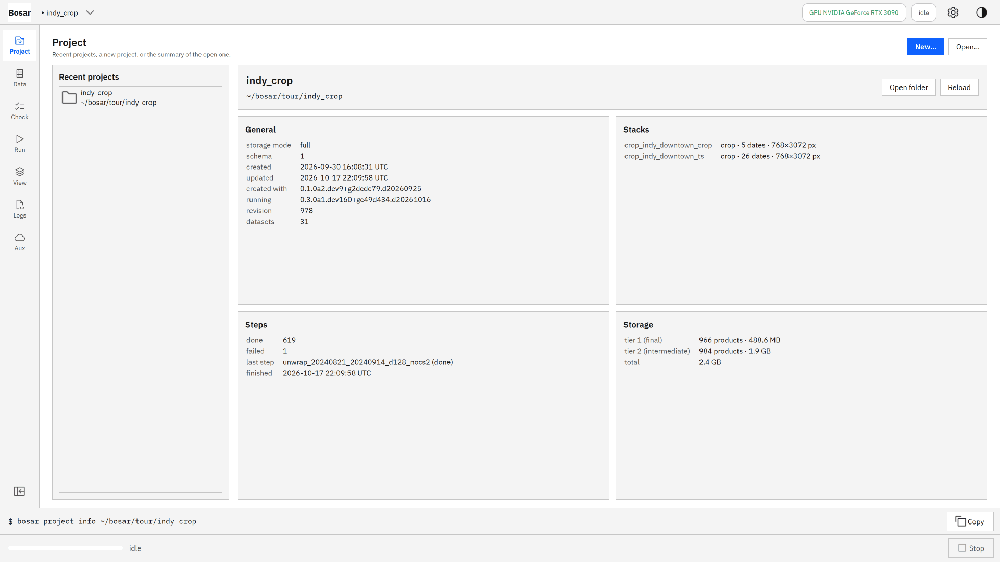
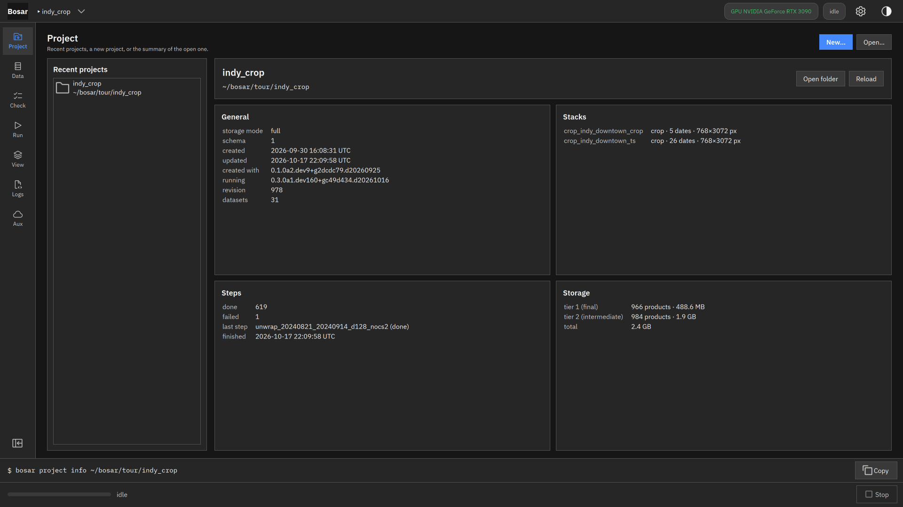
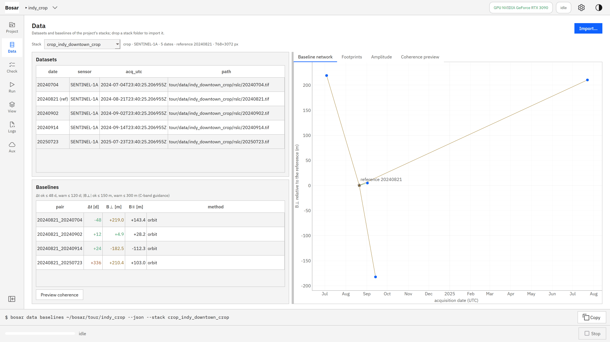
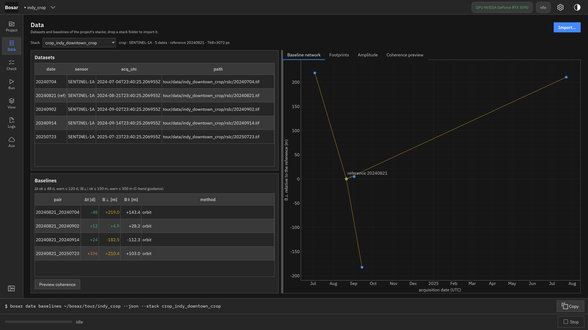
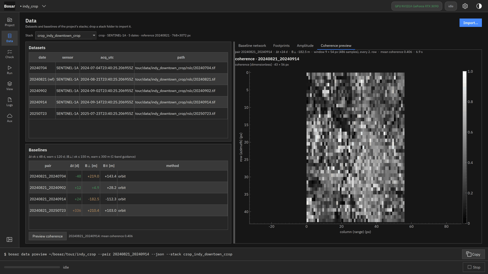

# Project and data

Create a project, import a stack, look at dates, baselines and a coherence preview.

Built in v0.1.0. [Back to the tour](README.md)

The screenshots at 4K, the where-to-click animations and the DInSAR recording are in `bosar-tour-4k.zip` under [Releases](https://github.com/HU-Jiashu/bosar/releases); the pages show the same screenshots at 1080p.

## Result

<picture><source media="(prefers-color-scheme: dark)" srcset="../assets/tour/project_data/03_preview_dark.png"></picture>

## Step by step

### 1. Open or create a project: its folder holds the products, the logs and project.json.

```bash
bosar project new tour/indy_crop --name indy_crop
```



<details><summary>dark theme</summary>



</details>

### 2. Import a stack (GAMMA/StaMPS export, SAFE, BEAM-DIMAP or a crop): dates, geometry and the baseline plot.

```bash
bosar data import tour/indy_crop data/indy_downtown_crop
```



<details><summary>dark theme</summary>



</details>

### 3. A quick coherence preview of a pair tells whether it is worth processing.

```bash
bosar data preview tour/indy_crop --pair 20240821_20240914
```


<details><summary>dark theme</summary>



</details>
