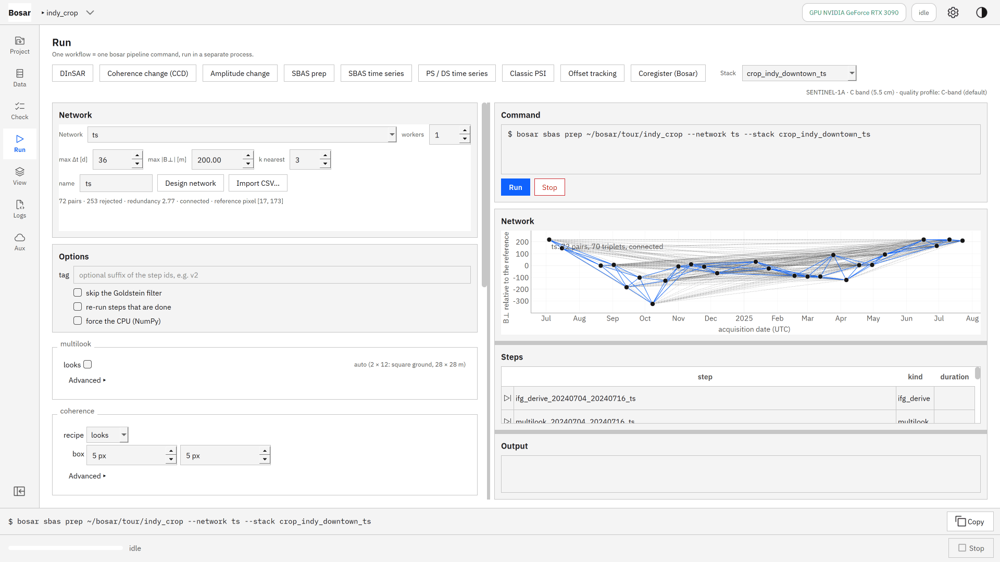
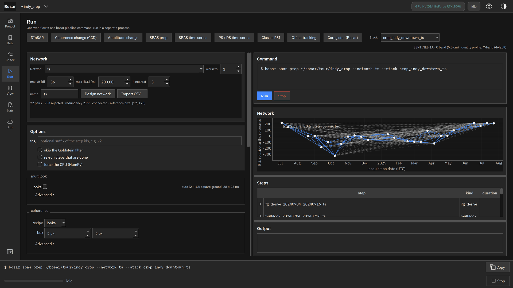
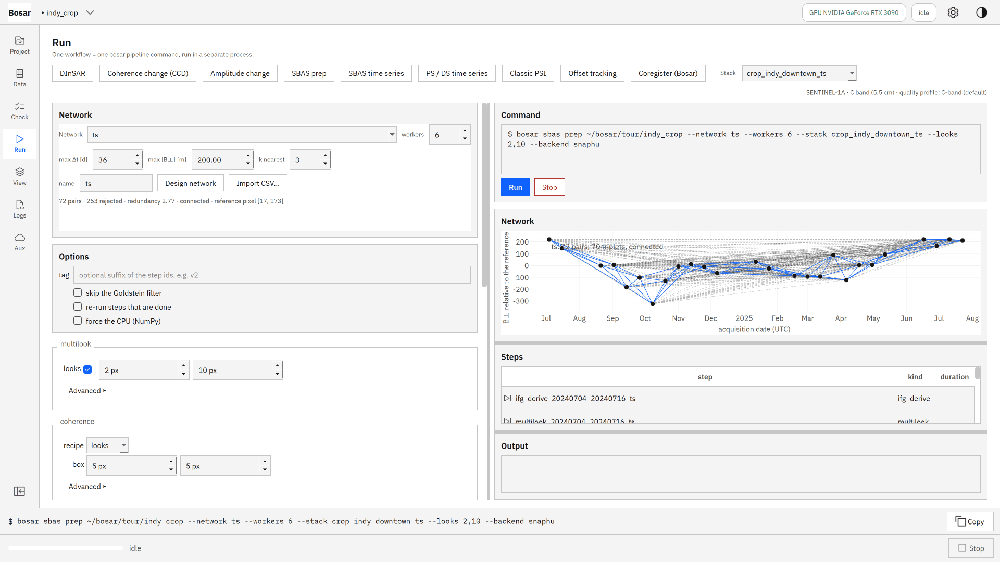
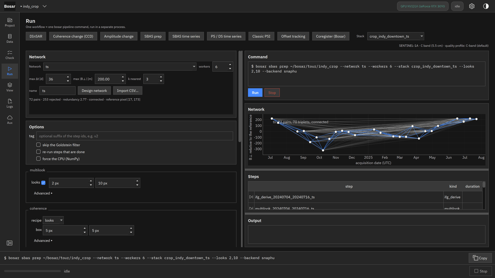
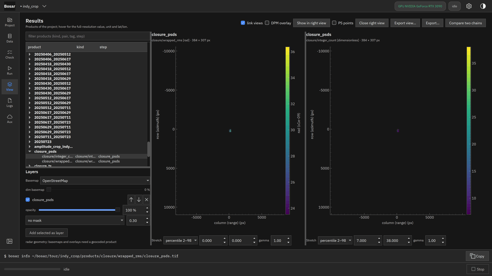

# SBAS preparation

Network designer, derived pairs, batch unwrapping, closure maps.

Built in v0.2.0. [Back to the tour](README.md)

The screenshots at 4K, the where-to-click animations and the DInSAR recording are in `bosar-tour-4k.zip` under [Releases](https://github.com/HU-Jiashu/bosar/releases); the pages show the same screenshots at 1080p.

## Result

<picture><source media="(prefers-color-scheme: dark)" srcset="../assets/tour/sbas_prep/03_closure_dark.png"></picture>

## Step by step

### 1. SBAS prep: design the network (temporal and perpendicular baseline limits plus sequential links) or import a CSV; the plot shows the selected pairs.

```bash
bosar sbas network tour/indy_crop --stack crop_indy_downtown_ts --name ts --max-dt 36 --max-bperp 200 --k 3
```



<details><summary>dark theme</summary>



</details>

### 2. One command derives every pair from the star stack, multilooks, estimates coherence, picks a common reference pixel, unwraps and checks triplet closure - resumable, in parallel workers.

```bash
bosar sbas prep tour/indy_crop --network ts --looks 2,10 --backend snaphu --workers 6
```



<details><summary>dark theme</summary>



</details>

### 3. Closure maps: RMS of the wrapped closure (phase bias) and the number of triplets that do not close (unwrapping errors).

```bash
bosar sbas prep tour/indy_crop --network ts --looks 2,10 --backend snaphu --workers 6
```


<details><summary>dark theme</summary>



</details>
