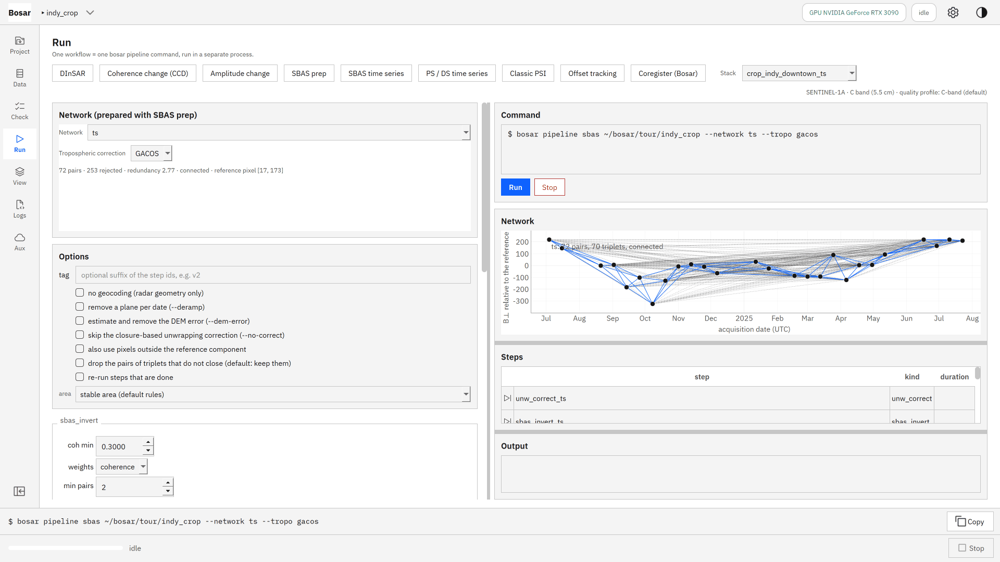
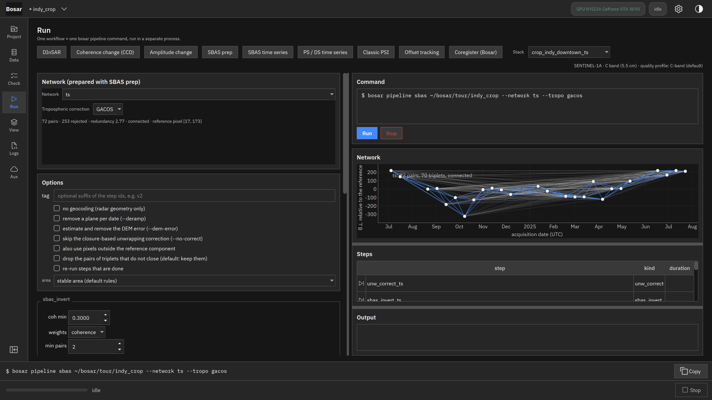
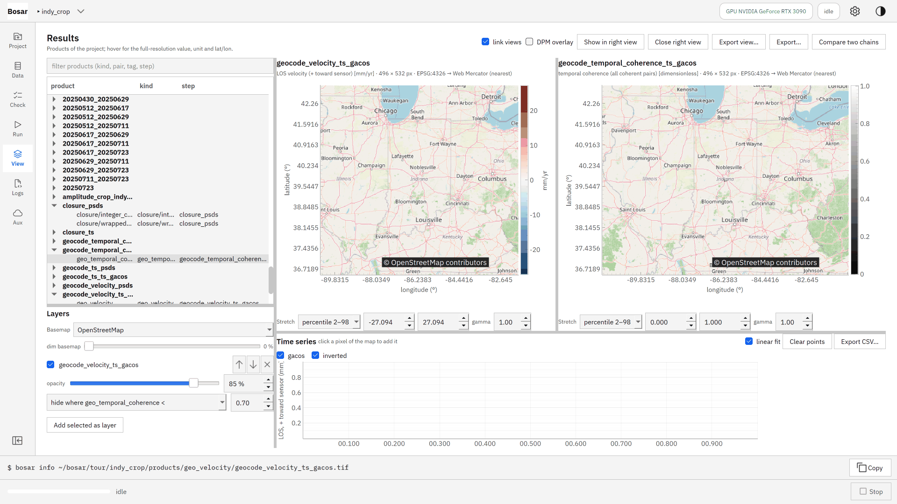
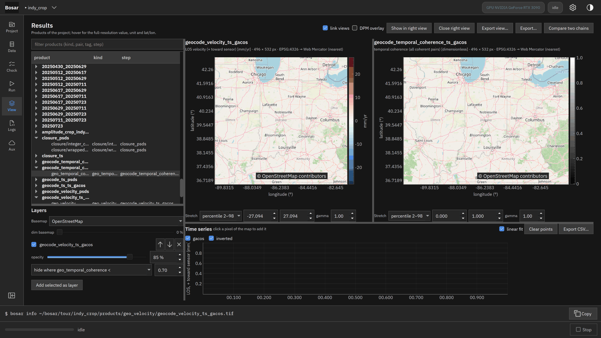
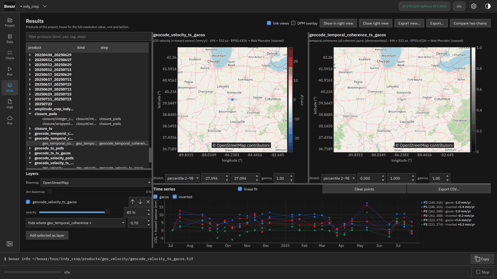
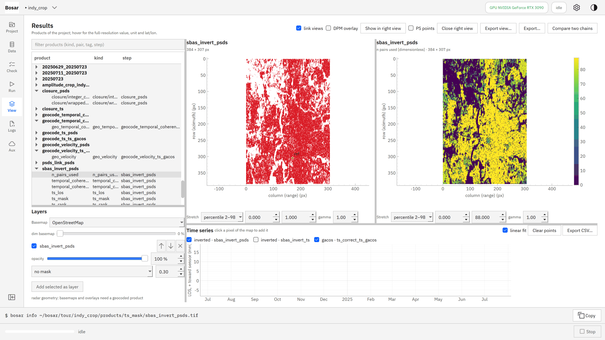
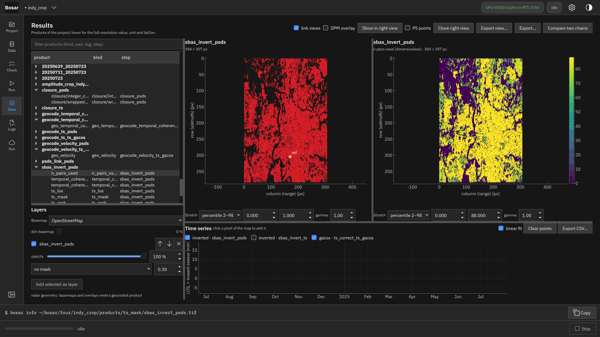

# SBAS time series

Velocity and temporal coherence; click a pixel for its displacement history.

Built in v0.2.0. [Back to the tour](README.md)

The screenshots at 4K, the where-to-click animations and the DInSAR recording are in `bosar-tour-4k.zip` under [Releases](https://github.com/HU-Jiashu/bosar/releases); the pages show the same screenshots at 1080p.

## Result

<picture><source media="(prefers-color-scheme: dark)" srcset="../assets/tour/sbas_ts/03_time_series_dark.png"></picture>

## Step by step

### 1. SBAS time series of a prepared network: closure-based unwrapping correction, pixel-wise inversion, tropospheric correction, geocoding.

```bash
bosar pipeline sbas tour/indy_crop --network ts --tropo gacos
```



<details><summary>dark theme</summary>



</details>

### 2. LOS velocity in mm/yr (left, hidden where the temporal coherence is below 0.7) and the temporal coherence (right).

```bash
bosar pipeline sbas tour/indy_crop --network ts --tropo gacos
```



<details><summary>dark theme</summary>



</details>

### 3. Click pixels: their LOS displacement history in mm with the linear fit and rate; toggle the corrections, export the curves as CSV.

```bash
bosar gui tour/indy_crop
```


<details><summary>dark theme</summary>



</details>

### 4. Quality layers in radar geometry: the mask of pixels with a connected network and good temporal coherence, and the number of pairs each pixel used after the coherence, component and closure rules.

```bash
bosar pipeline sbas tour/indy_crop --network ts --tropo gacos
```



<details><summary>dark theme</summary>



</details>
