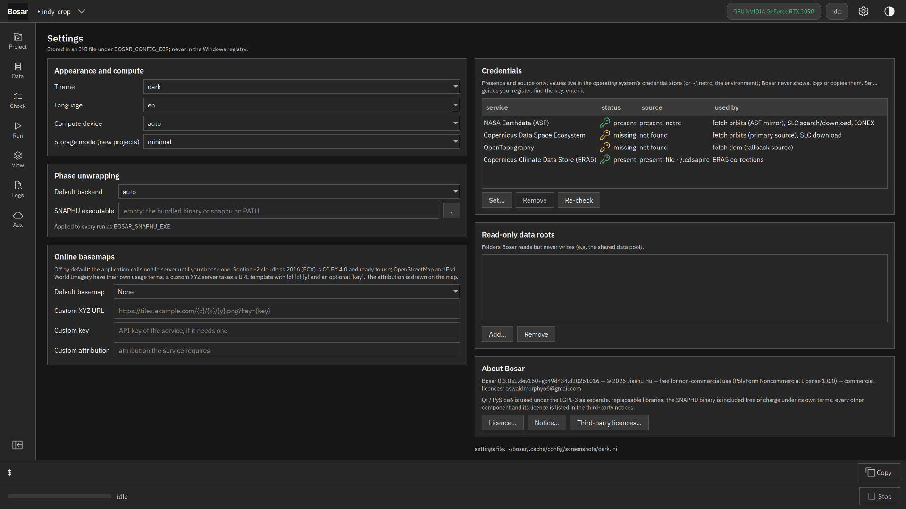
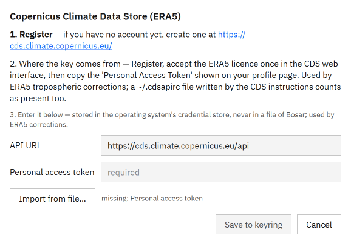
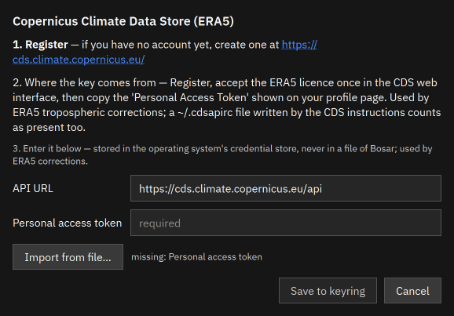

# Settings

Theme, language, compute device, credentials, data roots.

Built in v0.1.0. [Back to the tour](README.md)

The screenshots at 4K, the where-to-click animations and the DInSAR recording are in `bosar-tour-4k.zip` under [Releases](https://github.com/HU-Jiashu/bosar/releases); the pages show the same screenshots at 1080p.

## Result

<picture><source media="(prefers-color-scheme: dark)" srcset="../assets/tour/settings/01_settings_dark.png"></picture>

## Step by step

### 1. Settings: theme (light, dark, system), language, compute device, storage mode, SNAPHU binary, basemap URL, data roots.

```bash
bosar gui
```


<details><summary>dark theme</summary>



</details>

### 2. A guided dialog per service: where to register, where to find the key, fill in or import from a file. Values go to the system keyring, never to a log.

```bash
bosar auth set cds
```



<details><summary>dark theme</summary>



</details>
