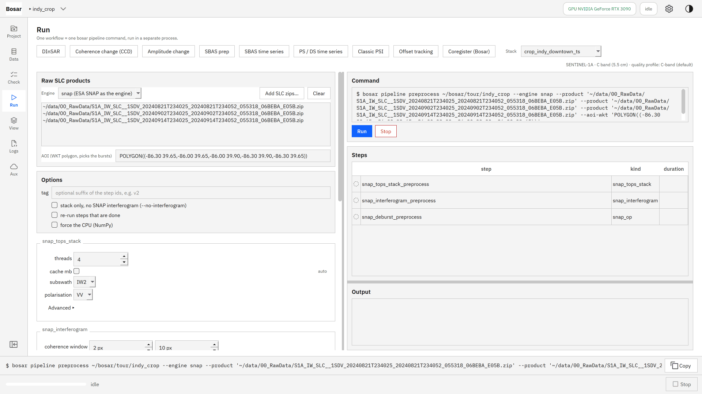
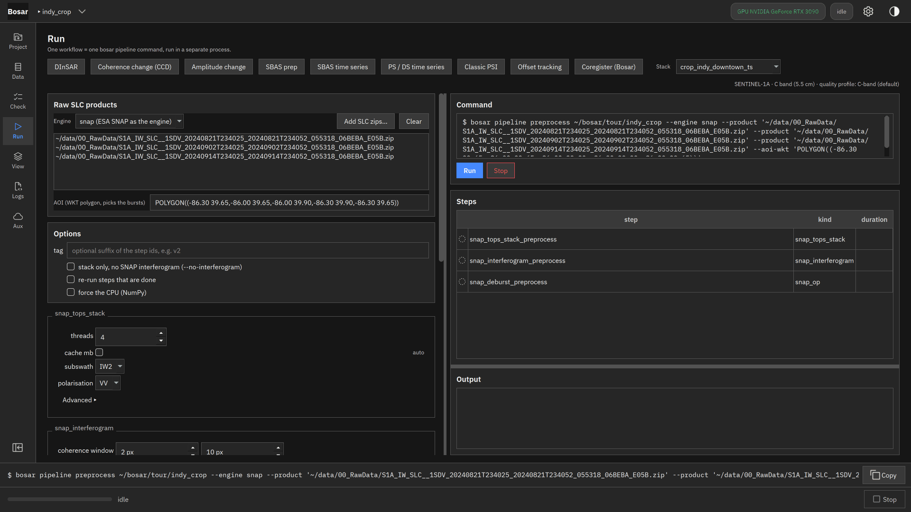
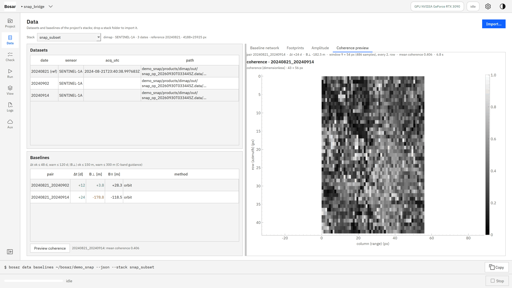
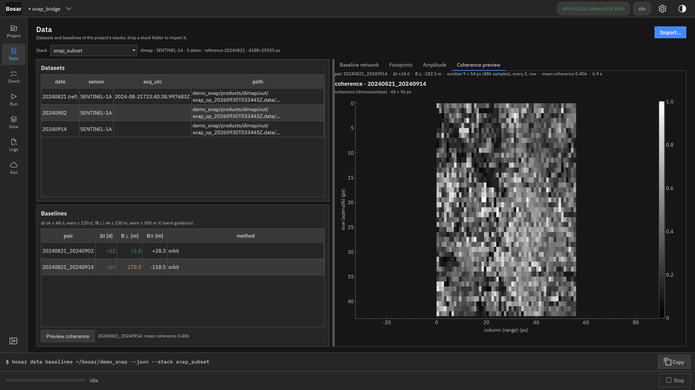
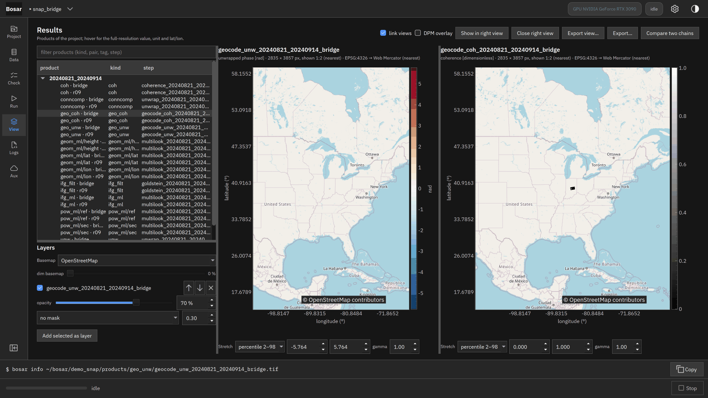

# SNAP bridge

Preprocess raw Sentinel-1 zips with SNAP as the engine, import, process.

Built in v0.2.0. [Back to the tour](README.md)

The screenshots at 4K, the where-to-click animations and the DInSAR recording are in `bosar-tour-4k.zip` under [Releases](https://github.com/HU-Jiashu/bosar/releases); the pages show the same screenshots at 1080p.

## Result

<picture><source media="(prefers-color-scheme: dark)" srcset="../assets/tour/snap_bridge/03_result_dark.png"></picture>

## Step by step

### 1. Coregister with the engine set to snap: raw Sentinel-1 zips, sub-swath and an AOI that picks the bursts. SNAP's gpt runs as a separate program with Bosar's orbits and DEM; everything it writes stays in the project.

```bash
bosar pipeline preprocess <project> --engine snap --product <S1 zip> … --subswath IW2 --aoi-wkt "POLYGON((…))"
```



<details><summary>dark theme</summary>



</details>

### 2. The coregistered stack and its interferograms are imported as a BEAM-DIMAP stack; from here every workflow runs on it.

```bash
bosar data import <project> <stack.dim> --reader dimap --ifg-dim <ifg.dim>
```



<details><summary>dark theme</summary>



</details>

### 3. DInSAR on the SNAP-preprocessed subset: unwrapped phase and coherence over the DEM box.

```bash
bosar pipeline dinsar <project> --stack snap_subset --pair 20240821_20240914
```


<details><summary>dark theme</summary>



</details>
