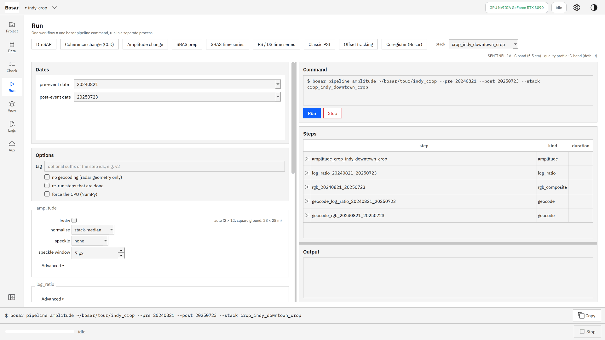
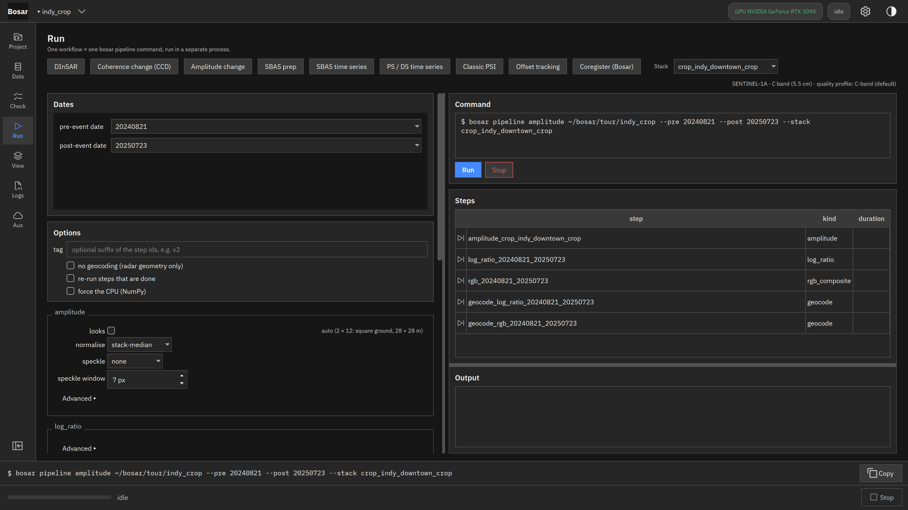
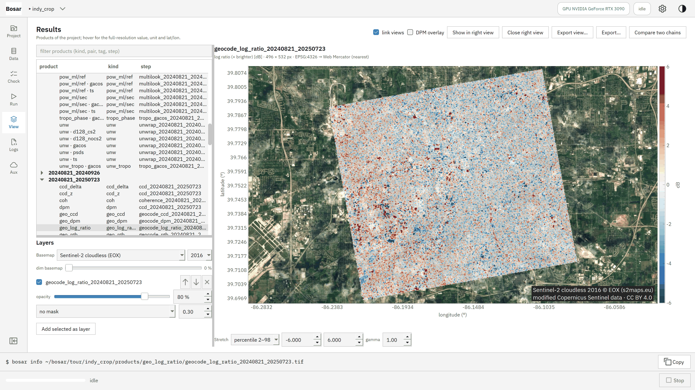
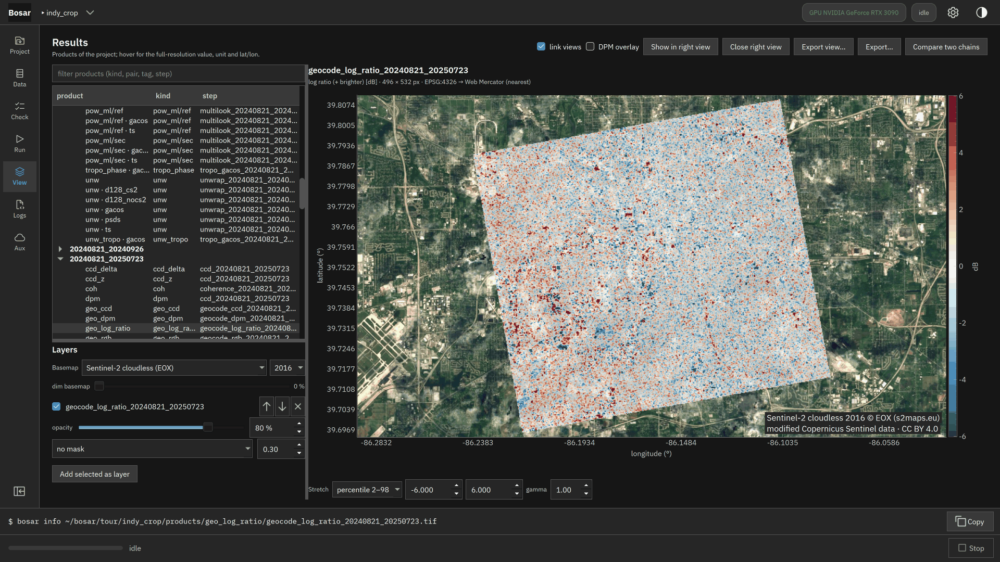
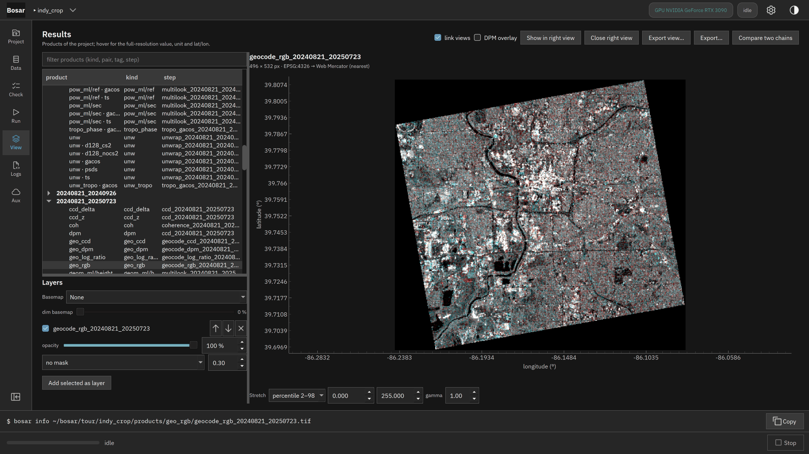

# 幅度变化

对数比值和前后 RGB 合成，叠在底图上。

构建于 v0.1.0。[返回导览](README.md)

4K 截图、点击位置动画和 DInSAR 录屏在 [Releases](https://github.com/HU-Jiashu/bosar/releases) 的 `bosar-tour-4k.zip` 里；页面上是同一批截图的 1080p 版本。

## 结果

<picture><source media="(prefers-color-scheme: dark)" srcset="../../assets/tour/amplitude/03_rgb_dark.png"></picture>

## 逐步操作

### 1. 幅度变化：事件前后各一个日期；影像栈先按时间中值归一化。

```bash
bosar pipeline amplitude tour/indy_crop --stack crop_indy_downtown_crop --pre 20240821 --post 20250723
```



<details><summary>深色主题</summary>



</details>

### 2. 叠在底图上的 dB 对数比值：红色比之前更亮，蓝色更暗。

```bash
bosar gui tour/indy_crop
```



<details><summary>深色主题</summary>



</details>

### 3. 前后 RGB 合成（R = 之前，G 和 B = 之后）：新出现的亮目标呈青色，消失的呈红色。

```bash
bosar pipeline amplitude tour/indy_crop --stack crop_indy_downtown_crop --pre 20240821 --post 20250723
```


<details><summary>深色主题</summary>



</details>
