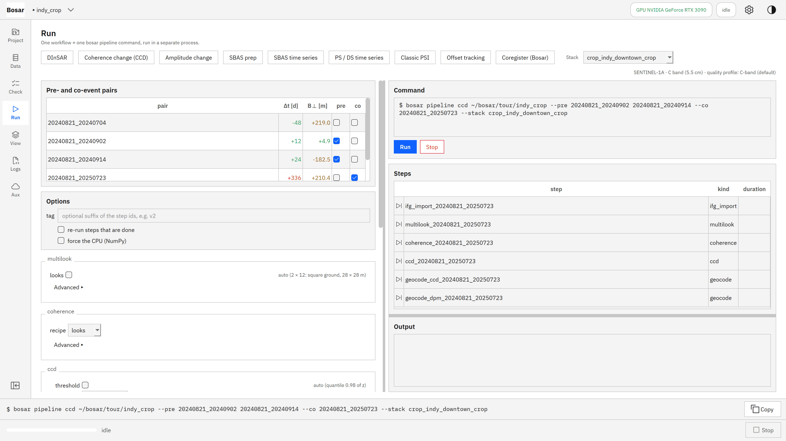
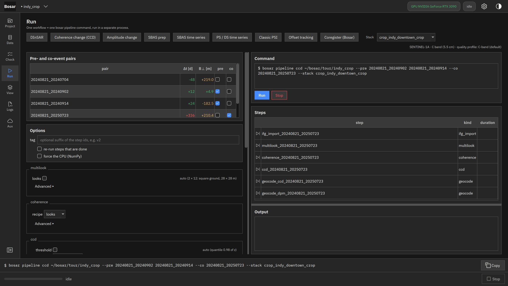
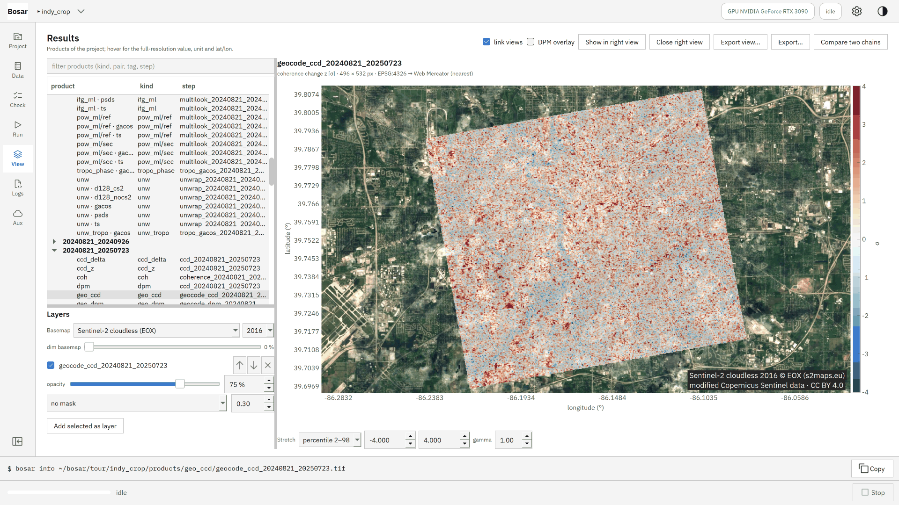
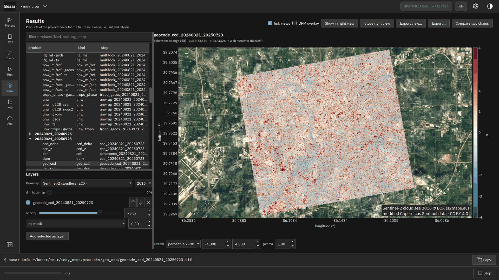
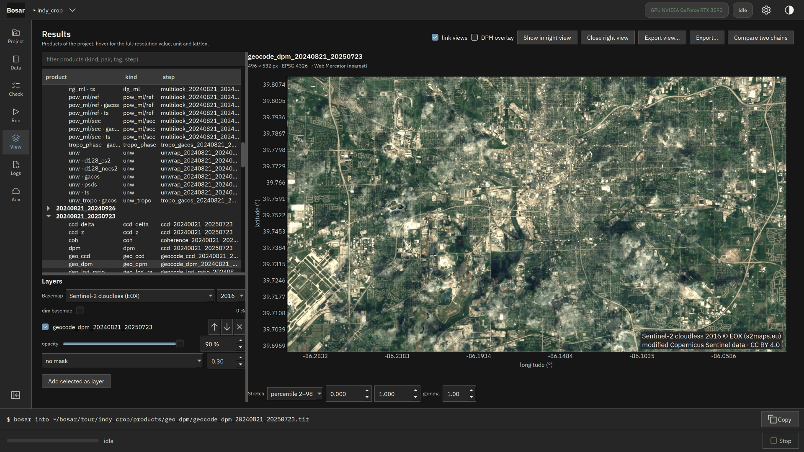

# 相干变化检测

事件前与跨事件像对、运行、叠在卫星影像上的损毁代理图。

构建于 v0.1.0。[返回导览](README.md)

4K 截图、点击位置动画和 DInSAR 录屏在 [Releases](https://github.com/HU-Jiashu/bosar/releases) 的 `bosar-tour-4k.zip` 里；页面上是同一批截图的 1080p 版本。

## 结果

<picture><source media="(prefers-color-scheme: dark)" srcset="../../assets/tour/ccd/03_dpm_dark.png"></picture>

## 逐步操作

### 1. 相干变化：勾选事件前像对和跨事件像对；计划步骤列出将运行什么、复用什么。

```bash
bosar pipeline ccd tour/indy_crop --stack crop_indy_downtown_crop --pre 20240821_20240902 20240821_20240914 --co 20240821_20250723
```



<details><summary>深色主题</summary>



</details>

### 2. 叠在 Sentinel-2 无云镶嵌图上的相干变化 z 图，75 % 不透明。

```bash
bosar gui tour/indy_crop
```



<details><summary>深色主题</summary>



</details>

### 3. 损毁代理图：超过阈值的连通区。这里的"事件"是一年的城市变化。

```bash
bosar pipeline ccd tour/indy_crop --stack crop_indy_downtown_crop --pre 20240821_20240902 20240821_20240914 --co 20240821_20250723
```


<details><summary>深色主题</summary>



</details>
