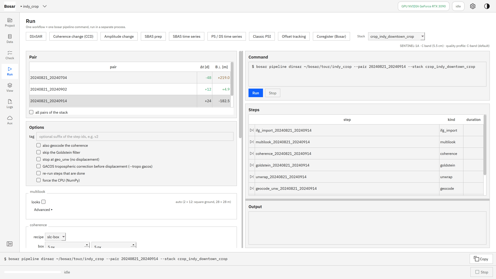
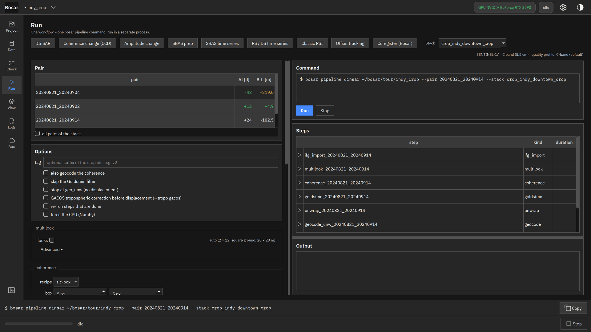
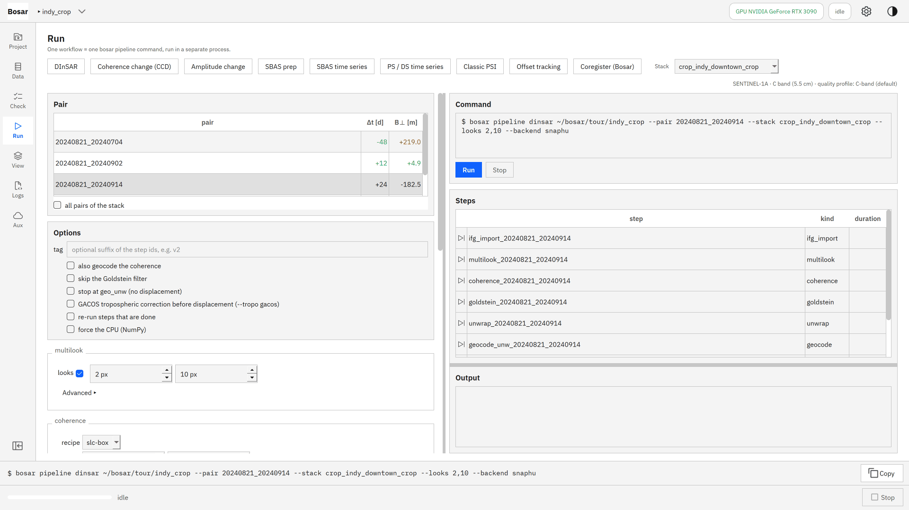
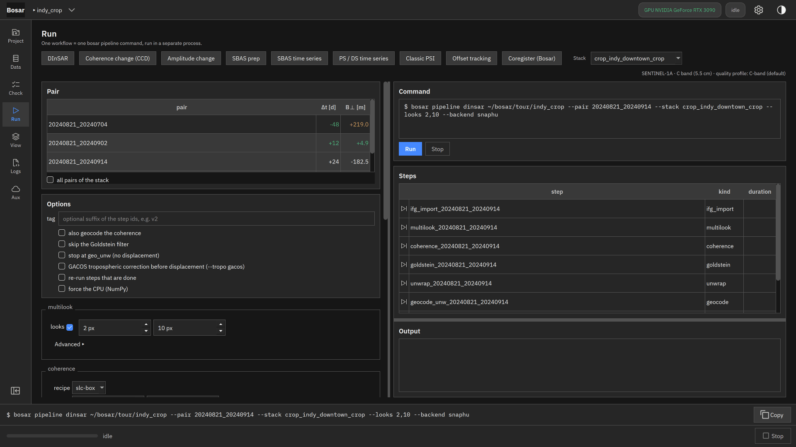
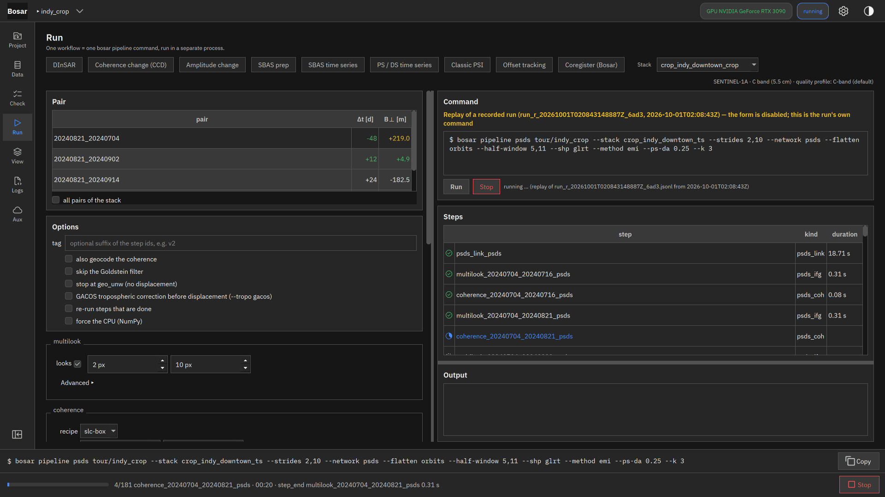

# DInSAR 差分干涉

选一对影像、设参数、运行，在地图上读视线向形变。

构建于 v0.1.0。[返回导览](README.md)

4K 截图、点击位置动画和 DInSAR 录屏在 [Releases](https://github.com/HU-Jiashu/bosar/releases) 的 `bosar-tour-4k.zip` 里；页面上是同一批截图的 1080p 版本。

## 结果

<picture><source media="(prefers-color-scheme: dark)" srcset="../../assets/tour/dinsar/04_result_dark.png"></picture>

## 逐步操作

### 1. 运行页，DInSAR：选影像栈和像对。命令框显示按钮将要执行的那一条命令。

```bash
bosar pipeline dinsar tour/indy_crop --stack crop_indy_downtown_crop --pair 20240821_20240914
```



<details><summary>深色主题</summary>



</details>

### 2. 按步骤设参数；未设置的字段显示将被选用的值（"auto (…)"）。只有与默认不同的才写进命令。

```bash
bosar pipeline dinsar tour/indy_crop --stack crop_indy_downtown_crop --pair 20240821_20240914 --looks 2,10 --backend snaphu
```



<details><summary>深色主题</summary>



</details>

### 3. 运行中：各步骤的状态和耗时、实时日志、状态栏进度，Stop 干净地取消。

```bash
bosar pipeline dinsar tour/indy_crop --stack crop_indy_downtown_crop --pair 20240821_20240914
```


<details><summary>深色主题</summary>



</details>

### 4. 结果页：叠在 OpenStreetMap 上的视线向形变（正值朝向卫星）；悬停显示数值、单位和经纬度。

```bash
bosar gui tour/indy_crop
```


<details><summary>深色主题</summary>


</details>
