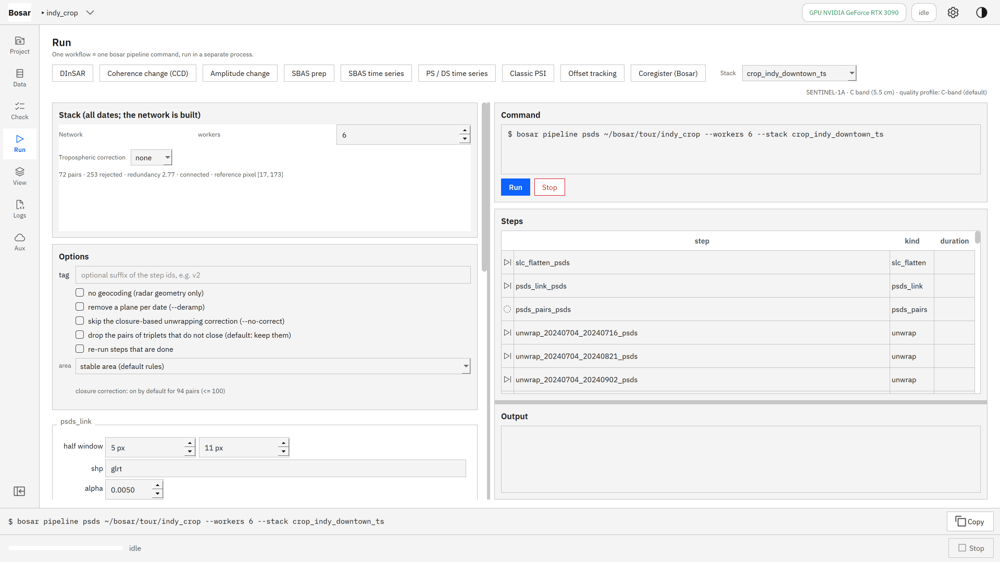
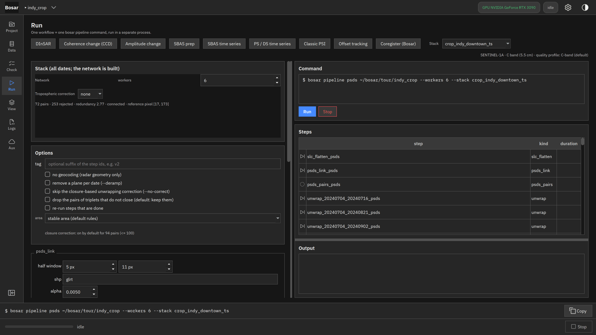
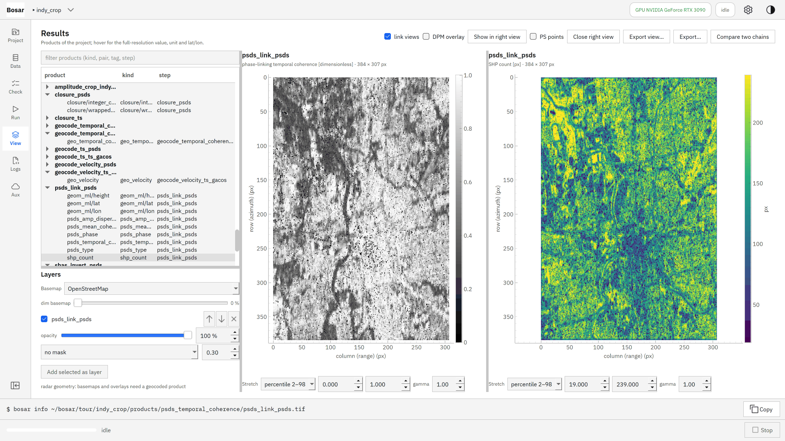
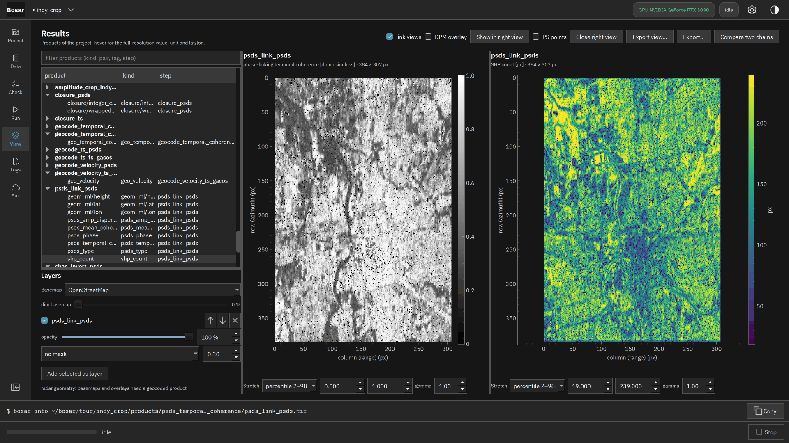
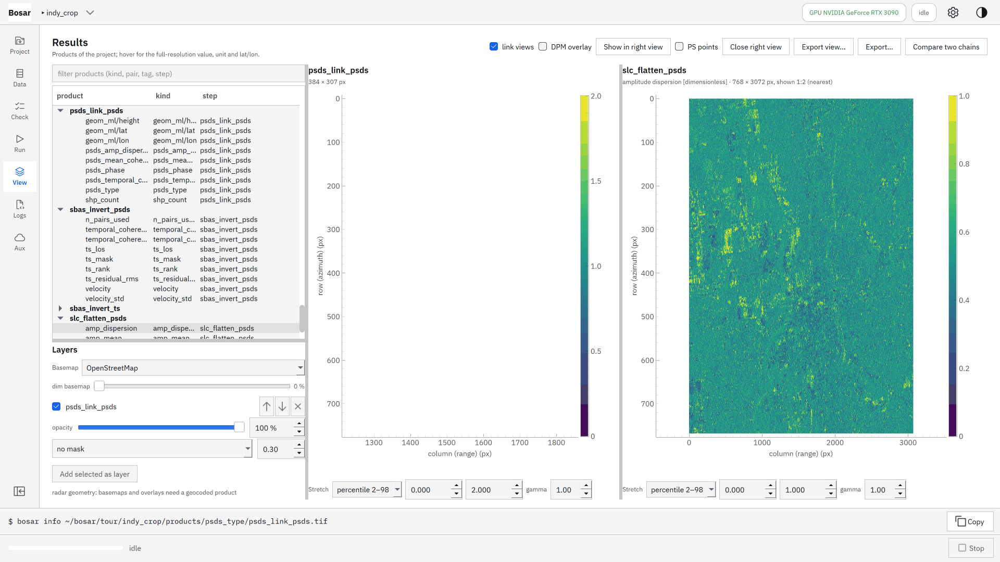
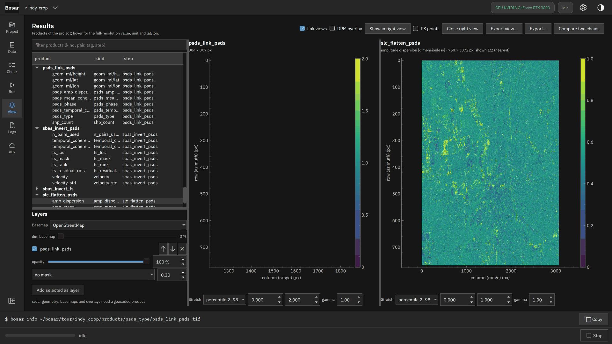
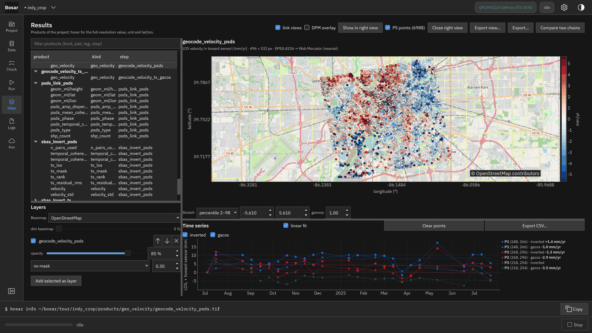

# PS / DS 时间序列

分布式散射体相位连接加永久散射体：覆盖是多视 SBAS 的数倍，并给出质量判定。

构建于 v0.3.0。[返回导览](README.md)

4K 截图、点击位置动画和 DInSAR 录屏在 [Releases](https://github.com/HU-Jiashu/bosar/releases) 的 `bosar-tour-4k.zip` 里；页面上是同一批截图的 1080p 版本。

## 结果

<picture><source media="(prefers-color-scheme: dark)" srcset="../../assets/tour/psds/04_result_dark.png"></picture>

## 逐步操作

### 1. PS / DS 时间序列：去平地的 SLC 栈、统计同质像元、相位连接（EMI）、PS 选择，然后在混合栈上做 SBAS 解缠和反演。部分空白的日期被发现并剔除。

```bash
bosar pipeline psds tour/indy_crop --stack crop_indy_downtown_ts --workers 6
```



<details><summary>深色主题</summary>



</details>

### 2. 雷达几何下的相位连接：拟合的时间相干（左；对这个栈纯噪声低于 0.36，DS 需要 0.6）和统计同质像元数（右）。

```bash
bosar pipeline psds tour/indy_crop --stack crop_indy_downtown_ts --workers 6
```



<details><summary>深色主题</summary>



</details>

### 3. 像元类型（0 无，1 永久散射体，2 分布式散射体）和用于选 PS 的幅度离差。

```bash
bosar pipeline psds tour/indy_crop --stack crop_indy_downtown_ts --workers 6
```



<details><summary>深色主题</summary>



</details>

### 4. 混合栈的视线向速度叠在地图上，永久散射体为点（颜色 = 速度，大小 = 质量），地图上方是质量判定，下方是点击像元的历史。

```bash
bosar gui tour/indy_crop
```


<details><summary>深色主题</summary>



</details>
