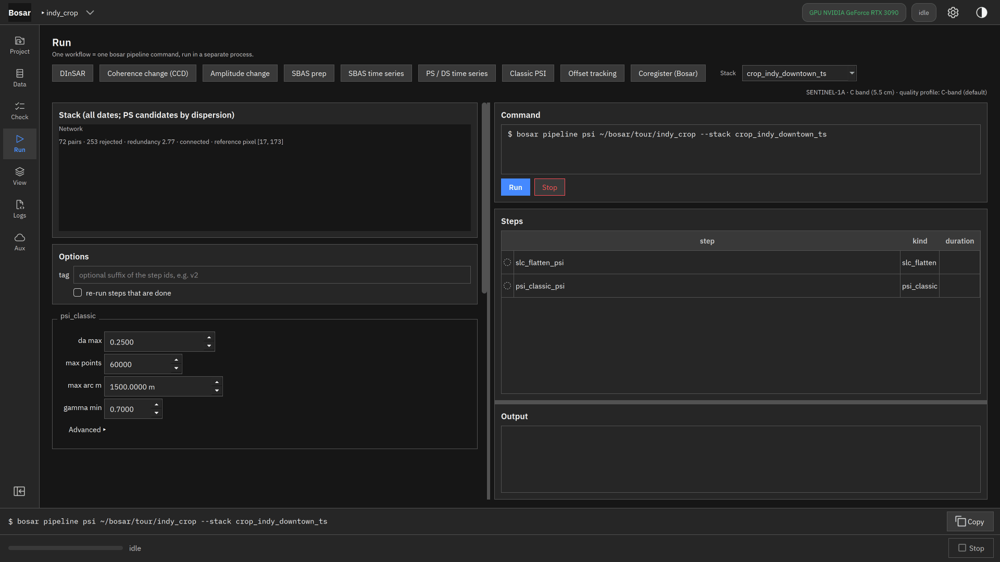

# 经典 PS-InSAR

周期图链路（幅度离差、弧段、APS）作为运行页的一个工作流；它的 GeoPackage 是结果页的点图层。

构建于 v0.3.0。[返回导览](README.md)

4K 截图、点击位置动画和 DInSAR 录屏在 [Releases](https://github.com/HU-Jiashu/bosar/releases) 的 `bosar-tour-4k.zip` 里；页面上是同一批截图的 1080p 版本。

## 结果

<picture><source media="(prefers-color-scheme: dark)" srcset="../../assets/tour/psi/01_run_dark.png"></picture>

## 逐步操作

### 1. 经典 PS-InSAR 工作流：按幅度离差选永久散射体候选、Delaunay 网络、每条弧上的周期图（同时解高程误差和速率）、从参考点积分、大气屏——在同一去平地栈上对 PS / DS 链路的独立检验。

```bash
bosar pipeline psi tour/indy_crop --stack crop_indy_downtown_ts
```


<details><summary>深色主题</summary>



</details>
