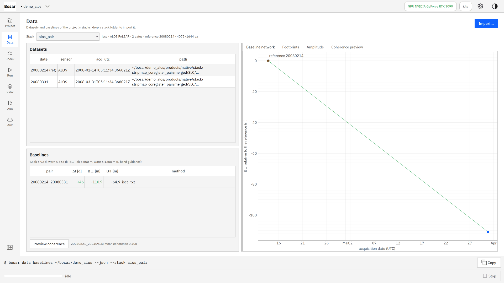
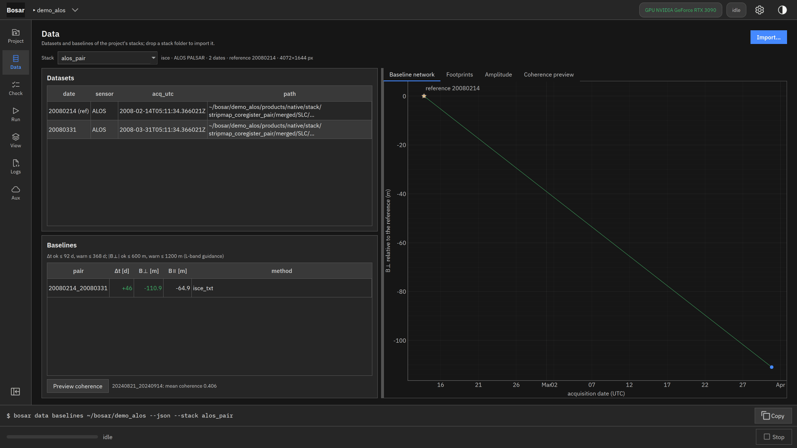
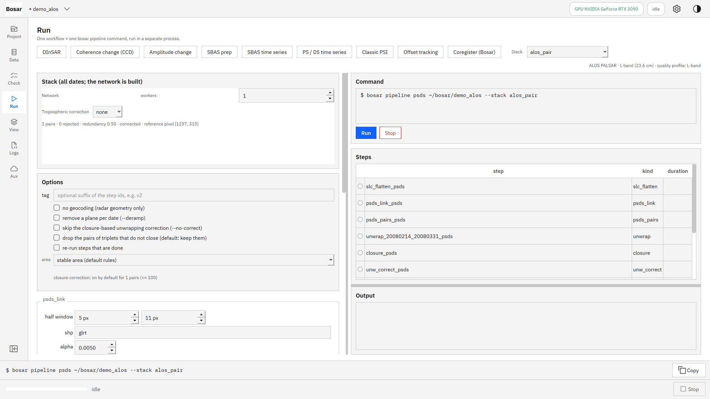
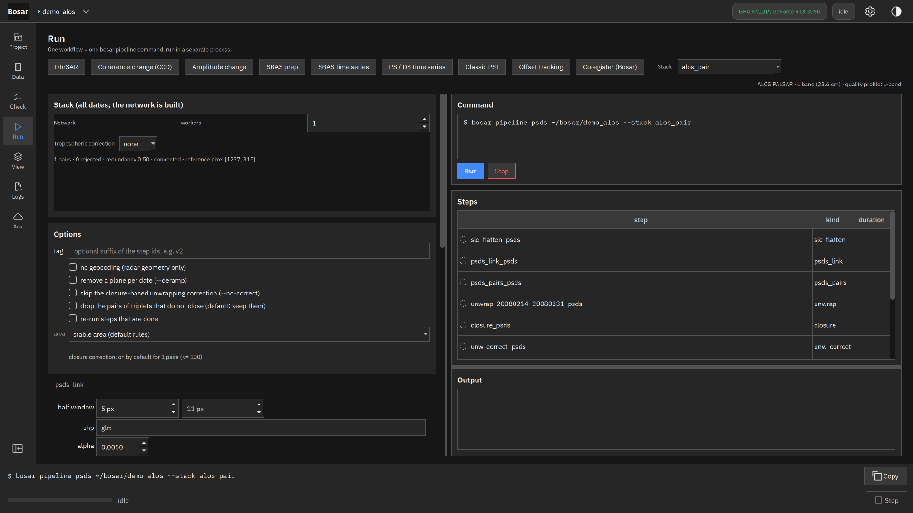
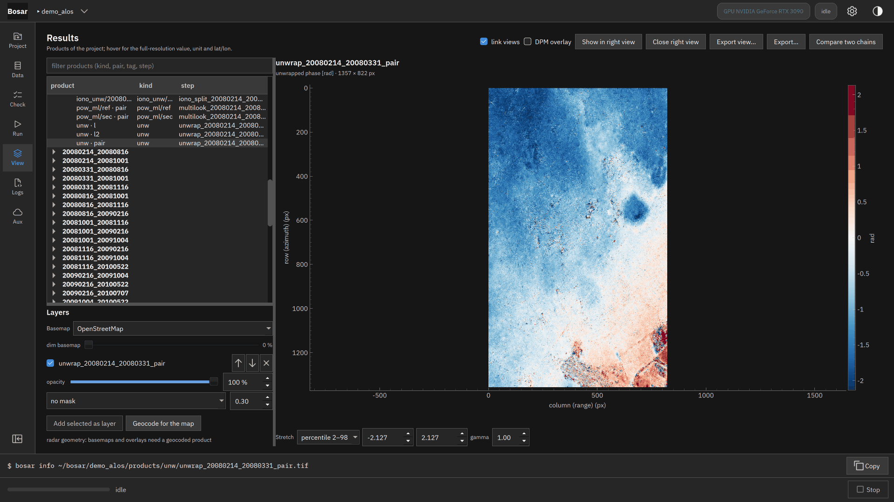
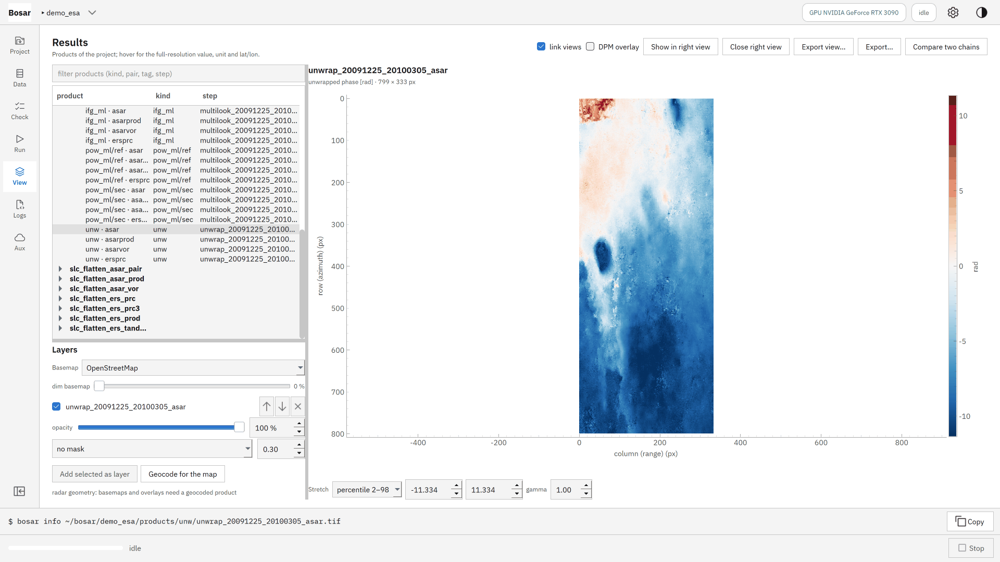
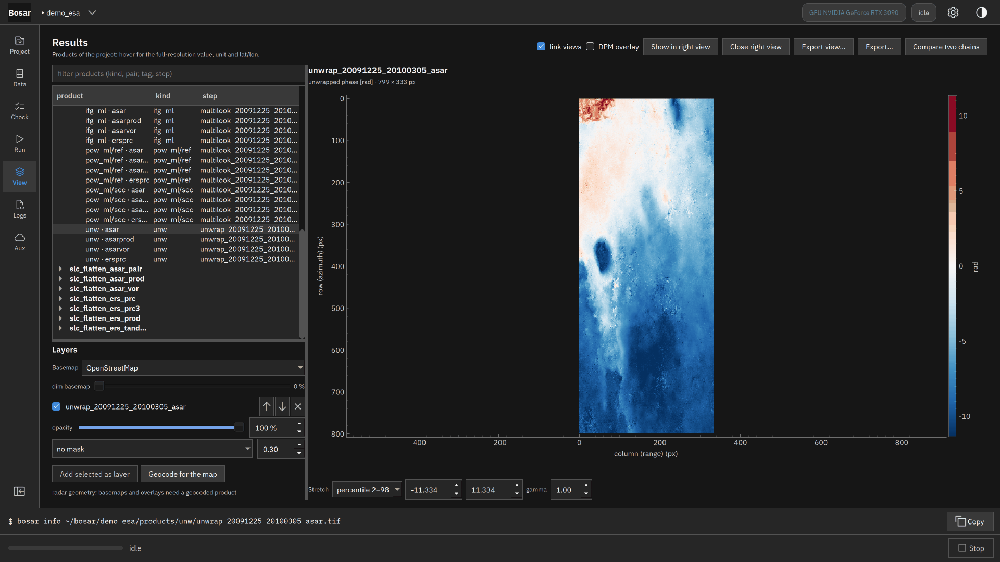

# 更多传感器

ALOS-1 PALSAR（L 波段）、ENVISAT ASAR 和 ERS-1/2 走条带链路：带传感器信息的影像栈、L 波段质量配置、各一幅墨西哥城干涉图。

构建于 v0.4.0。[返回导览](README.md)

4K 截图、点击位置动画和 DInSAR 录屏在 [Releases](https://github.com/HU-Jiashu/bosar/releases) 的 `bosar-tour-4k.zip` 里；页面上是同一批截图的 1080p 版本。

## 结果

<picture><source media="(prefers-color-scheme: dark)" srcset="../../assets/tour/sensors/03_alos_pair_dark.png"></picture>

## 逐步操作

### 1. ALOS-1 PALSAR L1.1（CEOS，直接来自 ASF 的 zip）走条带链路——DEM 上顾及多普勒的几何配准、FBD 过采样到 FBS 距离格网、定标——再像其他栈一样导入：传感器、23.6 cm 波长和基线随之而来。同一链路也读 ENVISAT ASAR 和 ERS-1/2（带 DORIS 轨道的 .N1 / .E1 / .E2）以及 NISAR RSLC。

```bash
bosar pipeline stripmap-coregister <project> --product <ALPSRP zip> … --reader alos --dem bosar --crop-wkt "POLYGON((…))" --id alos_pair
```



<details><summary>深色主题</summary>



</details>

### 2. 运行页在影像栈旁标出传感器、波段和判定将采用的质量配置：L 波段下相干下限、允许的离散和电离层模型（滤波而非平面）是 L 波段那一套——同样的弧度阈值按波长缩放。--iono 为每个像对加上分谱电离层估计。

```bash
bosar pipeline psds <project> --stack alos_mx --network l --k 3 --iono
```



<details><summary>深色主题</summary>



</details>

### 3. 墨西哥城，20080214 - 20080331（46 天，B⊥ −111 m）：该像对雷达几何下的解缠 L 波段相位。正相位是远离传感器的运动：东南的 Iztapalapa 在 46 天里沉降约 4 rad = 7.5 cm 视线向——与文献的 20-40 cm/yr 同量级——电离层仍在其中（这个像对的分谱模型是 1.1 rad 的距离向梯度）。

```bash
bosar sbas prep <project> --stack alos_pair --network pair --flat-step slc_flatten_alos_pair
```


<details><summary>深色主题</summary>



</details>

### 4. ENVISAT ASAR IS2，20091225 - 20100305（70 天），同一裁剪、同一路线：解缠 C 波段相位跨 −12 … +10 rad，盆地大部分相对西北角在 70 天里远离 5 cm 视线向——又是 Iztapalapa 的量级，来自一颗 2012 年停止工作的卫星。ERS-1 / ERS-2 串联日（1996）在同一项目里：±6 rad 的湍流大气，别无其他。

```bash
bosar pipeline stripmap-coregister <project> --product <ASA_IMS .N1> … --reader asar --dem bosar --crop-wkt "POLYGON((…))" --id asar_pair
```



<details><summary>深色主题</summary>



</details>
