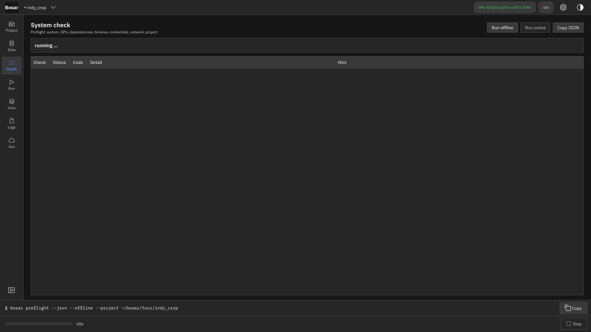
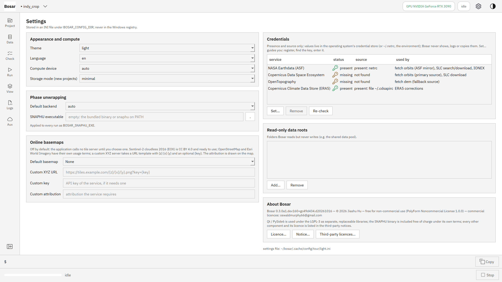
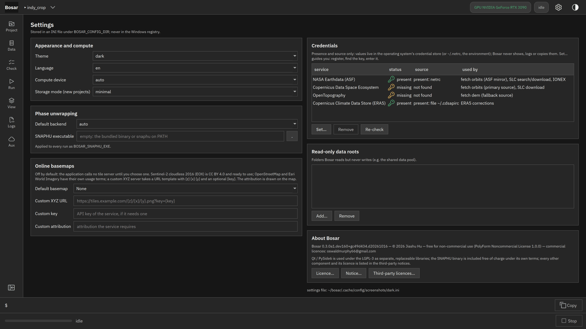

# 系统检查

预检表：Python、GPU、SNAPHU、SNAP、凭据、只读数据根目录。

构建于 v0.1.0。[返回导览](README.md)

4K 截图、点击位置动画和 DInSAR 录屏在 [Releases](https://github.com/HU-Jiashu/bosar/releases) 的 `bosar-tour-4k.zip` 里；页面上是同一批截图的 1080p 版本。

## 结果

<picture><source media="(prefers-color-scheme: dark)" srcset="../../assets/tour/system_check/01_preflight_dark.png"></picture>

## 逐步操作

### 1. 每个任务之前都跑预检：解释器、依赖包、GPU、SNAPHU、SNAP、磁盘空间、项目。

```bash
bosar preflight --offline
```


<details><summary>深色主题</summary>



</details>

### 2. 凭据存在系统钥匙串里，只显示有 / 无；轨道、DEM 瓦片和 GACOS 格网先到只读数据根目录里找。

```bash
bosar auth status
```



<details><summary>深色主题</summary>



</details>
