# 结果查看器

底图、图层透明度与掩膜、拉伸、联动视图、出图，两条链路对比。

构建于 v0.2.0。[返回导览](README.md)

4K 截图、点击位置动画和 DInSAR 录屏在 [Releases](https://github.com/HU-Jiashu/bosar/releases) 的 `bosar-tour-4k.zip` 里；页面上是同一批截图的 1080p 版本。

## 结果

<picture><source media="(prefers-color-scheme: dark)" srcset="../../assets/tour/viewer/02_satellite_mask_dark.png"></picture>

## 逐步操作

### 1. 图层面板：底图，以及每个图层的可见性、0-100 % 透明度、顺序和可选的相干掩膜。

```bash
bosar gui tour/indy_crop
```

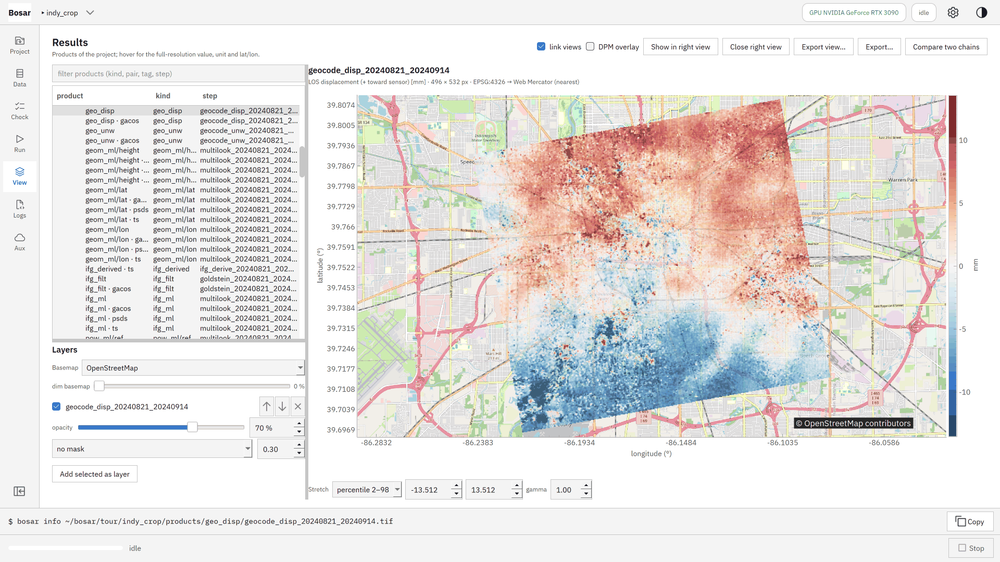

<details><summary>深色主题</summary>

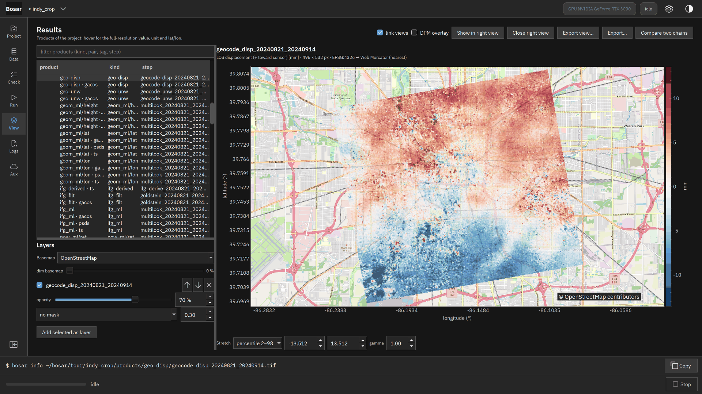

</details>

### 2. Sentinel-2 无云底图，形变 50 % 透明，相干低于 0.4 处隐藏。

```bash
bosar gui tour/indy_crop
```


<details><summary>深色主题</summary>

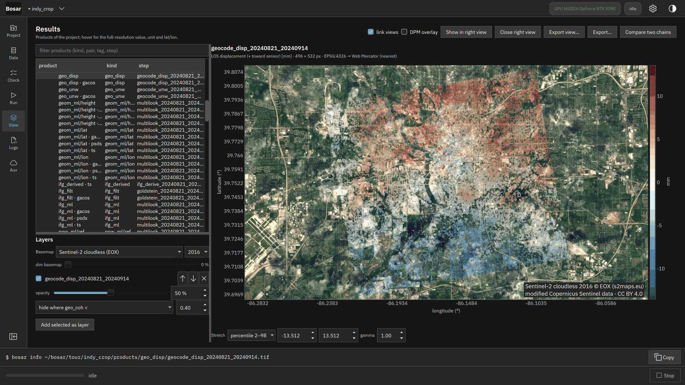

</details>

### 3. 任何地理编码产品都能作为额外图层叠到地图上并上下移动。

```bash
bosar gui tour/indy_crop
```

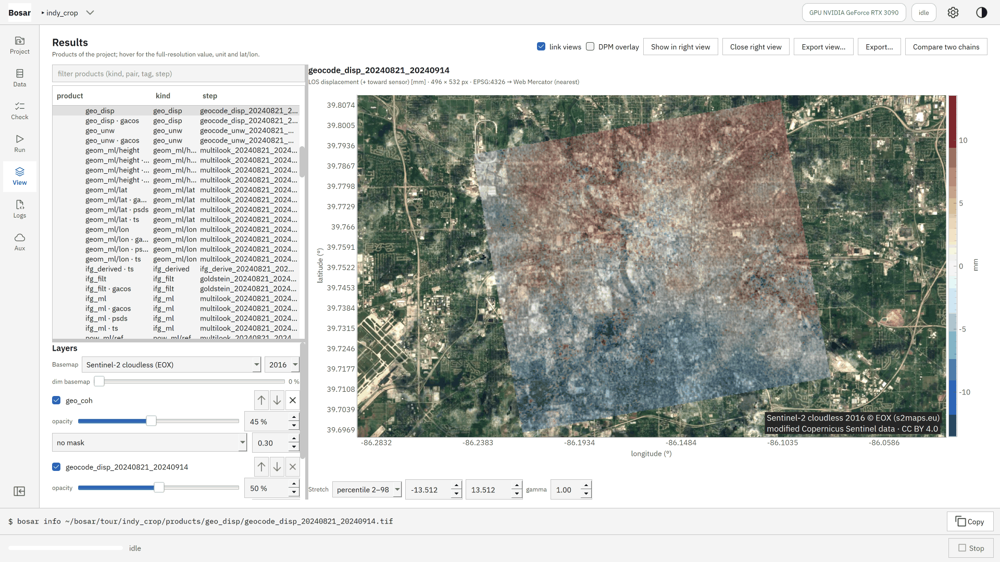

<details><summary>深色主题</summary>

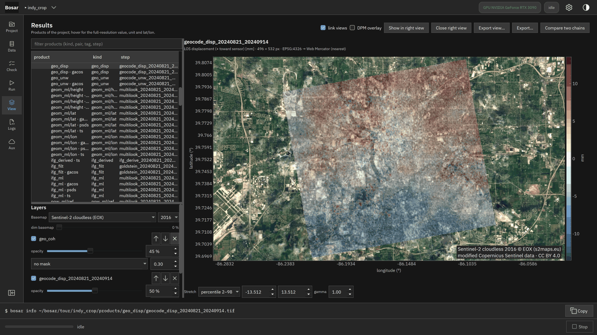

</details>

### 4. 每个视图的拉伸（百分位、最大最小、手动、gamma）按产品类型记住；两个视图一起平移缩放。

```bash
bosar gui tour/indy_crop
```

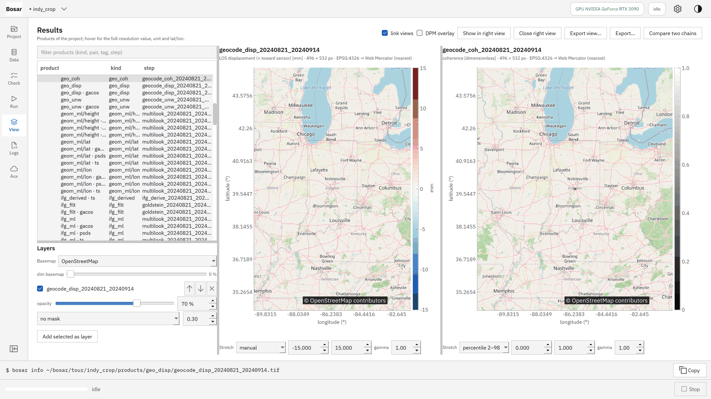

<details><summary>深色主题</summary>

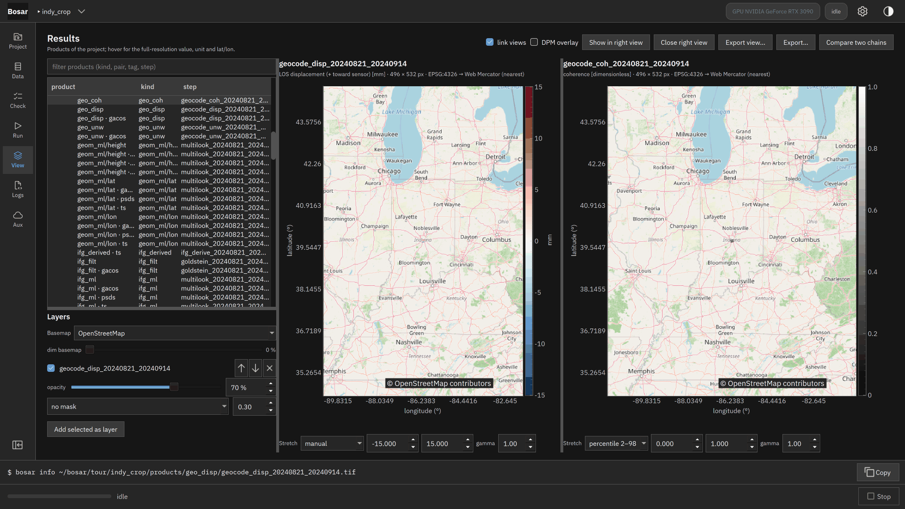

</details>

### 5. "导出视图"按所选 DPI 写出带图例、比例尺、指北针和署名的 PNG 或 PDF；各图层的命令行写在文件元数据里。

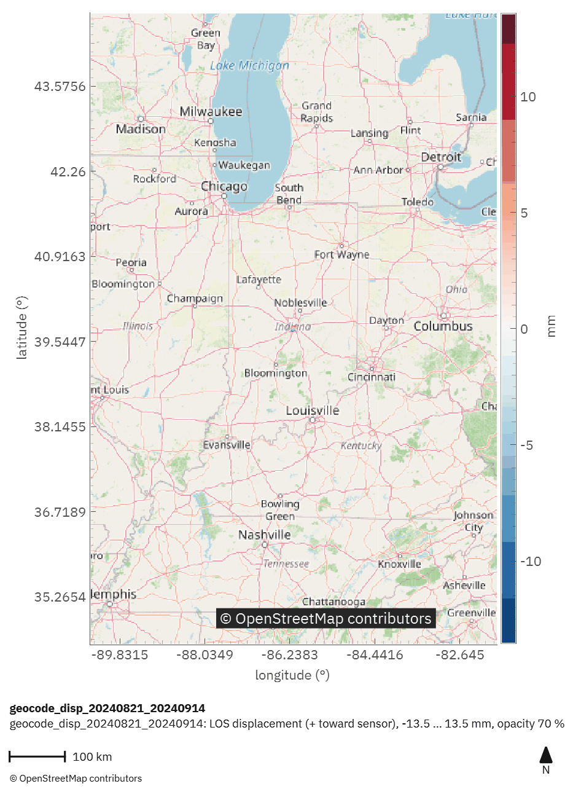

<details><summary>深色主题</summary>

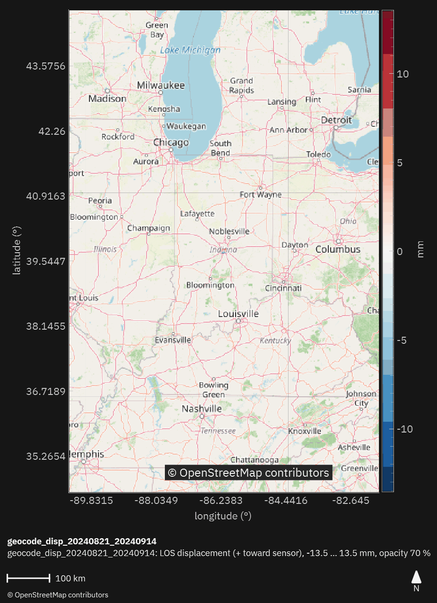

</details>

### 6. 对比两条链路：经典 PSI 点对同一影像栈的 PS / DS 速度——每个点采样包含它的格元；地图上的差值（mm/yr，发散色带、以 0 为中心）、带 1:1 线的散点图、n、相关系数、差值中位数（两个参考点）和 MAD 标准差。

```bash
bosar gui tour/indy_crop
```

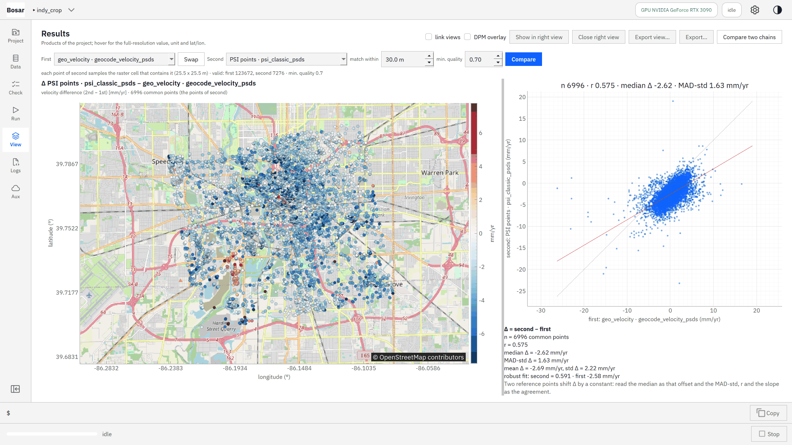

<details><summary>深色主题</summary>

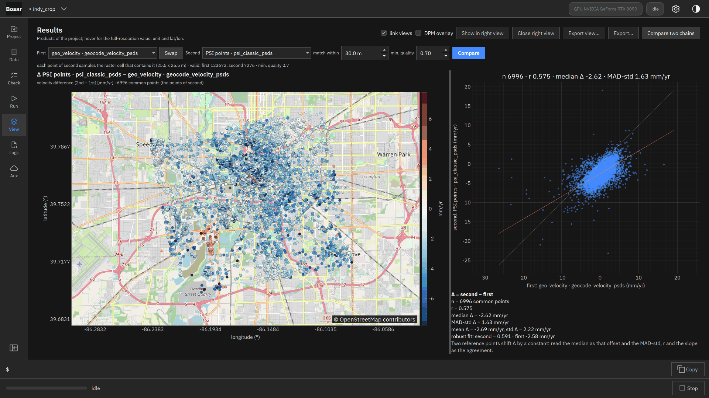

</details>
